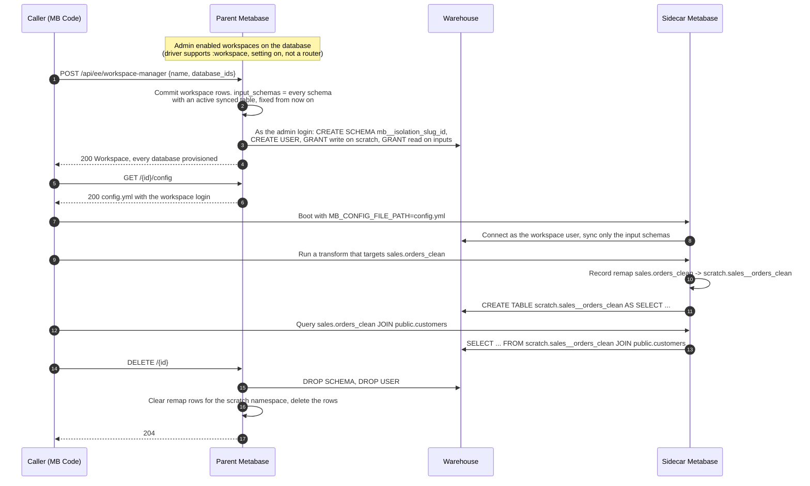
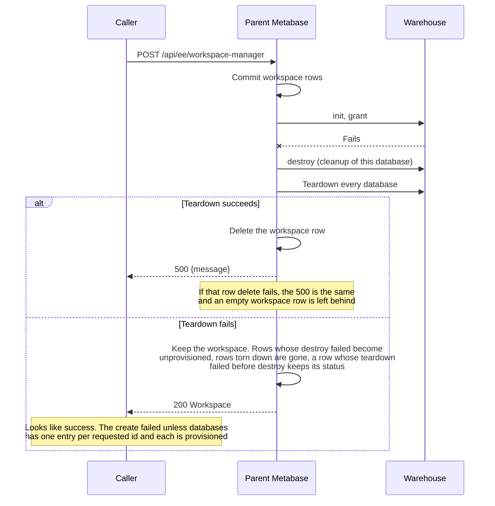
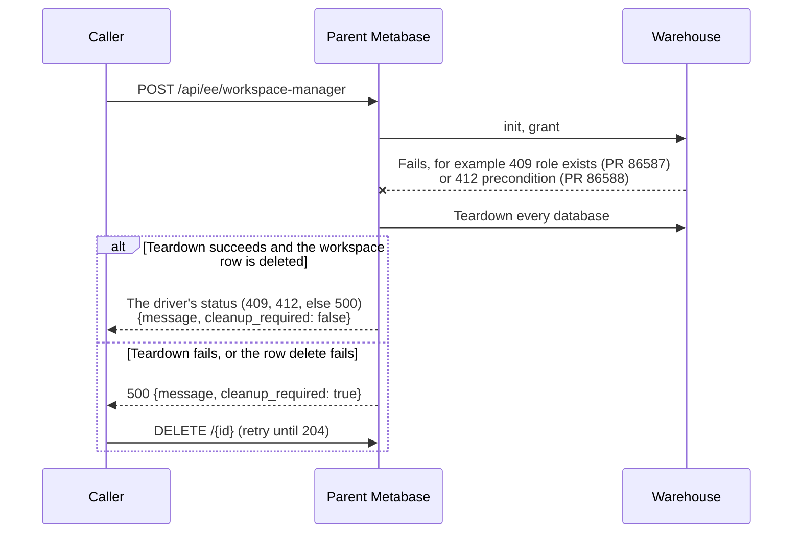
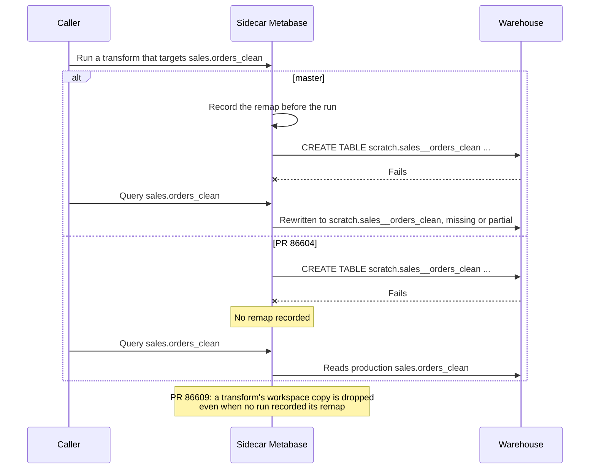
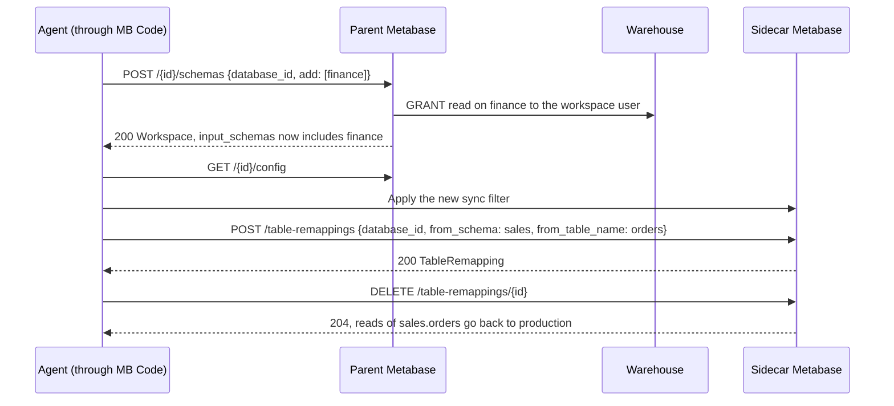
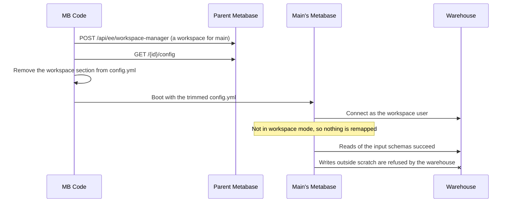
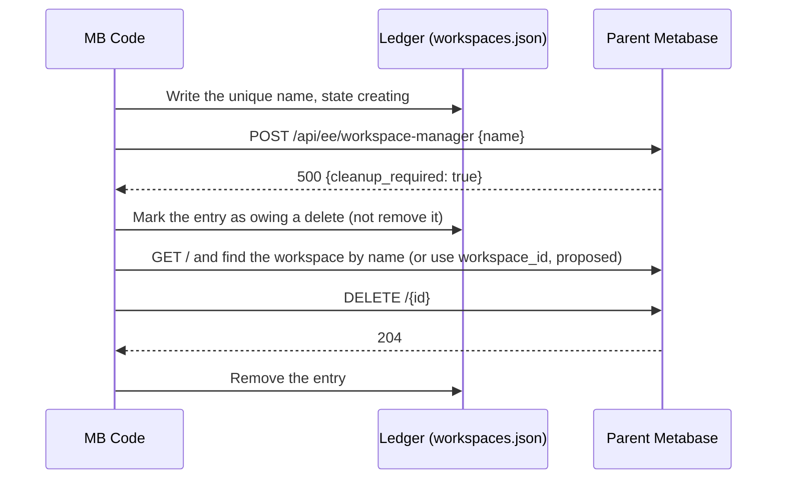

# Workspaces contract

> **Question this answers:** What exactly can a caller (MB Code desktop, CI) ask of the parent Metabase and of a sidecar Metabase to get an isolated warehouse login, what does it get back, and which parts are on master, in an open hardening PR, or still to do for MB Code?

A workspace is a warehouse login plus a scratch namespace. The login reads the database's input schemas and writes only to the scratch namespace. A local Metabase (the sidecar) redirects transform output, and later reads of it, into the scratch namespace.

This is the workspace layer. It is not the agent-facing API: "give me a safe place to run a transform", backed by a workspace or a staging database, is a layer above this and is not designed yet.

## Files

| File | Boundary | Format |
| --- | --- | --- |
| `parent.openapi.yaml` | caller -> parent: `/api/ee/workspace-manager` | OpenAPI 3.1 |
| `config.schema.json` | parent -> sidecar: the `config.yml` from `GET /{id}/config` | JSON Schema 2020-12 |
| `sidecar.openapi.yaml` | caller -> sidecar: `/api/ee/workspace-instance` | OpenAPI 3.1 |

The spec files tag every operation and field that differs from master with `x-status`: `master` (on master at `061dee78c2d`), `hardening` (an open PR, named in `x-pr`) or `proposed` (not built). `x-source` names the implementation; `EE/` is `enterprise/backend/src/metabase_enterprise/workspaces/`. The sections below follow the same split.

## 1. On master

### Lifecycle

A sidecar that already holds the databases can enter workspace mode without a restart: `POST /api/ee/workspace-instance/current`, keyed by database id. Booting from `config.yml` needs the `:config-text-file` feature for every section except `settings`, and `:workspaces` for the `workspace` section.

### A failed create

### Rules a caller can rely on

- No manager response carries a credential. Only `GET /{id}/config` does.
- The warehouse enforces isolation: the workspace user has no write grant outside its scratch namespace. A sidecar bug cannot write production.
- `input_schemas` is fixed at create.
- Workspace names are not unique. For idempotent create, pick a unique name and find it with `GET /` after a lost response.
- `config.yml` supports `{{env VAR}}` in any value, so a caller can keep secrets out of the file and pass them as environment variables or JVM system properties.
- On master, Postgres, MySQL, Redshift, ClickHouse and SQL Server report the `:workspace` feature. Snowflake, BigQuery and H2 report it false, so their databases are not eligible.

## 2. Open hardening PRs

These keep the API shape. Two change a flow; the rest change what happens inside one step.

### A failed create, with #86601

### A failed transform run, with #86604 and #86609

### The others

| PR | Change |
| --- | --- |
| #86584 | `config.yml` leaves out the parent's own login settings (auth provider, OAuth, Azure AD) and unused SSH tunnel secrets |
| #86585 | `config.yml` sends the SSL root certificate's value, not the parent's Secret id |
| #86587 | Postgres teardown and role safety: refuse a role that already exists (409), end the workspace user's sessions on teardown |
| #86588 | Postgres preconditions (412): admin login privileges and role membership, PUBLIC write on an input schema, PUBLIC CONNECT; pinned `search_path` |
| #86589 | Only Postgres reports `:workspace` until each other engine is proven (ENG-14447 to ENG-14450) |
| #86602 | Close an empty swapped connection pool after a failed checkout |
| #86603 | Refuse actions and data-grid edits in workspace mode |
| #86605 | Check the remapped target when a transform is created or retargeted |
| #86600 | Skip remapping lookups on instances that have no remappings |
| #86610 | Sync filter patterns match each input schema name literally |
| #86612 | Refuse (400) to create on a database with schemas but no synced input schemas |

## 3. Follow-ups for MB Code: backend (proposed)

Sketches to discuss, not commitments. Marked `proposed` in the specs.

| Need | Proposal |
| --- | --- |
| Delete a kept workspace without a name lookup | `workspace_id` in the failed-create error body |
| Read a schema created after the workspace | `POST /{id}/schemas` `{database_id, add, remove}` (ENG-14446). Needs a revoke driver method |
| Shadow a table up front, or stop shadowing it | `POST /table-remappings`, `DELETE /table-remappings/{id}` on the sidecar. Open: copy or empty, and how a copy avoids handing the agent credentials |
| A database added to a live workspace | Nothing proposed. Create a new workspace and restart the sidecar |
| Strictly read-only credentials (no scratch) | Nothing proposed; not in the specs. Section 4 covers main's read-only boot without it |

## 4. Follow-ups for MB Code: in mbcode

Changes in metabase/mbcode, no backend work needed.

| Change | Why |
| --- | --- |
| On a failed create with `cleanup_required: true`, keep the ledger entry as owing a delete | With #86601 the parent keeps that workspace; removing the entry leaks it |
| On master, treat a `200` as failed unless every requested database is present and `provisioned` | A teardown that fails before destroy can leave a row `provisioned` |
| Boot main's Metabase without the `workspace:` section | Read-only credentials for main with no remapping, below |
| Bump the pinned head image after the hardening PRs merge | The sidecar only gets the fixes in section 2 from a newer build |

### Main's Metabase: read-only, no remapping

On Postgres older than 15, PUBLIC can create tables in `public` by default; #86588 refuses to provision until that is revoked.

### Keeping a workspace the parent kept

## Verifying

The specs were written from the code, not generated, and an independent check compared every master claim with the code. Until a test holds them to it:

- `parent.openapi.yaml` and `sidecar.openapi.yaml` should match what `bun run generate-openapi` produces for these routes. Master's checked-in `resources/openapi/openapi.json` has no workspace routes, although other `/api/ee` routes are there; why is not yet known.
- `config.schema.json` should validate the output of `metabase-enterprise.workspaces.config/build-workspace-config` in a test.
