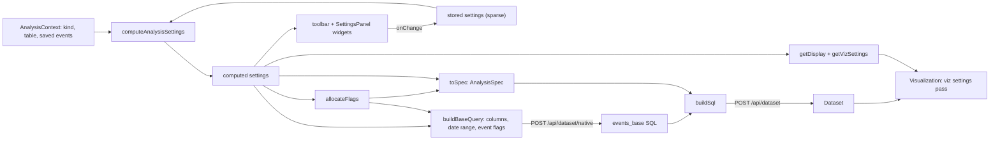

# Analysis settings

Per-analysis settings fill the `SettingsPanel` and the toolbar, and they drive the query. This plan sets up the frontend model and the information flow. Getting the SQL right is still a non-goal.

## Context

- [product-analytics-context.md](product-analytics-context.md): goal, the five analyses.
- [event-analysis-ui.plan.md](event-analysis-ui.plan.md): the page, toolbar and `AnalysisConfig` this builds on. Its "Later chunks" list Setup panels, Advanced settings and Save. This plan covers all three.
- [pa_prototype_data_and_queries.plan.md](pa_prototype_data_and_queries.plan.md): the base query, flag columns and planners.

## Status

All seven chunks are implemented. Where things live, under [`frontend/src/metabase/product-analytics/`](../../../frontend/src/metabase/product-analytics/):

- `settings/`: the typed definition types and the wrappers over viz-core.
- `analyses/`: one file per analysis (definitions, `toSpec`, display, viz settings), plus `common-settings.ts`, `column-roles.ts` and `setting-helpers.ts`.
- `events/`: the saved-event catalog and flag allocation.
- `use-analysis.ts`: settings to results. `use-analysis-state.ts`: stored settings and URL sync. `use-save-analysis.ts`: create and update, plus `use-add-to-dashboard-toast.ts` for what happens after a create.
- `components/AnalysisWorkspace.tsx`: shared by `/event-analysis/new/:kind` and `/event-analysis/:cardId`.
- The card marker and its guard live in `metabase-types` (`api/product-analytics.ts`, `guards/product-analytics.ts`), because the dashboard and query builder can't import from another feature.

Where the code differs from the plan below:

- Every definition has an `isValid`, which receives the stored value as `unknown`. Stored settings come from the URL and saved cards, so they're typed as an untrusted `StoredSettings` record. The compiler makes every validator narrow its input, and an adapter in `settings/compute.ts` maps this onto viz-core's `isValid`.
- The URL hash holds only unsaved edits. It's written when a setting changes, not from an effect, and it's empty when the settings match the saved card. It's cleared after a save.
- `AnalysisContext` has no `kind`, since no callback needed it.
- The analysis kinds live in `metabase-types` (`PRODUCT_ANALYTICS_KINDS`), so the guard rejects cards whose kind the builder doesn't know.
- The redirects don't check native-query permissions, because the real version will compile to MBQL. They're skipped in the embedding SDK.
- Titles are `getTitle` functions, not `title` getters. Spreading a definition evaluates its getters at module load, before the locale is set.
- A flag is named by the event's position in the catalog (`ev_<n>`), not numbered in order of use. Picking or dropping one event doesn't rename the others' columns.
- `funnel.exclusions` isn't implemented, and the spec gets `[]`.
- The old `defaultSpec()` moved to [`specs.ts`](../specs.ts), for [`check.ts`](../check.ts). A test confirmed the computed defaults reproduced it exactly before the move.
- Saving follows the query builder:
  - A new analysis saves through `SaveQuestionModal`. If it was saved into a dashboard, the builder goes to that dashboard in edit mode, scrolled to the new card. Otherwise it goes to the saved analysis, which shows the "Saved" toast with "Add this to a dashboard" (`AddToDashSelectDashModal`). The toast is sent from the saved page, because the new page unmounts. Router state on that navigation tells the saved page to send it (`use-add-to-dashboard-toast.ts`).
  - A saved analysis updates in place with no modal, and only when there are unsaved changes.
  - Save is hidden when the card is archived or not writable, or for a new analysis when the user can't write to any collection.
  - Unsaved changes get the "Discard your changes?" prompt when leaving the page, except on the navigation right after a save.
  - Not yet: "Save as new" for a saved analysis, and renaming. Both wait on a design for naming.

## Summary

- **Reuse the viz settings engine and its widgets.** The engine is already generic: `getComputedSettings<T>(defs, object, stored)` doesn't care that `object` is usually a series. Only the viz definitions do. Analysis settings pass a different object, an `AnalysisContext`, which exists before any query runs. A thin typed layer sits on top, and the engine itself isn't copied.
- **The context holds facts, and settings hold choices.** The table's columns are a fact. Which column is the event timestamp is a choice, so it's a setting whose default is computed from the columns.
- **Two passes, not one.** Analysis settings are computed before the query, and viz settings after it. Analysis settings fan out three ways: the base query (columns, date range, events), the planner spec, and the derived display and viz settings.
- **Save as an ordinary native question.** Keep the analysis definition under one `visualization_settings` key, and route cards that carry it back to the builder. Don't add a card type.
- **Rule of thumb:** if it changes the query, it's an analysis setting. If it needs the result, it's a viz setting.

## Information flow



Changing an advanced option rebuilds only the outer SQL. The base SQL stays cached unless the columns, the date range or the set of events changes.

## How viz settings work (the parts we borrow)

- Each key has a definition: `getDefault`, `isValid`, `getHidden`, `getProps`, `getSection`, `readDependencies`, `writeDependencies`, `eraseDependencies`, `widget`.
- [`getComputedSettings`](../../../frontend/src/metabase/viz-core/lib/settings.ts#L32) computes every key, read dependencies first. For each key, `getValue` wins if it's defined. Otherwise the stored value is used if it passes `isValid`, and `getDefault` fills in the rest.
- Stored settings are sparse: only what the user changed. Everything else is recomputed, so defaults follow the data, and a stale stored value falls back instead of breaking.
- [`getSettingsWidgets`](../../../frontend/src/metabase/viz-core/lib/widgets.ts#L101) turns definitions into widget descriptors: title, value, hidden, props, and an `onChange` that applies write and erase dependencies. String widget names resolve through the registry in [visualizations/register.ts](../../../frontend/src/metabase/visualizations/register.ts#L192): `select`, `toggle`, `segmentedControl`, `number`, `radio`, `multiselect` and others. None of those need a series.
- `ChartSettingsWidget` renders one descriptor: label, hint, widget.

### Column settings, and what "buckets" means there

- `column_settings` is built by [`nestedSettings`](../../../frontend/src/metabase/viz-core/lib/settings/nested.ts#L45), which returns two definitions:
  - `column_settings` holds the stored value: a map from column key (`getColumnKey`, e.g. `'["name","count"]'`) to that column's sparse settings. Its `nestedColumns` widget lists the columns and opens a sub-panel for each.
  - `column` is computed only. Its value is a function, `(col) => settings for col`, memoized per key. Viz code calls `settings.column(col)`.
- Each column's settings come from a second run of the same engine. That run has its own definitions (`getSettingDefinitionsForColumn`), its own object (the column), and an inheritance chain under the stored values: instance-wide custom formatting, then model metadata (`column.settings`).
- `series_settings` and `settings.series(key)` follow the same pattern, with single series as the objects.

What that tells us:

- The engine runs fine over objects that aren't a series. That's the evidence analysis settings can use it.
- A nested bucket lives inside viz settings and is computed after the series exists. Analysis settings are needed before the query, so they're a separate pass with their own store, not a nested viz setting.
- Different buckets of settings are best modeled as separate definition sets over separate objects: analysis settings over `AnalysisContext`, viz settings over the series. Grouping in the UI (toolbar, Setup, Advanced) is just `getSection`, like the Data and Display tabs in `ChartSettings`.
- `nestedSettings` fits per-step settings later (a step's label, a per-step window), keyed by step id. For now, a list widget that edits an array is enough.

## Decisions

### Reuse viz-core's engine, with typed definitions on top

A copy of the engine would drift while the prototype changes, and reconciling it when we harden this would be painful. So:

- At runtime, use `getComputedSettings` and `getSettingsWidgets` from viz-core, unchanged.
- Write product analytics definitions against a typed `SettingDefinition<S, K>` (below). A definition then reads `settings["funnel.window"]` as a `Duration`, not `any`.
- Two wrappers, `computeAnalysisSettings` and `getAnalysisSettingWidgets`, pass the definitions to viz-core and type the result. The only casts live there.
- The wrappers hold no behavior. If product analytics needs the engine to do something new, change viz-core. That's what keeps drift at zero.
- The typed definitions follow viz-core's calling conventions:
  - Callbacks take viz-core's arguments in viz-core's order, with the context as the object.
  - `isValid` reads the stored value from `settings[key]`. There's no value argument.
  - Placement uses `getSection`, because `getSettingsWidgets` overwrites a static `section`.
  - A definition with no `widget` is dropped from the widget list.
- The embedding SDK's `computedSettingsTransform` is a no-op outside the SDK, so it doesn't affect us.
- When we harden this, the typed `SettingDefinition<TObject, TSettings>` is a candidate to move into viz-core. That's where type cleanup pays off for every visualization.

### Sparse stored settings; the spec becomes an IR

- Page state holds `stored: Partial<Settings>` instead of `spec`. Defaults are computed, not seeded, which retires `defaultSpec()` for anything user-facing.
- `config.toSpec(computed, flagFor)` is the only bridge to the planners. `AnalysisSpec` and the planners don't change. This is the seam that keeps hacky query building contained.
- Keys follow viz conventions: flat, dotted for grouped ones (`funnel.window`, `columns.timestamp`), plain for the rest (`counting`, `date_range`, `granularity`).
- One settings type per kind:

```ts
type ColumnRoleSettings = {
  // Column names. null means the table has no such column.
  "columns.timestamp": string | null;
  "columns.person": string | null;
  "columns.session": string | null;
  "columns.event_id": string | null;
  "columns.event_name": string | null;
  "columns.url_path": string | null;
};

type CommonSettings = ColumnRoleSettings & {
  counting: Grain;
  date_range: string; // a serialized date filter, e.g. "past90days"
  granularity: Granularity;
};

type FunnelSettings = CommonSettings & {
  "funnel.steps": EventRef[];
  "funnel.view": "steps" | "overTime" | "timeToConvert";
  "funnel.window": Duration;
  "funnel.ordering": "strict" | "loose" | "any";
  "funnel.anchor": "first" | "each";
  "funnel.allow_retry": boolean;
};

type AnalysisSettingsByKind = {
  funnel: FunnelSettings;
  paths: PathsSettings;
  habit: HabitSettings;
  lifecycle: LifecycleSettings;
  cohorts: CohortsSettings;
};
```

### The analysis context

```ts
type AnalysisContext = {
  table: Table | undefined; // columns, with semantic and base types
  savedEvents: EventDefinition[];
};

type EventDefinition = {
  id: string;
  name: string; // "Started trial"
  getFilter: (query: Lib.Query, columns: ColumnRoles) => Lib.ExpressionClause;
};
```

- `table` is the table's metadata. The column role defaults read it.
- `savedEvents` is the list of events the pickers offer. Today that's the eight definitions hardcoded in `base-query.ts` and `defaults.ts`, moved to `events/catalog.ts`. Later it's this table's saved event definitions (the segment-like concept in [product-analytics.md](product-analytics.md)), fetched from the API.
- It's in the context rather than imported, for two reasons:
  - Defaults need it. The default funnel steps and the default "active" event are picked from it.
  - Once it's fetched, the context is where async facts belong.
- If a default needs data (say, the most common events in this table), fetch it into the context. That still happens before the main query.

### Definitions

```ts
type SettingSection = "toolbar" | "setup" | "advanced";

type SettingKey<S> = keyof S & string;

type SettingWidgetProps<V> = {
  id: string;
  value: V;
  onChange: (value: V) => void;
};

type StoredSettings = Record<string, unknown>; // untrusted until validated

type SettingDefinition<TContext, S, K extends SettingKey<S>> = {
  getTitle?: () => string;
  group?: "columns";
  getSection: () => SettingSection;
  widget?: string | ComponentType<SettingWidgetProps<S[K]>>;
  getDefault: (context: TContext, settings: Partial<S>) => S[K];
  // The stored value comes from the URL or a saved card, so it's unknown.
  isValid: (value: unknown, context: TContext, settings: Partial<S>) => boolean;
  getHidden?: (context: TContext, settings: S) => boolean;
  getProps?: (
    context: TContext,
    settings: S,
    onChange: (value: S[K]) => void,
  ) => Record<string, unknown>;
  readDependencies?: SettingKey<S>[];
  writeDependencies?: SettingKey<S>[];
  eraseDependencies?: SettingKey<S>[];
};

type SettingDefinitions<TContext, S> = {
  [K in SettingKey<S>]: SettingDefinition<TContext, S, K>;
};
```

- `getDefault` and `isValid` are required, and the mapped type needs a definition for every key. So computed settings are a complete, validated `S` that `toSpec` can trust.
- Shared settings come from a factory, the way viz definitions spread `columnSettings()` or `GRAPH_DATA_SETTINGS`: `commonSettings({ granularity: { units, default } })`, or `granularity: null` to hide it. The factory includes the column roles.
- `AnalysisConfig` becomes generic over the kind:

```ts
type AnalysisConfig<K extends AnalysisKind> = {
  kind: K;
  name: string;
  question: string;
  setupLabel: string;
  settings: SettingDefinitions<AnalysisSettingsByKind[K]>;
  getEventRefs: (settings: AnalysisSettingsByKind[K]) => EventRef[];
  toSpec: (
    settings: AnalysisSettingsByKind[K],
    flagFor: (ref: EventRef) => string,
  ) => AnalysisSpec;
  getDisplay: (settings: AnalysisSettingsByKind[K]) => CardDisplayType;
  getVizSettings: (
    settings: AnalysisSettingsByKind[K],
  ) => VisualizationSettings;
};
```

Make `AnalysisWorkspace` generic over `K` too, so the config, stored settings and computed settings stay correlated. With `kind: AnalysisKind` as a plain union, TypeScript can't relate them without casts.

### Column roles are settings

- The planners read six columns by fixed names today: `created_at`, `person_id`, `session_id`, `event_id`, `event_name` and `url_path`. Each becomes a `columns.*` setting that holds a column name, the way `graph.dimensions` holds column names.
- Defaults come from `ctx.table`: semantic type first, then column name, then base type. For example:

| Setting              | Default                                                                                                    |
| -------------------- | ---------------------------------------------------------------------------------------------------------- |
| `columns.timestamp`  | `type/CreationTimestamp`, else a datetime column named like `created_at` or `timestamp`, else the first datetime column |
| `columns.person`     | `type/User`, else a column named like `person_id`, `user_id` or `distinct_id`                              |
| `columns.session`    | A column named like `session_id`, else none                                                                |
| `columns.event_id`   | `type/PK`, else a column named like `event_id`, else none                                                  |
| `columns.event_name` | A text column named like `event_name` or `event`, else none                                                |
| `columns.url_path`   | `type/URL`, else a column named like `url_path` or `path`, else none                                       |

- `pageviews` sits with them in the Columns group. It's an event, not a column, and paths name the events it matches by their URL path rather than their event name. It defaults to `event_type = 1` on tables with an `event_type` number column (Umami and Track), and to none elsewhere. See `events/pageviews.ts`, and [post-prototype.md](post-prototype.md) for other schemas.
- `isValid` checks that the column still exists. If the table changes, a stored choice falls back to the default.
- They go in the Advanced panel, grouped under "Columns", until there's a design for them.
- Other settings depend on them. With no session column, `counting` drops the "Sessions" option (`getProps`), and a stored "session" falls back to "person" (`isValid`). Both read `columns.session`.
- With no timestamp or person column, the result card shows an error that points at the Advanced panel.
- Query: `buildBaseQuery` selects the mapped columns plus the flags. `buildSql` wraps the compiled base in a projection that renames them to the fixed names, so the planners don't change.
- Later, if event tables get column roles in table metadata (an open question in [product-analytics.md](product-analytics.md)), those become the defaults, and per-analysis overrides keep working. That's the same layering as `column_settings`, where model metadata sits under the stored values.
- Out of scope: a person that's an expression, like `coalesce(distinct_id, visitor_id)`. `pa_events_resolved` already stitches that into `person_id`.

### The toolbar layout stays hand-written

The framework doesn't decide what's in the toolbar. Which controls exist, their order, their grouping and their look all stay in `AnalysisToolbar`'s JSX. The framework supplies each control's state: its value, an `onChange` that applies dependencies, whether it's hidden, and props such as the granularity units.

- Toolbar settings are common to every kind: `counting`, `date_range` and `granularity`, and later `filters` for "who's included". So the toolbar is typed against `CommonSettings` and knows nothing about kinds. Per-kind differences arrive through `hidden` and `props`.
- Their definitions use `getSection: () => "toolbar"`, which keeps them out of the panels.
- Their `widget` is a toolbar component: `CountingMenu`, `DateRangeButton` or `GranularityButton`, moved out of today's `AnalysisToolbar`. These follow the same contract as panel widgets: `value`, `onChange` and extra props.
- `AnalysisToolbar` places each one by id:

```tsx
type AnalysisToolbarProps = {
  widgets: Record<ToolbarSettingKey, SettingWidget>;
  panel: AnalysisPanel;
  setupLabel: string;
  sql: string | null;
  onPanelChange: (panel: AnalysisPanel) => void;
};

<Group justify="space-between">
  <Group>
    {/* UI state, not a setting */}
    <SegmentedControl value={panel} onChange={onPanelChange} />
    <Button.Group>
      <ToolbarSetting widget={widgets.counting} />
      {/* Stub. Later a "filters" setting. */}
      <FilterButton />
    </Button.Group>
  </Group>
  <Group>
    <ToolbarSetting widget={widgets.date_range} />
    <ToolbarSetting widget={widgets.granularity} />
    <SqlButton sql={sql} />
    <SaveButton />
  </Group>
</Group>
```

- `ToolbarSetting` renders the widget bare, without the `ChartSettingsWidget` label, and renders nothing when the setting is hidden.
- Adding a toolbar control means adding a common setting and placing it in this JSX. Both are deliberate edits.
- The Setup/Advanced switch is UI state. It isn't persisted.

### Persisted settings must be JSON-safe

`stored` goes into the URL and into saved cards, so every value has to survive `JSON.stringify`.

- Column names, `EventRef`s, durations and enums already do.
- A `DatePickerValue` doesn't, because specific dates are `Date` objects. Store `date_range` as the string a dashboard date filter uses (`"past90days"`, `"2026-01-01~2026-03-31"`), with `serializeDateParameterValue` and `deserializeDateParameterValue` from [parsing.ts](../../../frontend/src/metabase/querying/parameters/utils/parsing.ts#L544). Convert at the edges: the date button and the base query.
- It's also the format a dashboard date filter sends. That's where wiring saved cards to dashboard filters would start.

### Events are chosen in settings

- Funnel steps, the paths start and end, the habit and lifecycle "active" event, and the cohorts start and return events are all settings whose values are `EventRef`s. That part is permanent.
- What's temporary is what an `EventRef` can point at, and the picker UI. For now, `type EventRef = { type: "saved"; id: string }`, which points into `ctx.savedEvents`.
- `allocateFlags(eventIds, ctx.savedEvents)` gives each event in use a flag named by its position in the catalog (`ev_<n>`). It returns:
  - the definitions for `buildBaseQuery`, which stops hardcoding flags;
  - `flagFor`, for `toSpec`.
- Only events in use become columns.
- Memoize the allocation on a stable key, such as the serialized refs. The base query request has to stay referentially stable; see the comment in [use-analysis-query.ts](../../../frontend/src/metabase/product-analytics/use-analysis-query.ts#L52).
- Later, `{ type: "filter", ... }` holds a one-off event built with the filter picker, inline in the setting.
- Don't persist raw MBQL clauses in `visualization_settings`. The backend walks the whole map and normalizes anything shaped like a legacy field ref ([`normalize-visualization-settings`](../../../src/metabase/models/interface.clj#L444)), which would mangle MBQL 5 clauses. By the time filter-based events exist, store them as a JSON string or move the definition out of viz settings.
- Keep the widgets simple, since they'll be replaced:
  - `EventPickerWidget`: a `Select` over `ctx.savedEvents`.
  - `EventListWidget`: a stack of those, with add and remove. No reordering.

### Dependencies to build first

These rules come from the planners, and between them they exercise every hook. Default values are examples.

| Setting                    | Rule                                                                | Hook                                          |
| -------------------------- | ------------------------------------------------------------------- | --------------------------------------------- |
| `granularity`              | Units differ per kind. Hidden for habit and paths.                  | `getProps`, `getHidden`                       |
| `granularity` (funnel)     | Only used when `funnel.view` is `overTime`.                         | `getHidden`, `readDependencies`               |
| `counting`                 | No "Sessions" option without a session column.                      | `getProps`, `isValid`, `readDependencies`     |
| `cohorts.start_periods`    | Only when `cohorts.row_mode` is "started".                          | `getHidden`, `readDependencies`               |
| `paths.start`, `paths.end` | Start is hidden for "to", and end is hidden for "from".             | `getHidden`                                   |
| `habit.threshold`          | Only for `measure: "threshold"`. Default depends on the sub-period. | `getHidden`, `getDefault`, `readDependencies` |
| `cohorts.horizon`          | Default depends on granularity, e.g. 8 weeks or 6 months.           | `getDefault`, `readDependencies`              |

`writeDependencies` and `eraseDependencies` come with the engine, but nothing needs them yet.

### Viz settings: the second pass

- `getDisplay(computed)` and `getVizSettings(computed)` replace the static `display` and `getVizSettings(spec)`. `funnel.view` picks the display: `steps` gives a funnel, `overTime` a line, and `timeToConvert` a bar.
- `funnel.view` goes in the Setup panel as a segmented control for now. It comes from the CEO prototype, not the designs, so it may not make the cut. Deleting it is cheap.
- These functions return only what the analysis owns: column mapping (`funnel.dimension`, `graph.metrics`) and stacking.
- No user-editable viz settings for now. If we add them, store user overrides separately and merge them over the derived ones, so re-deriving never clobbers a user's choice.

### Saving and reopening

The saved card:

```ts
{
  type: "question",
  name,
  display: config.getDisplay(computed),
  dataset_query: { type: "native", database, native: { query: sql } },
  visualization_settings: {
    ...config.getVizSettings(computed),
    "product_analytics.analysis": {
      version: 1,
      kind,
      table_id: tableId,
      settings: stored,
    },
  },
}
```

- The SQL is a compiled cache of the definition. Dashboards, subscriptions, static viz and public links run it with no product analytics code. The builder treats the definition as the source of truth, and recompiles on open and on save.
- Persist `stored`, not `computed`, for the same reason viz does: defaults keep tracking the data and the code.
- `version` is there because setting keys will churn.
- Known gap: dashboard filters can't target the saved SQL, because it has no template tags. A date range template tag is the obvious first one later.

Why not a new card type:

- `card.type` (question, model, metric) describes the card's role downstream: whether it's a data source, whether it's a metric. A product analytics result is a question in every downstream sense.
- Which editor authored a card is a separate axis. There's precedent: visualizer dashcards keep their definition under `visualization_settings.visualization`, and `isVisualizerDashboardCard` sends "Edit visualization" to the visualizer instead of the query builder ([DashCard.tsx](../../../frontend/src/metabase/dashboard/components/DashCard/DashCard.tsx#L319)).
- A type is expensive. It's a backend enum ([`card-types`](../../../src/metabase/lib/schema/metadata.cljc#L733)), about 20 backend files compare `:type` against `:model` or `:metric`, and there are frontend switches, search filters and serialization on top.
- If this ships, promote the marker to its own card column (for example, a generic `source` or `definition`), and keep `type: "question"`.

Routing back to the builder:

- A new route, `/event-analysis/:cardId`, loads the card, reads the definition, and seeds `kind`, `tableId` and `stored`. Save updates the card in place.
- `isAnalysisCard(card)` and `getAnalysisDefinition(card)` go in the feature's public API, since `product-analytics` has `enforcePublicApi: true`.
- Hook 1: [`getNewCardUrl`](../../../frontend/src/metabase/dashboard/actions/getNewCardUrl.ts#L29) builds every dashboard-to-card URL, including the title link. Return the builder URL when the card is an analysis and the click didn't change the card. Drill-throughs keep today's behavior for now.
- Hook 2: redirect in the query builder once a saved card loads ([`resolveCards`](../../../frontend/src/metabase/query_builder/actions/core/initializeQB.ts#L194)). That covers links from collections, search and recents. Those payloads don't include `visualization_settings`, so the card URL builder in `urls/cards.ts` can't tell an analysis apart.

### URL state

- Follow the metrics viewer ([url-state.ts](../../../frontend/src/metabase/common/metrics-viewer/url-state.ts), [use-viewer-url.ts](../../../frontend/src/metabase/metrics-viewer/hooks/use-viewer-url.ts)): base64url JSON in the URL hash, with `utf8_to_b64url` and `b64url_to_utf8` from `metabase/utils/encoding`. Decoding is wrapped in `try`/`catch` and falls back to `{}`.
- Skip its compact schema and date revival. `stored` is sparse and already JSON-safe.
- Read the hash once when the page loads. Write it with `replace` on every change, so a reload keeps your work without filling the browser history.
- Bad input degrades gracefully. The engine iterates definitions, not stored values, so unknown keys are ignored, and invalid values fall back through `isValid`.
- On a saved analysis, the hash holds unsaved edits and wins over the card's settings, like a dirty question in the query builder. With no edits, the hash is empty.

## Chunks

1. **Typed layer.** Add `settings/types.ts`, and `settings/compute.ts` with the two wrappers. viz-core already tests the engine, so only test what's new.
2. **Settings to spec.**
   - Move the event catalog to `ctx.savedEvents`. Add `allocateFlags`, and make `buildBaseQuery` take event definitions.
   - Add the per-kind settings types, definitions and `toSpec`. Column names stay hardcoded in this chunk.
   - Defaults reproduce today's `defaultSpec`, so the generated SQL for each kind must be identical before and after. Diff it.
3. **Column roles.** Add the `columns.*` settings and their defaults, make the base query select the mapped columns, and add the renaming projection in `buildSql`. Results on `pa_events_resolved` must not change.
4. **Panel.**
   - `SettingsPanel` takes the widgets for the current panel and renders them with `ChartSettingsWidget`.
   - New widgets: `EventPickerWidget`, `EventListWidget`, and `DurationWidget` (a number input and a unit select).
   - Do funnel end to end first, then the other four.
5. **Toolbar.** Move counting, date range and granularity onto `getSection: () => "toolbar"`, with the layout above. Delete `AnalysisConfig.granularity` and the `set-grain`, `set-date-filter` and `set-spec` actions. The reducer keeps `update-settings` and `set-panel`.
6. **URL state.** Small, once `stored` is JSON-safe. It also makes iterating on the prototype easier.
7. **Save and reopen.** Build the card shape, the save flow, `/event-analysis/:cardId` and the two routing hooks. First, spike whether the existing save and add-to-dashboard modals accept a plain card.

## Open questions: column roles

The defaults in [`column-roles.ts`](../../../frontend/src/metabase/product-analytics/analyses/column-roles.ts) are overfit. Each role's name list starts with `pa_events_resolved`'s exact column names, so every role there maps to itself. The generic fallbacks (`user_id`, `ts`, `timestamp`, `event`, `path`) haven't been tried on a real second table. Before this ships, work out:

- **Where roles live.** Make the table's metadata the source of truth (the "event table" question in [product-analytics.md](product-analytics.md)), with per-analysis overrides on top. The settings already allow this: the default would read the table's roles, and a stored value still wins.
- **Whole schemas, not single roles.** Roles come in sets, so a known export format tells you all of them at once. Fingerprint the table against standard schemas and assign every role together, which is more reliable than matching each role separately. For example:
  - Segment: `timestamp`, `user_id` or `anonymous_id`, `event`.
  - Snowplow: `derived_tstamp`, `domain_userid`, `domain_sessionid`, `event_name`, `page_urlpath`.
  - GA4 export: `event_timestamp` (microseconds), `user_pseudo_id`, `event_name`.
  - PostHog: `timestamp`, `distinct_id`, `event`.
  - Amplitude export: `event_time`, `user_id`, `session_id`, `event_type`.

  This is how "automatically recognize industry-standard schemas" from `product-analytics.md` would work.
- **Roles that aren't plain columns.** GA4 keeps the session id and page URL inside nested event parameters, and PostHog keeps them in a properties map. The stitched person is `coalesce(distinct_id, visitor_id)`. A role may need to be an expression, not a column name.
- **Say when a guess is a guess.** Today the timestamp silently falls back to the first datetime column. Flag low-confidence matches and ask the user to confirm them.
- **Semantic types.** A column has one semantic type, and FK is one of them, so a semantic type can't mark a foreign key column as the person. Roles probably need their own mapping. See `product-analytics.md`.

Related: the table picker still accepts only `pa_events_resolved`. Column roles no longer need that restriction, but the saved events in `events/catalog.ts` filter on values seeded in that table. Lift the restriction once events can be defined per table, with filter-picker events or saved event definitions.
