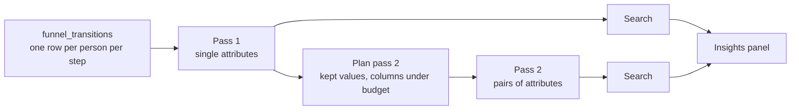

# Product analytics: insights

## Goal

A toggleable sidebar to the right of `AnalysisResult` that answers "what's different about the people who drop off?". For each funnel step it lists attributes associated with higher or lower conversion:

> **Viewed pricing → Started trial**
> OS is iOS
> 14% converted vs. 29% of everyone else · 4,210 people

We start with funnels. The same approach carries over to the other analyses that produce a rate (see [Other analyses](#other-analyses)).

## How it works



1. **Build a per-person funnel table** with attribute values for each person at each step. This is a CTE; nothing is materialized.
2. **Pass 1** aggregates it by each attribute on its own. The result is a few hundred to a few thousand rows of counts.
3. **The search** runs on the client. It finds groups whose conversion differs significantly from everyone else's and ranks them by how many conversions the difference accounts for.
4. **Pass 2** aggregates by pairs of attributes, but only for the most promising columns and values from pass 1. It finds two-factor groups such as "Android using Firefox".

Both passes return counts, not people, so the results are small enough to send to the browser. That keeps the server's memory use low and works without write access to the database. The search runs in the browser in the prototype and can stay there in production. The rows go through the same query path and permissions as the analysis itself, and the existing result cache (RTK in the prototype, the Metabase result cache in production) stores them. Changing a search threshold doesn't re-run a query.

## Definitions

- **Transition k** is step k → step k+1. A funnel with n steps has T = n − 1 transitions.
- **Population of transition k** is everyone who reached step k. N_k people.
- **Converted** means they also reached step k+1. X_k people.
- **A group** is a set of conditions on attributes, e.g. `browser = Safari`, or `browser = Firefox AND os = Android`.

## The per-person table

### Attribute values

For each candidate column, use **the first non-empty value we saw for the person, as long as we saw it by the time they reached step k**. Otherwise the value is `(not set)`.

This rule:

- **Handles sparse columns.** Event data is sparse: a column might only be populated on checkout events and empty on every pageview. With this rule, it's usable for any transition that starts after the person's first checkout event.
- **Prevents leakage.** A column that is only populated on the conversion event itself (for example, `plan` on `checkout_completed`) would otherwise "predict" conversion perfectly. Under the as-of rule, it's `(not set)` for everyone at the start of trial → checkout, so it never shows up as an insight there.
- **Is cheap.** It takes two aggregates per column in the existing per-person `GROUP BY`, with no second scan.
- **Makes `(not set)` meaningful.** "People with no UTM source" is a real group (direct traffic), so `(not set)` is a reportable value like any other.

For people who use two devices, this rule uses the first browser we saw, even if they reached step k on the other one. That's acceptable for now.

### SQL sketch

```sql
-- extends funnel_levels; attribute columns are projected as ifNull(col, '')
funnel_people AS (
  SELECT
    actor,
    <level expression>,
    minIf(ts, step_1) AS t_1, ..., minIf(ts, step_n) AS t_n,
    -- for each attribute: the first non-empty value, and when we first saw one
    argMinIf(browser, ts, browser != '') AS browser_first,
    minIf(ts, browser != '') AS browser_seen,
    ...
  FROM scoped_events
  GROUP BY actor
),
-- one row per person per transition they started
funnel_transitions AS (
  SELECT
    actor,
    k,
    level >= k + 1 AS converted,
    if(browser_first != '' AND browser_seen <= [t_1, ..., t_n][k],
       browser_first, '(not set)') AS browser,
    ...
  FROM funnel_people
  ARRAY JOIN range(1, n) AS k   -- k = 1 .. n-1
  WHERE level >= k
)
```

The `browser_first != ''` guard matters because `minIf` returns the epoch, not NULL, when nothing matches.

## Candidate columns

- String, boolean and category columns from the event table and the joined users table.
- Excluded:
  - Role columns: person, session, event ID, timestamp, event name and URL path.
  - PK, FK and UUID columns.
  - **Columns referenced by any step's filters.** These would be circular: if step 2 is defined by `url_path`, then `url_path` trivially predicts step 2.
- Fingerprint `distinct-count` between 2 and 200. Very high-cardinality columns (city, user agent) rarely produce groups large enough to report, and they cost the most rows.
- **No null-percentage filter.** The fingerprint's `nil%` is measured over all events, so a checkout-only column looks 99% empty even when most people who reach checkout have a value. The minimum group size in the search already handles columns that are too sparse to matter, and it measures that per person and per transition.
- Order by `dimension_interestingness` when it's available, then by `distinct-count` ascending. It's persisted on `metabase_field`; check that it reaches the frontend in table query metadata.
- Numeric columns are skipped for now. They need binning.

Attribute columns flow through `extraColumns` (`base-query.ts`, `build-sql.ts`, `scopedEvents`), the same way the cohorts attribute does.

## Pass 1: single attributes

```sql
SELECT k, browser, os, country, ...,
       count() AS reached,
       countIf(converted) AS converted
FROM funnel_transitions
GROUP BY GROUPING SETS ((k), (k, browser), (k, os), (k, country), ...)
```

- The `(k)` rows are each transition's totals, N_k and X_k.
- Every other row is a one-factor group's counts. "Everyone else" is the total minus the group.
- Rows ≤ T × (sum of the distinct counts of the columns).

  | Funnel | Columns | Rows |
  |---|---|---|
  | 4 steps (T = 3) | 15 columns averaging 20 values | 3 × 300 = 900 |
  | 4 steps (T = 3) | 15 columns at the 200-value cap | 9,000 |

Pass 1 produces every one-factor insight. It also gives the size of every value in every column, which is what pass 2 is planned from.

## Pass 2: pairs of attributes

Two-factor groups need a count for each combination of two values, e.g. (`browser = Safari`, `os = iOS`). Pass 2 fetches these for a limited set of columns and values. The search only needs pass 2 for the two-factor group itself. The one-factor parents and the transition totals come from pass 1, and everything else is subtraction.

### Which values to keep

**A two-factor group is never larger than either of its one-factor parents.** Everyone in "Safari and iOS" is also in "Safari". So if "Safari" is below the minimum group size, no two-factor group containing it can qualify.

For each column, keep only the values that met the minimum group size in pass 1, in at least one transition. Lump the rest into `(other)`, which is never reported.

This puts a ceiling on how many values each column can keep:

- One column's values split people into groups that don't overlap, so their sizes add up to at most the population.
- With a minimum group size of 1% of the population, at most 100 values can each reach 1% (100 × 1% = 100%).
- In practice it's a handful: browser keeps 5 or so, country maybe 10.
- To keep the worst case tight, we also cap each column at its 20 largest values.

Call the number of kept values for column c **k_c**.

### How many rows

With **M** columns there are **M × (M − 1) / 2 pairs**, each unordered pair counted once. Eight columns give 28 pairs.

A pair (a, b) returns at most k_a × k_b rows per transition, one per combination of kept values. So:

```
rows ≤ T × Σ over pairs (k_a × k_b)
```

**Example 1, typical.** A 3-step funnel (T = 2) with 8 columns:

| Column | Kept values (k) |
|---|---|
| device | 3 |
| os | 5 |
| browser | 5 |
| country | 10 |
| language | 8 |
| utm_source | 6 |
| utm_medium | 4 |
| referrer_domain | 8 |

Summing k_a × k_b over all 28 pairs gives 1,031. (A shortcut is ((Σk)² − Σk²) / 2 = (49² − 339) / 2.) Rows ≤ 2 × 1,031 = **2,062**.

**Example 2, worst case.** A 5-step funnel (T = 4) where every column hits the 20-value cap.

- One pair returns at most 20 × 20 × 4 = 1,600 rows.
- With a budget of 50,000 rows, that's 31 pairs at most.
- So M = 8 (28 pairs, 44,800 rows). M = 9 would be 36 pairs and 57,600 rows, which is over budget.

**Choosing M.** Add columns in order of their best pass-1 score, then interestingness, while the bound stays under the budget. The bound is computed exactly from pass 1 before pass 2 runs, so nothing needs to be estimated.

The actual result is usually far below the bound, because `GROUP BY` only returns combinations that occur. In the generated data, iOS only ever appears with Safari, so os × browser has a handful of cells, not 25.

Each row is a few short strings and two integers, so 50,000 rows is a few MB of JSON. That's comfortable to send to the browser. Tune the budget later.

### SQL sketch

```sql
SELECT k, browser, os, country, ...,
       count() AS reached,
       countIf(converted) AS converted
FROM (
  SELECT k, converted,
         if(browser IN ('Safari', 'Chrome', ...), browser, '(other)') AS browser,
         ...
  FROM funnel_transitions
)
GROUP BY GROUPING SETS ((k, browser, os), (k, browser, country), (k, os, country), ...)
HAVING browser != '(other)' AND os != '(other)' AND ...
```

## Search

For each transition k and each candidate group S:

- `n_S`, `x_S` are the group's reached and converted counts.
- The rest are `n_R = N_k − n_S` and `x_R = X_k − x_S`.
- The rates are `p_S = x_S / n_S` and `p_R = x_R / n_R`.

### Filters

1. **Minimum group size:** `n_S ≥ max(100, 1% of N_k)`, and the same for the rest. Both sides also need at least 10 conversions and 10 drop-offs, so that the z-test below is reliable.
2. **Significance:**
   - A two-sided, two-proportion z-test.
   - Benjamini–Hochberg at q = 0.10, with singles and pairs as separate families, each across all transitions. To apply it, sort the p-values in ascending order, find the largest i where `p_(i) ≤ (i / m) × q`, and keep the first i.
   - The result: at most about 10% of what we show is expected to be noise.
   - Benjamini–Hochberg scales with the number of candidates (pass 2 can add thousands), so real effects don't disappear as we test more columns.
   - Separate families mean the one-factor insights don't change when pass 2 arrives, except to be replaced by a pair that explains them (rule 4).
3. **Pairs (A = a AND B = b) must interact.** The combination has to matter beyond A and B on their own:
   - A log-odds interaction test over the four cells A∧B, A∧¬B, ¬A∧B and ¬A∧¬B, all from subtraction. A pair's p-value is the larger of this and its z-test, so the pairs family corrects for both.
   - This drops pairs made of two independent effects: "no UTM source and desktop" is two separate effects added together, not a combination.
   - Pairs must also cover less than 95% of each parent. iOS always means Safari, so "Safari and iOS" is the same people as "iOS".
4. **Leave out what another insight explains.** Insight A is explained by insight S when, among the people in neither, A's remainder (A minus the people it shares with S) converts like everyone else. This one test covers three cases:
   - **Subsets:** "Safari" only converts worse because of the iOS users in it. Without them, Safari is ordinary.
   - **Mirror images:** "desktop converts better" only because iOS converts worse. Compared with Android instead of everyone, desktop is ordinary.
   - **Duplicates:** `utm_source`, `utm_medium` and `utm_campaign` are always `(not set)` together, so they're the same people.
   - If A is (almost) inside S, the test is instead whether A converts like the rest of S.
   - When two insights explain each other, the narrower one stays: "iOS converts worse", not "Windows converts better".
   - Overlaps come from the pass 2 cells. With three conditions, only the bound |X∩Y∩Z| ≥ |X∩Z| + |Y∩Z| − |Z| is available, so it's only used when it shows one group is inside the other.

There is no minimum effect size. What counts as meaningful depends on the business: going from 1.00% to 1.05% can matter at scale. The ranking below and the human reading the list handle relevance.

### Ranking

**Excess conversions** = `n_S × (p_S − p_R)`. That's how many more (or fewer) people in the group converted than if they had converted at everyone else's rate. Rank by its absolute value.

This combines size and effect in a number people can read ("~340 fewer trials").

- A 1.00% → 1.05% difference across 10M people is 5,000 conversions, so it ranks high.
- A 20-point swing on 150 people is 30 conversions. It still shows if it's significant, just lower down.

Show the top 5 per transition, with "Show more" for the rest.

### Display

The text is generated from a template, so it sticks to the conditions and the numbers:

```
Browser is Safari and OS is iOS
14% converted vs. 29% of everyone else · 4,210 people
```

- **Conditions** are joined with "and" as `<column display name> is <value>`. `(not set)` becomes `<column> is not set`.
- **Rates:** the group's conversion rate vs. everyone else's, then the group size.
- **Direction:** an icon or color says whether the group converts better or worse than everyone else.
- **Insights are grouped** under their transition heading, "Viewed pricing → Started trial".
- **No causal language.** The numbers describe an association.

## Exploring an insight

The point of clicking an insight is to test hypotheses. If Safari stands out, how do Firefox and Edge look? What happens with a filter, or another breakout?

### Prototype: ad-hoc native question

"Explore" opens the query builder with an ad-hoc native question; nothing needs to be saved. It shows the insight's transition, broken out by the insight's column, with **every value**, not only the one in the insight:

```sql
-- same CTEs as the insight passes
SELECT browser,
       count() AS people,
       round(countIf(converted) / count(), 4) AS conversion
FROM funnel_transitions
WHERE k = 1
GROUP BY browser
ORDER BY people DESC
```

- **Two factors** are concatenated into one column, `concat(browser, ' · ', os) AS segment`. It stays a single dimension and charts as one bar per combination.
- **Display:** a bar chart of `conversion`, with `people` alongside so the group size is visible.
- **Navigation:** build an ad-hoc native card and use `Urls.serializedQuestion`.

### Next: GUI exploration

A native question can't be filtered or broken out further without editing SQL. The next step is to make the per-person table the source of a GUI question:

1. Save `SELECT * FROM funnel_transitions WHERE k = 1` as a question or model. It has one row per person, with the attribute columns and `converted` (0/1). For the demo, this can happen automatically on click.
2. Open a new GUI question on it with Count and Average of `converted`, broken out by the insight's column(s).
3. From there, the normal filter and breakout UI works for testing hypotheses.

In production, once analysis queries are MBQL, the per-person table can be a query stage, so no saved card is needed.

## UI

```
┌ Insights ───────────────────── ✕ ┐
│ Viewed pricing → Started trial   │
│ ▼ OS is iOS                      │
│   14% converted vs. 29% of       │
│   everyone else · 4,210 people   │
│   [Explore]                      │
│ Started trial → Purchased        │
│ ▸ ...                            │
│ Looking for combinations…        │
│ Checked 11 attributes across     │
│ 19,505 people                    │
└──────────────────────────────────┘
```

- An "Insights" toggle in `AnalysisToolbar`. The ~320px panel is a sibling of `AnalysisResult` in `AnalysisWorkspace`. Its open state is remembered in local storage, not the URL.
- **Query timing:**
  - When the panel is open, run pass 1, and show one-factor insights as soon as it returns.
  - Pass 2 depends on pass 1, so it runs right after. Two-factor insights merge into the list when they arrive, under a "Looking for combinations…" indicator.
- **Empty state:** list which attributes were checked, and for how many people. "Nothing stands out" is a real result.
- **Loading and errors:** loading uses the same pattern as `AnalysisResult`. Errors are shown in the panel only and don't affect the chart.

### Future optimization: one scan for the chart and pass 1

The "Step by step" chart can be derived from pass 1's `(k)` total rows:

- People at step 1 = `reached` for k = 1.
- People at step k+1 = `converted` for k.

Running pass 1 in place of the steps query would give the chart and one-factor insights from one scan. Pass 1 is heavier (two aggregates per attribute column), so measure whether the chart gets noticeably slower before switching. This only applies to the "Step by step" view.

## Ordering "any"

Insights work here too. The order of the steps in the list is still the expected sequence; the user just doesn't require people to do them in that order.

- Level is the number of leading steps the person did, in any order: level ≥ k means they did each of steps 1..k at least once.
- The as-of time for transition k is when they had done all of steps 1..k: `max(t_1, ..., t_k)`. This is used for every ordering, not only "any".

**Open decision:** the current "any" step chart counts each step independently. Someone who did step 3 but not step 2 counts at step 3, so the bars won't match the insight populations. Switching the chart to the cumulative definition above would make them agree.

## Test data (do first)

The generator draws `sawPricing`, `startsTrial` and `checksOut` independently of every attribute, so a correct search finds nothing. Plant effects and record them in `ground-truth.json`. The search's unit tests should then assert that exactly these come back:

| Planted effect | Expected result |
|---|---|
| **One factor:** iOS checkout conversion × 0.6 | "People on iOS" for trial → checkout |
| **Two factors:** Android + Firefox drop between pricing and trial, weak for either alone | Reported only as the combination |
| **Sparse property:** a property set only on `trial_started` (e.g. `trial_source` in `event_data`, promoted in `02_pa_events_resolved.sql` like `plan`) that predicts checkout | Found for trial → checkout only |
| **Leakage:** `plan` is only set on `checkout_completed` (already true) | Never appears for trial → checkout |
| **Decoy:** ~50 people with a huge effect | Rejected by the minimum group size |
| **Redundancy:** iOS always means Safari (already true) | "People on iOS", not "Safari and iOS" |

## Other analyses

The search reads rows of (question, attribute values, reached, converted). For funnels, the questions are transitions. The other analyses map onto the same shape:

| Analysis | Population | Success |
|---|---|---|
| Funnel | reached step k | reached step k+1 |
| Cohorts | started in the cohort | returned in period N |
| Habit | active in the lookback | active ≥ X sub-periods |
| Lifecycle | active in a period | active in the next period |

Paths isn't a rate, so it's out of scope.

The contract per analysis is a CTE of (actor, question, as_of, converted). Shared code adds the attribute values as of `as_of`. Both passes and the search are shared. Build this abstraction when the second analysis is added, not before.

## Implementation

Built as planned, except where noted here. `bun run dev/product-analytics/check-insights.ts` runs both passes and the search against ClickHouse without Metabase, and checks the planted effects in `ground-truth.json`.

On the generated data it reports six insights: the three planted ones, plus three that come from how the generator simulates browsing:

- `(not set)` UTM people start more trials. People who browse less before reaching pricing pick up fewer UTM tags, and only people who were going to see pricing anyway start trials.
- `utm_source = google` and `utm_campaign = brand` start fewer trials. The cause isn't known, possibly correlated draws from the generator's random number generator.

- **Test data:** `dev/product-analytics/generate.ts`, `sql/02_pa_events_resolved.sql`, `ground-truth.json`.
- **Planner:** in `sql/analyses/funnel.ts`, extract `funnel_levels` into a builder that takes attribute columns. Add `planFunnelInsights(spec, attributes, pass)`, which returns `funnel_transitions` plus the pass 1, pass 2 and explore `SELECT`s. The "last definition wins" dedupe in `compose.ts` lets it replace `funnel_levels`.
- **New files under `insights/`:**
  - `candidates.ts`: column selection from table metadata.
  - `plan-pass-2.ts`: kept values and M from pass 1 and the budget.
  - `search.ts`: pure function, rows in and ranked insights out. Covers the z-test, Benjamini–Hochberg, the interaction test and the "explained by" rule. Unit-tested against the planted effects.
- **Hook:** `insights/use-funnel-insights.ts` runs pass 1 then pass 2, reusing `useCompiledBase` from `use-analysis-query.ts`. Both passes raise the `/api/dataset` row limit to the pass 2 budget with `constraints`.
- **UI:** `components/InsightsPanel.tsx`, a toggle in `AnalysisToolbar.tsx`, layout in `AnalysisWorkspace.tsx`, and the panel's open state in local storage.
- **Explore:** build an ad-hoc native card and navigate with `Urls.serializedQuestion`.

## Defaults

| Setting | Value |
|---|---|
| Minimum group size | max(100 people, 1% of the transition's population), for the group and the rest |
| Normal-approximation check | ≥ 10 conversions and ≥ 10 drop-offs on each side |
| False discovery rate (Benjamini–Hochberg) | q = 0.10, singles and pairs as separate families |
| Pair interaction | folded into the pairs' Benjamini–Hochberg family |
| Pair redundancy | covers < 95% of each parent |
| "Explained by" test | p ≥ 0.05 for the remainder vs. the people in neither |
| Candidate column distinct count | 2–200 |
| Kept values per column in pass 2 | ≤ 20 |
| Pass 2 row budget | 50,000 |
| Insights shown per transition | 5, then "Show more" |

## Later

- Derive the step chart from pass 1 (see [above](#future-optimization-one-scan-for-the-chart-and-pass-1)).
- GUI exploration through a saved per-person question.
- The other analyses.
- `event_data` map keys as candidate columns. Real Track data keeps sparse properties there.
- Binning numeric columns.
- When two one-factor insights are mostly the same people (≥ 80% overlap, known from pass 2), show the stronger one and mention the other.
