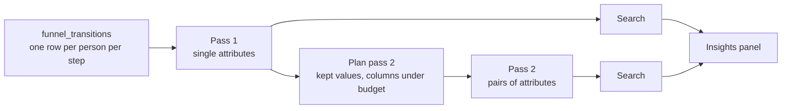

# Product analytics: insights

## Goal

A toggleable sidebar to the right of `AnalysisResult` that answers "what's different about the people who drop off?". For each funnel step it lists attributes associated with higher or lower conversion:

> **Viewed pricing → Started trial**
> OS is iOS
> 14% converted vs. 29% of everyone else · 4,210 people

We start with funnels. The same approach carries over to the other analyses that produce a rate (see [Other analyses](#other-analyses)).

## How it works



1. **Build a per-person funnel table** with attribute values for each person at each step. This is a CTE; nothing is materialized.
2. **Pass 1** aggregates it by each attribute on its own. The result is a few hundred to a few thousand rows of counts.
3. **The search** runs on the client. It finds groups whose conversion differs significantly from everyone else's and ranks them by how many conversions the difference accounts for.
4. **Pass 2** aggregates by pairs of attributes, but only for the most promising columns and values from pass 1. It finds two-factor groups such as "Android using Firefox".

Both passes return counts, not people, so the results are small enough to send to the browser. That keeps the server's memory use low and works without write access to the database. The search runs in the browser in the prototype and can stay there in production. The rows go through the same query path and permissions as the analysis itself, and the existing result cache (RTK in the prototype, the Metabase result cache in production) stores them. Changing a search threshold doesn't re-run a query.

## Definitions

- **Transition k** is step k → step k+1. A funnel with n steps has T = n − 1 transitions.
- **Population of transition k** is everyone who reached step k. N_k people.
- **Converted** means they also reached step k+1. X_k people.
- **A group** is a set of conditions on attributes, e.g. `browser = Safari`, or `browser = Firefox AND os = Android`.

## The per-person table

### Attribute values

For each candidate column, use **the first non-empty value we saw for the person, as long as we saw it by the time they reached step k**. Otherwise the value is `(not set)`. Flags that only go from false to true use a variant of this rule instead (see [Whether someone was identified](#whether-someone-was-identified)).

This rule:

- **Handles sparse columns.** Event data is sparse: a column might only be populated on checkout events and empty on every pageview. With this rule, it's usable for any transition that starts after the person's first checkout event.
- **Prevents leakage.** A column that is only populated on the conversion event itself (for example, `plan` on `checkout_completed`) would otherwise "predict" conversion perfectly. Under the as-of rule, it's `(not set)` for everyone at the start of trial → checkout, so it never shows up as an insight there.
- **Is cheap.** It takes two aggregates per column in the existing per-person `GROUP BY`, with no second scan.
- **Makes `(not set)` meaningful.** "People with no UTM source" is a real group (direct traffic), so `(not set)` is a reportable value like any other.

For people who use two devices, this rule uses the first browser we saw, even if they reached step k on the other one. That's acceptable for now.

### SQL sketch

```sql
-- extends funnel_levels; attribute columns are projected as ifNull(col, '')
funnel_people AS (
  SELECT
    actor,
    <level expression>,
    minIf(ts, step_1) AS t_1, ..., minIf(ts, step_n) AS t_n,
    -- for each attribute: the first non-empty value, and when we first saw one
    argMinIf(browser, ts, browser != '') AS browser_first,
    minIf(ts, browser != '') AS browser_seen,
    ...
  FROM scoped_events
  GROUP BY actor
),
-- one row per person per transition they started
funnel_transitions AS (
  SELECT
    actor,
    k,
    level >= k + 1 AS converted,
    if(browser_first != '' AND browser_seen <= [t_1, ..., t_n][k],
       browser_first, '(not set)') AS browser,
    ...
  FROM funnel_people
  ARRAY JOIN range(1, n) AS k   -- k = 1 .. n-1
  WHERE level >= k
)
```

The `browser_first != ''` guard matters because `minIf` returns the epoch, not NULL, when nothing matches.

## Candidate columns

- String, boolean and category columns from the event table. Person traits come in as `person_*` columns on it (see [Person properties](#person-properties)), not from the users table.
- Excluded:
  - Role columns: person, session, event ID, timestamp, event name and URL path.
  - PK, FK and UUID columns.
  - **Columns referenced by any step's filters.** These would be circular: if step 2 is defined by `url_path`, then `url_path` trivially predicts step 2.
- Fingerprint `distinct-count` between 2 and 200. Very high-cardinality columns (city, user agent) rarely produce groups large enough to report, and they cost the most rows.
- **No null-percentage filter.** The fingerprint's `nil%` is measured over all events, so a checkout-only column looks 99% empty even when most people who reach checkout have a value. The minimum group size in the search already handles columns that are too sparse to matter, and it measures that per person and per transition.
- Order by `dimension_interestingness` when it's available, then by `distinct-count` ascending. It's persisted on `metabase_field`; check that it reaches the frontend in table query metadata.
- Numeric columns are skipped for now. They need binning.

Attribute columns flow through `extraColumns` (`base-query.ts`, `build-sql.ts`, `scopedEvents`), the same way the cohorts attribute does.

## Person properties

Traits sent with `identify()` (company, role, plan) are candidates like any other column, but only as they were at the time of each event.

- **Where they come from:** `pa_events_resolved.person_*`, copied from the latest `identify()` at or before each event (`04_pa_events_resolved.sql`, an `ASOF JOIN` against `pa_identity_history`). This matches PostHog's default, where person properties on an event are frozen when the event is ingested, and the current values are an opt-in join.
- **Not from the users table.** `pa_identities_resolved` holds current traits. Joined onto events, a plan bought at checkout looks known before the person even saw pricing, and the as-of rule can't catch it because the value is on every event. Users-table columns were candidates for a while (#84618) and made insights useless. `candidates.ts` now only takes event table columns. The FK to the users table is still the right source for questions about current state, like breakdowns and filters.

### Known gap: traits that change

The as-of rule takes the **first** non-empty value seen by step k. For event properties and for traits that don't change, that's right. For a trait that changes, it's the oldest value: `person_plan` reads `free` for everyone at trial → checkout, though it's `trial` by then.

The right rule is the **latest** value as of reaching step k. It doesn't fit the single `GROUP BY` in `funnel_people`, because the step times are computed in that same aggregate. Two ways to get it:

- Join `funnel_transitions` against the identity history on `person = person AND valid_from <= reached_at < valid_to`. Transitions are few rows and the history is small, so this is cheap. MBQL can express the range join. ClickHouse's `ASOF JOIN` does it without `valid_to`.
- A second pass over the events once the step times are known. It's simpler but scans the events twice.

For the prototype this doesn't matter. The only trait in the generated data that changes is `plan`, which follows the funnel and shouldn't be an insight anyway.

### Whether someone was identified

`pa_events_resolved.person__identified` is true from a person's first `identify()` on, and false before. It comes from whether the `ASOF JOIN` found a history row, not from the traits, since an `identify()` can send none of the promoted ones. That makes every `person_*` column empty after it too.

- **False, not NULL, in the table.** A plain per-event fact works everywhere else: Metabase's True/False filter picker, breakouts, cohorts by attribute (the latest value), and attribution that reads the value on a step's event. An earlier version stored NULL before `identify()` to suit the first-value rule, and made the column awkward everywhere else.
- **Its own as-of rule in insights.** Under the first-value rule a `false` would be the first value for anyone who browsed anonymously, and stick. So each attribute has a rule (`AttributeAsOf` in `sql/analyses/insights.ts`): `first-seen` for everything else, and `true-by-step` for this column, which is `"true"` if it was true on any event by the step and `"false"` otherwise. It's the first-value rule with `false` counted as empty and `"false"` as the fallback, so it fits the same `GROUP BY`. The values match the table's, so an insight maps straight onto a filter.
- **Wins ties.** When it and a trait are empty for the same people, the search keeps whichever attribute comes first, and `candidates.ts` puts this one first.
- **Labels:** "Person is identified" and "Person is anonymous" in titles, "Identified" and "Anonymous" on chart axes, with an info icon that explains them. Not "Signed up": `identify()` might also fire on a newsletter signup or an invite. Other columns get the info icon when they have a description in Metabase.
- **The double underscore** keeps it apart from a trait called `identified` promoted as `person_identified`.

### Open questions

- **Traits before someone is identified.** Most people view pricing anonymously, so every `person_*` column is `(not set)` at pricing → trial and person-property insights only appear from signup on. A trait that never changes (company) would be safe to apply to earlier events. A trait that's first set later isn't, because having a value at all leaks the outcome (`billing_cycle` is only set at checkout). Telling them apart could be a per-trait setting, like PostHog's choice between properties as of the event and current ones, or inferred from the history, for example "set at the first `identify()` and never changed".
- **Ties.** An `identify()` in the same second as an event applies to it, so `checkout_completed` carries the plan it bought. Fine for generated data. In Track, `created_at` is the batch time, so the order of an `identify()` and the events around it is unknown (see "Technical feedback" in [product-analytics.md](product-analytics.md)).
- **Which traits to copy.** The prototype promotes four traits by hand. The real thing needs a generic route: the whole trait map on each event with map access in MBQL, or the user picking which traits matter.
- **Track has no history.** `pa_identities` keeps only the latest row per person. The prototype adds `pa_identity_history`. Track needs it, or something like it, before any of this works on real data (see [product-analytics.md](product-analytics.md)).

## Pass 1: single attributes

```sql
SELECT k, browser, os, country, ...,
       count() AS reached,
       countIf(converted) AS converted
FROM funnel_transitions
GROUP BY GROUPING SETS ((k), (k, browser), (k, os), (k, country), ...)
```

- The `(k)` rows are each transition's totals, N_k and X_k.
- Every other row is a one-factor group's counts. "Everyone else" is the total minus the group.
- Rows ≤ T × (sum of the distinct counts of the columns).

  | Funnel | Columns | Rows |
  |---|---|---|
  | 4 steps (T = 3) | 15 columns averaging 20 values | 3 × 300 = 900 |
  | 4 steps (T = 3) | 15 columns at the 200-value cap | 9,000 |

Pass 1 produces every one-factor insight. It also gives the size of every value in every column, which is what pass 2 is planned from.

## Pass 2: pairs of attributes

Two-factor groups need a count for each combination of two values, e.g. (`browser = Safari`, `os = iOS`). Pass 2 fetches these for a limited set of columns and values. The search only needs pass 2 for the two-factor group itself. The one-factor parents and the transition totals come from pass 1, and everything else is subtraction.

### Which values to keep

**A two-factor group is never larger than either of its one-factor parents.** Everyone in "Safari and iOS" is also in "Safari". So if "Safari" is below the minimum group size, no two-factor group containing it can qualify.

For each column, keep only the values that met the minimum group size in pass 1, in at least one transition. Lump the rest into `(other)`, which is never reported.

This puts a ceiling on how many values each column can keep:

- One column's values split people into groups that don't overlap, so their sizes add up to at most the population.
- With a minimum group size of 1% of the population, at most 100 values can each reach 1% (100 × 1% = 100%).
- In practice it's a handful: browser keeps 5 or so, country maybe 10.
- To keep the worst case tight, we also cap each column at its 20 largest values.

Call the number of kept values for column c **k_c**.

### How many rows

With **M** columns there are **M × (M − 1) / 2 pairs**, each unordered pair counted once. Eight columns give 28 pairs.

A pair (a, b) returns at most k_a × k_b rows per transition, one per combination of kept values. So:

```
rows ≤ T × Σ over pairs (k_a × k_b)
```

**Example 1, typical.** A 3-step funnel (T = 2) with 8 columns:

| Column | Kept values (k) |
|---|---|
| device | 3 |
| os | 5 |
| browser | 5 |
| country | 10 |
| language | 8 |
| utm_source | 6 |
| utm_medium | 4 |
| referrer_domain | 8 |

Summing k_a × k_b over all 28 pairs gives 1,031. (A shortcut is ((Σk)² − Σk²) / 2 = (49² − 339) / 2.) Rows ≤ 2 × 1,031 = **2,062**.

**Example 2, worst case.** A 5-step funnel (T = 4) where every column hits the 20-value cap.

- One pair returns at most 20 × 20 × 4 = 1,600 rows.
- With a budget of 50,000 rows, that's 31 pairs at most.
- So M = 8 (28 pairs, 44,800 rows). M = 9 would be 36 pairs and 57,600 rows, which is over budget.

**Choosing M.** Add columns in order of their best pass-1 score, then interestingness, while the bound stays under the budget. The bound is computed exactly from pass 1 before pass 2 runs, so nothing needs to be estimated.

The actual result is usually far below the bound, because `GROUP BY` only returns combinations that occur. In the generated data, iOS only ever appears with Safari, so os × browser has a handful of cells, not 25.

Each row is a few short strings and two integers, so 50,000 rows is a few MB of JSON. That's comfortable to send to the browser. Tune the budget later.

### SQL sketch

```sql
SELECT k, browser, os, country, ...,
       count() AS reached,
       countIf(converted) AS converted
FROM (
  SELECT k, converted,
         if(browser IN ('Safari', 'Chrome', ...), browser, '(other)') AS browser,
         ...
  FROM funnel_transitions
)
GROUP BY GROUPING SETS ((k, browser, os), (k, browser, country), (k, os, country), ...)
HAVING browser != '(other)' AND os != '(other)' AND ...
```

## Search

For each transition k and each candidate group S:

- `n_S`, `x_S` are the group's reached and converted counts.
- The rest are `n_R = N_k − n_S` and `x_R = X_k − x_S`.
- The rates are `p_S = x_S / n_S` and `p_R = x_R / n_R`.

### Filters

1. **Minimum group size:** `n_S ≥ max(100, 1% of N_k)`, and the same for the rest. Both sides also need at least 5 conversions and 5 drop-offs expected at the transition's overall rate, so that the z-test below is reliable. The approximation depends on the counts expected under the null hypothesis, not the observed ones, so a group that converts 0% is still tested. An earlier version required 10 observed conversions, which hid the strongest effects, like people who had already signed up never signing up.
2. **Significance:**
   - A two-sided, two-proportion z-test.
   - Benjamini–Hochberg at q = 0.10, with singles and pairs as separate families, each across all transitions. To apply it, sort the p-values in ascending order, find the largest i where `p_(i) ≤ (i / m) × q`, and keep the first i.
   - The result: at most about 10% of what we show is expected to be noise.
   - Benjamini–Hochberg scales with the number of candidates (pass 2 can add thousands), so real effects don't disappear as we test more columns.
   - Separate families mean the one-factor insights don't change when pass 2 arrives, except to be replaced by a pair that explains them (rule 4).
3. **Pairs (A = a AND B = b) must interact.** The combination has to matter beyond A and B on their own:
   - A log-odds interaction test over the four cells A∧B, A∧¬B, ¬A∧B and ¬A∧¬B, all from subtraction. A pair's p-value is the larger of this and its z-test, so the pairs family corrects for both.
   - This drops pairs made of two independent effects: "no UTM source and desktop" is two separate effects added together, not a combination.
   - Pairs must also cover less than 95% of each parent. iOS always means Safari, so "Safari and iOS" is the same people as "iOS".
4. **Leave out what another insight explains.** Insight A is explained by insight S when, among the people in neither, A's remainder (A minus the people it shares with S) converts like everyone else. This one test covers three cases:
   - **Subsets:** "Safari" only converts worse because of the iOS users in it. Without them, Safari is ordinary.
   - **Mirror images:** "desktop converts better" only because iOS converts worse. Compared with Android instead of everyone, desktop is ordinary.
   - **Duplicates:** `utm_source`, `utm_medium` and `utm_campaign` are always `(not set)` together, so they're the same people.
   - If A is (almost) inside S, the test is instead whether A converts like the rest of S.
   - When two insights explain each other, the narrower one stays: "iOS converts worse", not "Windows converts better".
   - Overlaps come from the pass 2 cells. With three conditions, only the bound |X∩Y∩Z| ≥ |X∩Z| + |Y∩Z| − |Z| is available, so it's only used when it shows one group is inside the other.

There is no minimum effect size. What counts as meaningful depends on the business: going from 1.00% to 1.05% can matter at scale. The ranking below and the human reading the list handle relevance.

### Ranking

**Excess conversions** = `n_S × (p_S − p_R)`. That's how many more (or fewer) people in the group converted than if they had converted at everyone else's rate. Rank by its absolute value.

This combines size and effect in a number people can read ("~340 fewer trials").

- A 1.00% → 1.05% difference across 10M people is 5,000 conversions, so it ranks high.
- A 20-point swing on 150 people is 30 conversions. It still shows if it's significant, just lower down.

Show the top 5 per transition, with "Show more" for the rest.

### Display

The text is generated from a template, so it sticks to the conditions and the numbers:

```
Browser is Safari and OS is iOS
14% converted vs. 29% of everyone else · 4,210 people
```

- **Conditions** are joined with "and" as `<column display name> is <value>`. `(not set)` becomes `<column> is not set`.
- **Rates:** the group's conversion rate vs. everyone else's, then the group size.
- **Direction:** an icon or color says whether the group converts better or worse than everyone else.
- **Insights are grouped** under their transition heading, "Viewed pricing → Started trial".
- **No causal language.** The numbers describe an association.

## Exploring an insight

The point of clicking an insight is to test hypotheses. If Safari stands out, how do Firefox and Edge look? What happens with a filter, or another breakout?

### Prototype: ad-hoc native question

"Explore" opens the query builder with an ad-hoc native question; nothing needs to be saved. It shows the insight's transition, broken out by the insight's column, with **every value**, not only the one in the insight:

```sql
-- same CTEs as the insight passes
SELECT browser,
       count() AS people,
       round(countIf(converted) / count(), 4) AS conversion
FROM funnel_transitions
WHERE k = 1
GROUP BY browser
ORDER BY people DESC
```

- **Two factors** are concatenated into one column, `concat(browser, ' · ', os) AS segment`. It stays a single dimension and charts as one bar per combination.
- **Display:** a bar chart of `conversion`, with `people` alongside so the group size is visible.
- **Navigation:** build an ad-hoc native card and use `Urls.serializedQuestion`.

### Next: GUI exploration

A native question can't be filtered or broken out further without editing SQL. The next step is to make the per-person table the source of a GUI question:

1. Save `SELECT * FROM funnel_transitions WHERE k = 1` as a question or model. It has one row per person, with the attribute columns and `converted` (0/1). For the demo, this can happen automatically on click.
2. Open a new GUI question on it with Count and Average of `converted`, broken out by the insight's column(s).
3. From there, the normal filter and breakout UI works for testing hypotheses.

In production, once analysis queries are MBQL, the per-person table can be a query stage, so no saved card is needed.

## UI

```
┌ Insights ───────────────────── ✕ ┐
│ Viewed pricing → Started trial   │
│ ▼ OS is iOS                      │
│   14% converted vs. 29% of       │
│   everyone else · 4,210 people   │
│   [Explore]                      │
│ Started trial → Purchased        │
│ ▸ ...                            │
│ Looking for combinations…        │
│ Checked 11 attributes across     │
│ 19,505 people                    │
└──────────────────────────────────┘
```

- An "Insights" toggle in `AnalysisToolbar`. The ~320px panel is a sibling of `AnalysisResult` in `AnalysisWorkspace`. Its open state is remembered in local storage, not the URL.
- **Query timing:**
  - When the panel is open, run pass 1, and show one-factor insights as soon as it returns.
  - Pass 2 depends on pass 1, so it runs right after. Two-factor insights merge into the list when they arrive, under a "Looking for combinations…" indicator.
- **Empty state:** list which attributes were checked, and for how many people. "Nothing stands out" is a real result.
- **Loading and errors:** loading uses the same pattern as `AnalysisResult`. Errors are shown in the panel only and don't affect the chart.

### Future optimization: one scan for the chart and pass 1

The "Step by step" chart can be derived from pass 1's `(k)` total rows:

- People at step 1 = `reached` for k = 1.
- People at step k+1 = `converted` for k.

Running pass 1 in place of the steps query would give the chart and one-factor insights from one scan. Pass 1 is heavier (two aggregates per attribute column), so measure whether the chart gets noticeably slower before switching. This only applies to the "Step by step" view.

## Ordering "any"

Insights work here too. The order of the steps in the list is still the expected sequence; the user just doesn't require people to do them in that order.

- Level is the number of leading steps the person did, in any order: level ≥ k means they did each of steps 1..k at least once.
- The as-of time for transition k is when they had done all of steps 1..k: `max(t_1, ..., t_k)`. This is used for every ordering, not only "any".

**Open decision:** the current "any" step chart counts each step independently. Someone who did step 3 but not step 2 counts at step 3, so the bars won't match the insight populations. Switching the chart to the cumulative definition above would make them agree.

## Test data (do first)

The generator draws `sawPricing`, `startsTrial` and `checksOut` independently of every attribute, so a correct search finds nothing. Plant effects and record them in `ground-truth.json`. The search's unit tests should then assert that exactly these come back:

| Planted effect | Expected result |
|---|---|
| **One factor:** iOS checkout conversion × 0.6 | "People on iOS" for trial → checkout |
| **Two factors:** Android + Firefox drop between pricing and trial, weak for either alone | Reported only as the combination |
| **Sparse property:** a property set only on `trial_started` (e.g. `trial_source` in `event_data`, promoted in `04_pa_events_resolved.sql` like `plan`) that predicts checkout | Found for trial → checkout only |
| **Leakage:** `plan` is only set on `checkout_completed` (already true) | Never appears for trial → checkout |
| **Person property:** admins (`role` from `identify()`) check out × 1.6 | `person_role = admin` for trial → checkout |
| **Person-property leakage:** `billing_cycle` is only sent by the `identify()` at checkout, and `plan` changes with the funnel | Neither `person_billing_cycle` nor `person_plan` appears for trial → checkout |
| **Decoy:** ~50 people with a huge effect | Rejected by the minimum group size |
| **Redundancy:** iOS always means Safari (already true) | "People on iOS", not "Safari and iOS" |

## Other analyses

The search reads rows of (question, attribute values, reached, converted). For funnels, the questions are transitions. The other analyses map onto the same shape:

| Analysis | Population | Success |
|---|---|---|
| Funnel | reached step k | reached step k+1 |
| Paths (bounces) | visits that landed on page k | had no other step |
| Cohorts | started in the cohort | returned in period N |
| Habit | active in a week | active on N+ days (or weeks) of the next 4 weeks |
| Lifecycle | active in a period, as new, returning or resurrected | active in the next period |

Paths as a whole isn't a rate, but its bounces are (see [Bounces](#bounces)). Exits are too, but left out for now: every visit exits somewhere, so a group with shorter visits exits more from every page, and the "explained by" rule only compares insights within one question, so it can't fold those together.

### The shared framework

Built with bounces, the second analysis:

- **SQL** (`sql/analyses/insights.ts`): an analysis supplies an `InsightPopulation`, a CTE with one row per actor per question: `k`, `converted` and each attribute by its id, as of the question's moment. Optionally a `label` per question. The singles, pairs and explore queries run over it unchanged.
- **Search:** what was a transition is a question. `search.ts`, `counts.ts` and `segments.ts` don't know what kind.
- **Hook** (`insights/use-insights.ts`): takes an `InsightsAnalysis` adapter, saying when it applies, what kind of attributes it compares by, whether to look for pairs, how to build its population, and how to head each question. `funnel-analysis.ts`, `bounce-analysis.ts`, `lifecycle-analysis.ts` and `habit-analysis.ts` are the four.
- **Wording** (`insights/outcomes.ts`): an `InsightOutcome` per analysis, built from the spec, for the panel and the explore chart ("2× as likely to bounce", "visits"), and whether a higher rate is better. A higher bounce rate is red.
- **Two kinds of attribute** (`InsightAttribute` in `insights/types.ts`):
  - `column`: a table column, as of the question's moment (`candidates.ts`). Funnels and bounces.
  - `event`: whether the actor did one of the event table's saved segments at least 1, 3 or 10 times (`event-candidates.ts`). Each segment gets a flag column on `events_base`, and the population counts it. Lifecycle and habit.
- **Expected outcomes** (optional): a population with `hasExpected` has an `expected` column, each actor's chance of the outcome given what else is known about them. The counts sum it and its variance. The search then compares a group with what's expected of it, not with everyone else (see [Compared with people as active](#compared-with-people-as-active)).
- **Pairs are optional** (`searchesPairs`). The pair interaction test compares raw rates, so it doesn't fit populations with expected outcomes.

The as-of rule is the population's: a funnel takes the first value seen by the person by reaching step k; bounces take the value on the landing event; lifecycle and habit count the events in the period (a week, for habit).

### Bounces

- **When:** only for paths from the start of a visit, like the bounce rate in the steps table. Paths that require an event leave out every visit that bounced anywhere else.
- **Questions:** the 5 most common landing pages (`MAX_LANDING_PAGES`), so the counts under each heading match the steps table's entrances and bounces for it.
- **Who:** visits, not people. A person with several visits counts once per visit.
- **Attributes as of landing:** the value on the visit's first step's event. A value from later in the visit would leak the outcome, and the funnel's per-person rule would give every visit the person's first-ever UTM tags.
- **Bounce** means the visit had one step, after merging repeats and with the event kinds the paths count. A visit that viewed one page and then fired an event that isn't counted as a step still bounced.
- **Expected finding: viewers bounce more and admins less, from every app page.** Nothing about browsing depends on role in the generator, but role is drawn by persona (power users are 50% admin and 5% viewer), and persona sets how long a visit is (1–3 events a day for casual users, 4–12 for power users). Persona never reaches the data, so it's a hidden confounder. Grouped by each person's number of visits, a stand-in for persona, the role gap disappears: 44–45% for every role at 1–3 visits, 30% at 4–10. It's a real association, not chance or leakage, and the reason the panel avoids causal language.

### Lifecycle

"What do people who keep coming back do?" The classic version of this finding is "people who invite a friend in their first week churn less". Event and person properties answer it badly, so lifecycle compares people by **what they did**, not who they are.

- **Questions:** one per state a person can be in for a period: new, returning and resurrected. Each heads as "New → Returning the following week".
- **Who:** one row per person per period they were active in the range, so a person active in 8 weeks counts 8 times ("active weeks").
- **Success:** active the next period too. The range's last period is left out, since there's no next period, and so is the one before it, since the last period may be cut short.
- **Attributes:** event attributes, counted in that period. The segment that defines being active is left out, since being active can't predict being active. Segments are compared ignoring `lib/uuid`s, through `Lib.areLegacyQueriesEqual`.
- **No pairs.** A pair is better asked as a segment of its own.
- **States match the chart.** `lifecycleStateColumns` in `sql/analyses/lifecycle.ts` builds both. See [Who's new](#whos-new).

#### Compared with people as active

Measured in the same period as the behavior, every segment predicts coming back, because active people do everything more. Measuring the outcome in the next period fixes the timing but not the confounding: in the generator, persona drives both how much people do and whether they come back.

So each row's `expected` chance of coming back is the rate of everyone in the **same state** with the **same number of active days** (hours, for a day) and the **same number of events, to a power of 2**. A group's insight is its rate against the rate expected of its members: "89.85% returned vs. 78.61% expected for people as active". The explore chart shows the expected rate as a gray bar beside each value.

- **Test:** `(observed − expected) / √Σ p(1 − p)`, the outcomes against independent draws at each person's expected chance (`expectedPValue` in `stats.ts`). It ignores the error in estimating each stratum's rate, and a group that's most of its stratum pulls the expected rate towards itself, which makes the test conservative for big groups.
- **"Explained by":** compares how far two groups beat what's expected of them per person (`differencePValue`).
- **Excess and ranking** are unchanged: `n × (rate − expected rate)` is observed minus expected outcomes.
- **Why both strata.** With active days alone, "Hit an error" looked like a reason to come back (new: 93.9% vs 91.1% expected, z = 2.7; returning: z = 8.6). Errors come with heavy use: power users have more events per active day, so they hit more errors, and come back more. Adding event volume took errors to noise (z = −0.8 and 0.8) and kept the planted invite effect (new: 99.0% vs 91.8%, z = 13).
- **Why not normalize the attribute instead,** like "errors were 3% of their events against 1% for everyone". The share's denominator is activity, which is what predicts coming back. A one-time action like an invite is 1 of 500 events for a power user and 1 of 20 for a casual one, so it would look *worse* the more engaged the person. It also needs a row per person in the browser.

#### Who's new

Lifecycle used to only see events in the range, so "new" meant "first active in the range": 82% of the range's first week were old users, and so were 7% of later "new" people (40% of those who never signed up in the range). The top insight was an artifact of that. Lifecycle now works like PostHog's:

- **First seen:** `pa_events_resolved.person__first_seen_at` is each person's first event, anonymous or not, on every event, like PostHog's person `created_at`. The "When each person was first seen" setting finds it by name, only when counting people.
- **New** is the period someone was first seen in, **returning** is active the period before, and otherwise **resurrected**.
- **Lookback:** lifecycle reads the period before the range (`getLookbackDays`, two periods' worth of days since a range can start partway through one), so the range's first period can be returning or went quiet. Only periods in the range show.
- **First seen counts any event,** while being active can be a narrower event. Someone who browsed the marketing site weeks before first using the app is resurrected, not new, in their first active week, and can be returning without ever being new. PostHog does the same; it avoids reading history.

#### Results

`check-insights.ts` checks lifecycle by week over all the data: "Sent an invite" among new people (99.5% vs 96.8% expected) is found, and "Hit an error" isn't, at any state. With the app's defaults (any event, last 90 days, the README's segments) there are 14 insights, all singles: 8 for returning, 5 for resurrected and 1 for new. The biggest are "Signed up: yes" among returning (93.4% vs 78.8%) and resurrected people (89.9% vs 78.6%): visitors who come back and sign up become users.

Known issues:

- **Segments inside the activity measure** are matched against people with more events, because their own events count. "Created a report" comes out slightly negative everywhere (returning: 92.1% vs 93.2%), with nothing planted.
- **Segments that are the activity.** With "Any action or event", "Was active" is a segment like any other. Since activity is held fixed, "Was active: no" means "all their events were marketing pages" (returning: 94.8% vs 66.1%). Correct but not interesting; picking an activity leaves it out.
- **Segment count.** Each segment adds a `countIf` per person per period; the prototype takes the first 20 (see [post-prototype.md](post-prototype.md), "Which events insights compare people by").

### Habit

"What do people who become regulars do?" Lifecycle asks whether people come back at all, which tops out for heavy users: returning people come back 79–93% of the time, so it can't say what moves someone from twice a week to most days. Habit asks how often they show up, and weights the people who show up most.

- **Not over the whole range.** The histogram counts active days over the range, and "did X in the range" correlates with that through opportunity: someone active on 30 days had 30 days to send an invite. Like lifecycle, the behavior comes before the outcome.
- **Who:** one row per person per week they were active in the range, so a person active in 9 weeks counts 9 times ("active weeks"). Rows are calendar weeks at either granularity.
- **Success, "became a regular":** active on N or more days of the **next 4 weeks**, or in N or more of the 4 weeks by week. A fixed window ahead means no exposure bias: people who stop count as not regular, and nobody has less time to be active in. 4 weeks is the month of WAU/MAU, close to DAU/MAU's 30 days: a person's active days in the next 4 weeks over 28 is their own DAU/MAU for the month ahead.
- **The range** only decides which weeks are rows: a week needs 4 full weeks after it, before the range's last week, which may be cut short. With the default 90 days (14 calendar weeks, the first and last partial), rows come from the first 9, and the rest only supply outcomes. A range spanning fewer than 6 calendar weeks has no insights.
- **N without asking:** one N over all rows, the smallest that makes at most 20% of them regulars. It's the question's heading ("Active 14+ days in the next 4 weeks"), passed as the population's `label`. Active days are small integers with many ties, so it can't be an exact 20%.
- **By week,** N can only be 0–4, and about half of rows are active in all 4 following weeks, so N is the whole window ("Active every week of the next 4") with about 50% regulars. It still means something, "never missed a week", but is less selective. A longer window would sharpen it but leave few weeks with a full window in a 90-day range.
- **One question, of everyone.** It was once split into new (the week someone was first seen) and everyone else, but nothing in the chart says who's new, and it needed a first-seen setting that only changed the insights panel. Not split into returning and resurrected like lifecycle either, since the expected chance already holds activity fixed. The cost is tenure, under known issues.
- **Expected chance:** the same strata as lifecycle, the week's active days and events to a power of 2.
- **DAU/MAU and WAU/MAU** show the same insights: the population doesn't depend on the measure.
- **SQL** (`sql/analyses/habit-insights.ts`): the per-person-per-period activity CTE, shared with lifecycle in `sql/analyses/event-activity.ts`, then the activity ahead as a window sum over the following rows by week number (`toRelativeWeekNum`, `RANGE BETWEEN 1 FOLLOWING AND 4 FOLLOWING`). Weeks without activity have no row and add nothing. The threshold is one CTE over the rows' distribution of activity ahead.

#### Planted: connecting an integration

The generator's invite bonus only happens in someone's first week, so nothing was planted for existing users. Now, from their third week, existing users have a 1% chance on each active day of connecting an integration (once), after which their daily chance of being active goes up by 0.15 for good. 1,685 people connect one. Its draws come from their own random stream, so everyone who doesn't connect one keeps the same events, and the other planted effects are unchanged. The README adds a "Connected an integration" segment.

#### Results

`check-insights.ts` checks habit by day (histogram) and by week (WAU/MAU) over all the data, with "Was active" as the activity:

- **By day,** N is 14: 18.5% of 71,003 active weeks are regulars. "Sent an invite" (62.6% vs 24.7% expected) and "Connected an integration" (51.1% vs 40.9%) are found, and "Hit an error" isn't. "Started trial" (18.2% vs 14.1%) marks newness, and "Created a report 3+" persona.
- **By week,** N is 4 (every week): 48.1%. Both planted effects are found (81.5% vs 54.9%, 85.4% vs 73.4%).
- **Lifecycle** finds the integration too, among returning people (96.0% vs 92.1%).

With the app's defaults (any event, last 90 days, by day, the README's 8 original segments), measured while new people were a question of their own, there were 13 insights, all singles; adding "Connected an integration" made 14. N was 14 days. Only "Sent an invite" (new: 60.7% vs 35.0% expected; everyone else: 63.5% vs 31.6%) and the integration were planted. The rest:

- **"Was active" as a segment** (5): with "Any action or event", it splits app weeks from marketing-page weeks, like lifecycle's "Segments that are the activity". With "Was active" as the activity there are 9 insights, integration included.
- **The week a visitor becomes a user** (2): "Signed up" (18.8% vs 11.4%) and "Started trial". People early in their life are more active in the weeks ahead than others as active that week. See tenure under known issues.
- **Persona proxies** (2): "Created a report 3+" and "Viewed pricing".
- **Inside the activity** (1): "Purchased" comes out lower (17.0% vs 20.5%), since its events count as activity.

Known issues, beyond lifecycle's:

- **Rows aren't independent.** A person's weeks are correlated, and someone active in 9 weeks counts 9 times, so p-values are too small for people with many weeks. Lifecycle has the same problem. The fix keeps the rows and changes only the variance: sum each person's (outcome − expected) over their rows before squaring, a cluster-robust variance. The singles query would need to unpivot attributes into rows first. One row per person (say, the first 80% of the range against the rest) would fix it too, but attributes would saturate over a long window, the windows would change with the range, and it would stop weighting heavy users.
- **Weeks that are already regular add little.** 96% of 7-of-7-day weeks became regulars (by day), so they can barely beat their expected chance, and add little weight to the test. Insights come mostly from 3–6-day weeks. In the generator, a 7-day week is nearly always a power user.
- **Tenure.** New people are more active in the weeks ahead than older people as active that week, so whatever marks being new, like "Signed up" or "Started trial", looks like a reason to become a regular. The split into new and everyone else was a rough control for it, and not a clean one: first seen is often a marketing visit a week before signing up, so the signup week counted under everyone else anyway. See tenure under [Later](#later).
- **Persona proxies.** By day, "Created a report 3+" comes out slightly positive (95.5% vs 93.5%): power users create reports from more of their report page views, so it marks persona beyond activity. Nothing about reports was planted. By week, "Hit an error" comes out slightly negative (78.3% vs 79.7%), like "Created a report" in lifecycle: errors are activity, so people with errors are compared with people busier than them.

## Implementation

Built as planned, except where noted here. `bun run dev/product-analytics/check-insights.ts` runs both passes and the search against ClickHouse without Metabase, and checks the planted effects in `ground-truth.json`.

It covers all the data with a 30-day window, not the app's defaults (the last 90 days, 7 days). There it finds the four planted effects, plus three side effects of how the generator simulates browsing:

- `(not set)` UTM people start more trials. People who browse less before reaching pricing pick up fewer UTM tags, and only people who were going to see pricing anyway start trials.
- `utm_source = google` and `utm_campaign = brand` start fewer trials. The cause isn't known, possibly correlated draws from the generator's random number generator.

With the app's defaults, most journeys take longer than 7 days from the first pricing view, so the funnel is small (about 1,800 trials and 190 purchases on 25,000 people):

- **Android + Firefox** has 6 conversions at pricing → trial, under the minimum of 10.
- **iOS** is significant, but desktop Safari happens to come out low too (12 of 176), so "Safari converts worse" explains it and replaces it.
- With `PA_PEOPLE=100000` both are found, but the admin effect disappears (see the known issue below).

The top insight with the app's defaults was "Person Plan is not set" at pricing → trial: 12.3% vs 0.3%. It now comes from `person__identified`, as "Person is anonymous" or "Person is identified", whichever is the narrower group. It isn't leakage, since the person really was identified (or not) at that pricing view. It says the first step mixes prospects with people who'd already signed up: the generator only starts trials within 3 days of signup, so signed-up people almost never start one. That's exaggerated, but it's the insight doing its job. A funnel about converting prospects should only count pricing views by people who haven't been identified, for example "Viewed pricing and Person Identified is false". All `person_*` columns are empty for the same people, so the tie rule keeps `person__identified` (see [Whether someone was identified](#whether-someone-was-identified)). With a signup step in place of trial, identified people convert at exactly 0%, which the minimum of 5 *expected* conversions lets through.

**Known issue: chains of explanations.** An insight is left out if any other insight explains it, even one that's left out itself. Both outcomes of this rule show up in the generated data:

- **It removes real effects.** On 100,000 people with the app's defaults, "admin converts better" (17.2% vs 9.3%, 1,325 people) is left out as explained by "desktop converts better". "Desktop" is itself left out, since it only looks better because iOS converts worse.
- **It also removes noise that nothing else can.** Only letting kept insights explain others brings admin back, but also about 30 UTM pairs ("UTM source is Twitter and campaign is launch"). "UTM source is not set" explains them, and is itself explained by people not having signed up yet. The pairs can't be tested against that directly, because it would take counts for three conditions together and pass 2 only has pairs.

A fix needs both: some way to test a pair against an explanation with a third condition (or a cheap three-way count for the conditions in question), and then only kept insights explaining others. The "explained by" test also counts "no significant difference" as explained, so a small remainder can't save an insight even when its effect is the same size. "Admin" was explained by "desktop" that way, with only about 400 admins not on desktop.

- **Test data:** `dev/product-analytics/generate.ts`, `sql/04_pa_events_resolved.sql`, `ground-truth.json`.
- **Planner:** in `sql/analyses/funnel.ts`, extract `funnel_levels` into a builder that takes attribute columns. `funnelInsightPopulation` in `sql/analyses/funnel-insights.ts` builds `funnel_transitions`; the pass 1, pass 2 and explore `SELECT`s are the shared ones in `sql/analyses/insights.ts`. The "last definition wins" dedupe in `compose.ts` lets it replace `funnel_levels`.
- **New files under `insights/`:**
  - `candidates.ts`: column selection from table metadata.
  - `plan-pass-2.ts`: kept values and M from pass 1 and the budget.
  - `search.ts`: pure function, rows in and ranked insights out. Covers the z-test, Benjamini–Hochberg, the interaction test and the "explained by" rule. Unit-tested against the planted effects.
- **Hook:** `insights/use-insights.ts` runs pass 1 then pass 2, reusing `useCompiledBase` from `use-analysis-query.ts`. Both passes raise the `/api/dataset` row limit to the pass 2 budget with `constraints`.
- **UI:** `components/InsightsPanel.tsx`, a toggle in `AnalysisToolbar.tsx`, layout in `AnalysisWorkspace.tsx`, and the panel's open state in local storage.
- **Explore:** build an ad-hoc native card and navigate with `Urls.serializedQuestion`.

## Defaults

| Setting | Value |
|---|---|
| Minimum group size | max(100 people, 1% of the transition's population), for the group and the rest |
| Normal-approximation check | ≥ 5 conversions and ≥ 5 drop-offs on each side, expected at the transition's rate |
| False discovery rate (Benjamini–Hochberg) | q = 0.10, singles and pairs as separate families |
| Pair interaction | folded into the pairs' Benjamini–Hochberg family |
| Pair redundancy | covers < 95% of each parent |
| "Explained by" test | p ≥ 0.05 for the remainder vs. the people in neither |
| Candidate column distinct count | 2–200 |
| Kept values per column in pass 2 | ≤ 20 |
| Pass 2 row budget | 50,000 |
| Insights shown per transition | 5, then "Show more" |

## Later

- Derive the step chart from pass 1 (see [above](#future-optimization-one-scan-for-the-chart-and-pass-1)).
- GUI exploration through a saved per-person question.
- Cohorts.
- **Cluster-robust variance** for populations with several rows per person, lifecycle and habit (see [Habit](#habit), known issues).
- **Event attributes for funnels:** what people did between steps, like "what does someone do on their trial that makes them likely to buy?". Counting events between reaching step k and converting leaks: fast converters have less time to do anything, and the events of converting predict it perfectly. Count them in a fixed window after reaching step k, among people who hadn't converted by its end.
- **Pairs with expected outcomes:** an interaction test against expected outcomes, so lifecycle and habit can look for pairs too.
- **First active, not first seen,** for lifecycle's new when being active is a narrower event than any event (see [Who's new](#whos-new)). It needs each person's first time doing that event, so it reads history, unless it's stamped on events like first seen.
- **Tenure in the expected chance,** for habit and maybe lifecycle: weeks since first seen (0, 1, 2, 3, 4+) alongside activity, since habits fade with time since signup in the generator and in real products. For habit, read from `person__first_seen_at` when the table has it, with no setting: it only sharpens "expected for people as active". Tried on habit, while it was split into new and everyone else, with the app's defaults: "Signed up" goes from 18.8% vs 11.4% expected to 18.8% vs 16.3%, "Started trial" drops out, and 14 insights become 11 (9 become 8 with "Was active" as the activity). It doesn't touch persona proxies or "Was active". One more column in the strata, but it thins each stratum.
- **Choosing N from the histogram:** selecting bars could set what makes a regular. The bars count days over the whole range, not the 4 weeks ahead, so it would need its own wording.
- **Popular events** in place of the first 20 segments (see post-prototype.md).
- `event_data` map keys as candidate columns. Real Track data keeps sparse properties there.
- Binning numeric columns.
- **New vs. returning visitor** as a bounce attribute: the visit's number for that person, known at landing, so it can't leak. With it, the "explained by" rule could fold "viewers bounce more" into "first visits bounce more", the engagement behind it (see [Bounces](#bounces)).
- When two one-factor insights are mostly the same people (≥ 80% overlap, known from pass 2), show the stronger one and mention the other.
- **Leave out columns that nearly determine conversion.** A column that almost perfectly separates who converted is recorded as part of converting, not something that predicts it. Measure the whole column, since every value of a leaky column is an artifact (`plan = free` at 2% as much as `plan = pro` at 98%). Normalized mutual information does this at any base rate: the share of the uncertainty in `converted` that knowing the column removes. Leave the column out above roughly 0.8 and say so ("Left out *Plan*: it almost determines who converted"). This is a backstop: leaks are often far from perfect (with a 7-day window, many buyers count as drop-offs), so the as-of rule stays the main defense.
  - **Not for one-sided groups.** "Person Plan is not set" at 37× has a normalized mutual information of 0.06: the identified fifth almost never converts, but the anonymous majority only converts at 12%, so the column predicts little overall. Numbers alone can't separate a structural 0% from a real one. A browser with a broken checkout would look the same, and that's the most useful insight there is. So don't leave groups out by ratio or rate.
- **Latest value as of each step** for person traits that change (see [Known gap](#known-gap-traits-that-change)). This would be a third `AttributeAsOf` rule, "the value on step k's event": `person_*` traits are stamped on every event, so that's the latest value as of the step. It's also PostHog's specific-step attribution for funnel breakouts, so breakouts could offer the same rules (first touchpoint, last touchpoint, specific step) through it.
- **Per-trait settings for person properties:** as of the event or current, and whether a trait that never changes may apply to events before someone is identified (see [Open questions](#open-questions)).
- **Turn an insight into a filter** ("Only count these people" / "Exclude these people" on the insight's step). Parked until the filter model is settled, since the action should add whichever filter we pick. Open points:
  - **Which columns.** The insight uses the first value seen by step k, across all events. A step filter tests step k's own event. Those agree for `person__identified` and, apart from traits that change, the other `person_*` columns. They don't for sparse event properties: "Viewed pricing and UTM source is Google" matches nobody when only the landing pageview has a UTM.
  - **Exclude and empty values.** Excluding "Browser is Safari" should keep people with no browser, so it's "is empty or is not Safari". Check whether Metabase's `!=` keeps NULLs. Excluding a pair is NOT (A AND B).
  - **Naming and undo.** A step defined by a segment gains a filter, so its name has to say so. The insight disappears once applied, so it probably wants an undo.
  - **Placement.** `Accordion.Control` is a `<button>`, so a ⋯ menu goes beside it in a row, not inside it.
- **"Hadn't done X before this step."** A funnel like "Viewed pricing → Signed up" really wants "Viewed pricing, by people who hadn't signed up yet". That's an exclusion step placed before step 1, relative to each person's own step time. As far as we can tell, the usual tools offer exclusion steps only between steps, and cohorts relative to now or the date range, not to the step. It's based on events, so sparse properties don't matter, and it's cheap: one `minIf(ts, <event>)` per person in `funnel_people`, compared with the step time. The catch is the lookback: the people it matters most for did X before the date range, which `scoped_events` doesn't cover. `person__identified` doesn't have this problem, because the ASOF join sees the whole history.
