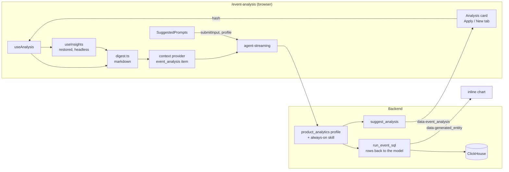

# Product analytics: Metabot insights

## Goal

Insights move out of the page and into Metabot. The page stays clean: the chart, plus a few suggested prompts below it. Clicking a prompt opens the Metabot sidebar. Metabot sees the deterministic insights for the current analysis, the page's settings and results, and a primer on the data. It answers with a short narrative, a chart or two, and next steps it can set up for the user.

Why this might work better than the insights panel ([insights.plan.md](insights.plan.md)):

- **The UI stays simple.** The search's complexity (pairs, "explained by", Benjamini–Hochberg, `(not set)`, as-of rules) is only read by Metabot.
- **Quality comes from judgment, not more statistics.** The panel had to show every significant association. Many of these were confounded ("Hit an error" goes with coming back, because active people hit more errors) or structural (identified people don't sign up again). Metabot can triage them with priors, skip the noise in a sentence, and check the interesting ones with a query the user can see.

This is a prototype for a demo. Code can be thrown away.

## Expected rates: drop them, keep the idea as a visible check

I agree with removing expected rates from the search:

- They're opaque. "89.9% vs 78.6% expected for people as active" asks the user to trust a stratification they can't see, and when the strata are wrong (missing tenure, or segments inside the activity measure) the answer flips with no way to tell.
- Funnels and bounces never used them. They condition on reaching a step or landing on a page, which already removes much of the confounding.
- Lifecycle and habit are where they mattered. Without them, those searches return raw associations, and the top of the list will be activity proxies ("Was active", "Created a report 3+", "Hit an error").

The idea behind them was sound, though: **compare like with like**. So it becomes one of Metabot's recipes, done in the open. When an association could just be "busier people do more of everything", Metabot buckets people by activity in the same period (active days, or events in powers of 2) and compares within buckets, with a chart. That's the expected-rate calculation, but only when it matters, and the user sees it.

Changes to the search:

- Lifecycle and habit populations drop the `expected` column (`hasExpected: false`). The search falls back to "vs. everyone else", which it already supports.
- Send Metabot more than the panel showed: the top 15 per question, not 5. Triage is its job now, and the activity proxies would otherwise crowd out the real effects.
- Say in the digest that these are raw associations, so Metabot doesn't read them as controlled.

Per the brief, Metabot shouldn't try to prove that "Hit an error" is really negative. It should skip it in a line ("errors track usage, not a reason to stay") and move on.

## How Metabot works today (what we reuse)

Summary of a survey of the code. File references are as of 1813f34.

- **The agent loop runs in the backend.** `POST /api/metabot/agent-streaming` (`src/metabase/metabot/api.clj`) streams AI-SDK server-sent events. A **profile** (`agent/profiles.clj`) picks the prompt template, tools and always-on skills. **Skills** are markdown in `resources/metabot/skills/`. Dialect notes, including `clickhouse.md`, preload when a viewing item has a `sql_engine`.
- **Pages give context** with `useRegisterMetabotContextProvider` (`frontend/src/metabase/metabot/context.tsx`). Items go in `user_is_viewing` and are rendered per type by `format-entity` (`agent/user_context.clj`) into the latest user message, not the system prompt. The context schema is **closed** (`metabot/context.clj`): a new item type or key needs a backend change.
- **Tools all run on the backend.** None is executed by the frontend.
- **Metabot can't see query results in the app today.** `create_sql_query` and `construct_notebook_query` validate a query and hand it to the frontend, which runs it to draw the chart. Only the MCP server and the Agent API run SQL and return rows, through `metabot/query_execution.clj` `execute-page!`.
- **Inline charts:** a `data-generated_entity` part with a card (`MetabotInlineChart.tsx`). The browser runs the query. The chart's title opens it in a new tab.
- **Modifying what you're looking at:** Metabot never edits a GUI question in place. It makes a new unsaved card and navigates to it, so Back returns to the original. Native SQL in the editor gets an accept/reject diff. **In the sidebar, every generated chart navigates away** (`state/actions.ts`, `data-generated_entity`), except on the full-page Metabot routes. We need to switch that off on `/event-analysis`.
- **Opening the panel from our UI:** `useMetabotAgent().submitInput(prompt, { profile })` opens the sidebar and sends the prompt with the registered context. `setPrompt` prefills without sending.
- **Local setup:** Metabot is OSS. Setting `MB_LLM_ANTHROPIC_API_KEY` (or configuring Admin → AI) is enough. The sidebar already mounts on `/event-analysis`. `MB_METABOT_DEBUG_LLM_REQUESTS=true` writes full requests to `logs/ai/requests/` and is useful for checking the prompt.

### What we get for free from our own page

The analysis state is sparse settings in the URL hash, and **every edit pushes a history entry** (`use-analysis-state.ts`). So:

- "Apply to this analysis" is a hash navigation, and **browser Back is undo**, the same way it is for Metabot in the query builder.
- "Open in new tab" is the same URL in a new tab, so the user keeps the old analysis open.

## Architecture



### Decisions

- **Insights stay on the client for now.** The hook already exists and runs both passes through `/api/dataset`. Its results go to Metabot as context with each message. One cost: Metabot only sees insights for the analysis on screen, not for an analysis it proposes. Moving the search to a backend tool fixes that (see [Phase 2](#phase-2-if-it-has-legs)).
- **A new viewing item type, `event_analysis`**, with `findings` (the markdown digest), `ctes`, `database_id` and `sql_engine: "clickhouse"`. This is about 20 lines in `context.clj` and `user_context.clj`, and it renders into the user message, so the system prompt stays cacheable. The other options were worse:
  - A native `adhoc` item works with no backend change, but tells the model "the user is in the SQL editor".
  - `addDeveloperMessage` stores the digest as part of the user's message, so it's visible in history, and it's only sent once.
- **A `product_analytics` profile**: the `:internal` tools, plus `run_event_sql` and `suggest_analysis`, with an always-on `product-analytics` skill. Any recipe or prompt changes happen in one markdown file. Skills are read when the namespace loads, so re-evaluate `metabase.metabot.skills` (or restart) after editing.
- **Metabot runs its own queries and sees the rows.** Without this it can only restate the digest. The data is ClickHouse, so this is native SQL. That matches how the page works today, and per the prototype's ground rules we skip native-query permission concerns.
- **Every chart Metabot shows, it has seen.** `run_event_sql` takes an optional `chart` argument. With it, the tool also emits the query as an inline chart. One tool, so the narrative and the chart can't disagree.
- **Metabot proposes; the user applies.** Metabot never changes the analysis on its own. `suggest_analysis` puts a card in the chat. "Apply" pushes a hash (Back undoes), and "Open in new tab" keeps the original.
- **No navigation away.** On `/event-analysis`, a `data-generated_entity` part only adds the inline chart: treat the route like full-page Metabot in `sendAgentRequest`.

### `run_event_sql`

```clojure
(mu/defn ^{:tool-name "run_event_sql" ...} run-event-sql
  "Run a ClickHouse query against the event data and return up to 200 rows. Start it with
   `FROM events_base` (or join it) to use the current analysis's events: its date range, filters
   and event flags are already applied. ..."
  [{:keys [sql chart]} :- [:map [:sql :string]
                              [:chart {:optional true} [:map [:title :string] [:display [:enum "bar" "line" "row" "table" "funnel"]]]]]]
  ...)
```

- **The CTE prelude.** The context item carries `ctes`, a list of `{name, sql, description}` in dependency order. The model sees only their names and descriptions, and the tool prepends all of them, merging with the model's own `WITH` if it has one. The model never copies a long CTE. The list is:
  - **`events_base`:** the analysis's events, with its date range, filters, people segments and `ev_n` event flags.
  - **The analysis's own CTEs,** from `buildSql`, like `funnel_levels`. Metabot builds on the analysis's logic (`windowFunnel`, periods, lookback) instead of recreating it.
  - **The insights population,** like `funnel_transitions`: one row per person per question, with `converted` and the attributes as of that moment. It's the most useful table for "break this down by anything".

  The descriptions come from the frontend, one line each, naming the key columns. ClickHouse inlines CTEs, so unused ones cost nothing.
- **The digest says which flag is which event:** "`ev_1` = Viewed pricing (step 1)". That's how Metabot writes "people who did step 1 but not step 2".
- **Execution:** `query-execution/execute-page!` with a native query on `database_id`, 200 rows. Return the rows as a compact table, and say when the result was truncated.
- **The chart:** the same full SQL (prelude included) as a `viz-part` card with `display`. The browser re-runs it, and the RTK cache won't help, but the query is small.
- Add it to `state-dependent-tools` so it can read memory.

### `suggest_analysis` and the analysis card

Metabot can't write stored settings directly: events and filters are MBQL queries, encoded in the hash. So the tool takes a small, typed vocabulary of changes, and the **frontend** turns it into settings with Lib, where the table metadata already is.

```ts
type SuggestedAnalysis = {
  title: string; // "Pricing → Signed up, anonymous visitors only"
  why: string; // one line, shown on the card
  kind?: AnalysisKind; // default: the current one
  changes: Array<
    | { type: "filter"; column: string; operator: "=" | "!=" | "is-empty" | "not-empty"; values?: string[] }
    | { type: "step-filter"; step: number; column: string; operator: ...; values?: string[] }
    | { type: "breakout"; column: string | null }
    | { type: "steps"; segments: string[] } // saved segment names
    | { type: "date_range"; value: string } // "past30days"
    | { type: "counting"; value: "person" | "session" | "event" }
    | { type: "funnel.window"; value: Duration }
  >;
};
```

- **The backend tool** validates the shape and emits a new `data-event_analysis` part. No query runs.
- **The frontend** gets a new part type in `ai-streaming/schemas.ts` and an `EventAnalysisSuggestion` card in `MetabotAgentDataPart.tsx`. The card shows the title, the why, and the changes in words, with two buttons:
  - **Apply:** `onChangeSettings` on the page. Back undoes it.
  - **Open in new tab:** the URL with the encoded settings.

  The card needs the page's state. Either expose it through a small context the workspace provides, or have the card build only the URL and read the current hash from `location`.
- **Column names** are the event table's column names, which the digest lists. Unknown names show the card disabled, with the reason.

This is what makes the "Viewed pricing → Signed up" fix concrete: Metabot spots that identified people convert at 0%, explains why, and offers "only count pricing views by anonymous visitors" as a `step-filter` on `person__identified`.

### The digest

`insights/digest.ts` builds plain markdown, and Metabot's context item carries it as `findings`. Keep it short and factual:

```md
# Funnel analysis on Events (pa_events_resolved)
Counting people · Past 90 days · Window 7 days · Strict order · Filters: none · Breakout: none
Steps: 1. Viewed pricing (ev_1) → 2. Started trial (ev_2) → 3. Purchased (ev_3)

## Result
| step | people | conversion from previous |
| Viewed pricing | 9,842 | |
| Started trial | 1,811 | 18.4% |
| Purchased | 188 | 10.4% |

## Insights (raw associations, not controlled for anything)
Compared each group with everyone else at the same transition. Attribute values are as of
reaching the transition's first step. "(not set)" means no value yet, e.g. anonymous.
Attributes checked: browser, os, device, country, utm_source, utm_medium, utm_campaign,
referrer_domain, trial_source, person__identified, person_role, person_company, ...

### Viewed pricing → Started trial (9,842 people, 18.4%)
1. Person is anonymous: 22.1% vs 0.4% · 7,920 people · +1,410 conversions · p<0.001
2. Browser is Firefox and OS is Android: 4.9% vs 18.7% · 210 people · −28 · p<0.001
...
### Started trial → Purchased (1,811 people, 10.4%)
1. OS is iOS: 5.3% vs 11.6% · 420 people · −26 · p<0.001
...
Nothing else stood out among 14 attributes.
```

- Reuse `describe.ts` and `outcomes.ts` for the wording, so the numbers match what the panel would have said.
- Include the result rows (capped at about 50) so Metabot can talk about the chart without querying.
- Include the saved segments on the table by name (they're the vocabulary for `steps`).
- **Wait for insights.** The chips show a loading state until both passes are done, and the first chip comes from the top insight. So the digest is always complete when it's sent, and there's no "insights arrived later" case to handle. Insights run on page load. That's fine for the demo; whether it's worth the queries in production is an open question.

## Suggested prompts

Three chips below `AnalysisResult`: two about this kind of analysis and one generic. They show a loading state, and can't be clicked, until the result and both insight passes are done.

- **The first chip comes from the top insight when there is one.** For example, "Why do people on iOS purchase less often?", built from the same template as the insight's title. It hints at what Metabot found without putting insights on the page. Without an insight, it uses the static fallback.
- **The second is static,** per kind.
- **The third is generic:** "What stands out here?". "Tell me more" reads oddly as a first message.

| Analysis | Static | Fallback for the first |
|---|---|---|
| Funnel | "Are people converting in one visit?" | "Where do people drop off, and who?" |
| Paths | "Tell me about bounce rate" | "Where do people go after landing?" |
| Habit | "What do regulars do differently?" | "How sticky is the product?" |
| Lifecycle | "What brings people back?" | "Why do people go quiet?" |
| Cohorts | "Is retention getting better?" | "Which cohorts retain best?" |

The chip sends its text as the user's message with `submitInput(text, { profile: "product_analytics" })`. Follow-up questions typed in the sidebar use the same profile while the page is open; set it on the agent for this route rather than per call.

## The skill: what Metabot knows and how it works

This is the part to iterate on most. It's a skill body, not code: [`resources/metabot/skills/product-analytics.md`](../../../resources/metabot/skills/product-analytics.md), always on for the `product_analytics` profile. It has four parts:

- **How to answer:** lead with the number, two or three findings, a chart for the main one, skipped items in a line, and next steps as `suggest_analysis` cards.
- **Triage:** before digging, sort insights into definitional (fix the analysis), activity proxies (skip in a line), **behaviors worth building on** (invites, integrations, setup: the classic "aha" or viral-loop candidates, which deserve the most care), who people are or where they came from, and small.
- **Recipes:** who can convert, compare like with like, broken beats behavioral, combinations, one visit or several, where they go instead, dig into a flagged behavior, look at a few people, and is it the data.
- **The data and querying:** as-of traits, sparse properties, current traits only for current-state questions, and the CTEs it can build on.

Recipes are framed as things worth considering, not steps to follow.

Not in the skill on purpose:

- **"The data is generated."** Metabot should treat it like real data. Otherwise it explains every pattern as an artifact of the generator. It will still find the generator's quirks: role tracks persona, and UTM tags thin out before pricing. The demo should avoid lifecycle by role.
- **Statistics.** The search already applied a minimum size and Benjamini–Hochberg. Metabot shouldn't recompute p-values, just respect group sizes.

## Phases

### Phase 0: setup (about 15 minutes)

- AI is configured in the running app. Check that the sidebar opens on `/event-analysis`.
- Regenerate the data (it's relative to today), re-sync, and check the README's segments exist.
- Give `integration_connected` an `integration` property (`slack`, `github`, `salesforce`, `zapier`), and plant one that's worth more, e.g. `slack` gets twice the activity boost. Promote it in `04_pa_events_resolved.sql` like `trial_source`. This gives the "dig into a flagged event" recipe something to find.

### Phase 1: the demo POC

In order of value, so stopping early still leaves something to show. Backend (b, d) and frontend (a, c, e) can run in parallel.

1. **Insights, headless.**
   - Restore `insights/` and `sql/analyses/{insights,funnel-insights,bounce-insights,lifecycle-insights,habit-insights,event-activity}.ts` from `0abafe5de78^`. Fix them up against the breakouts commit, since `funnel.ts` changed.
   - Leave out the panel, explore and supporting code.
   - Lifecycle and habit lose `expected`.
   - Call `useInsights` from `AnalysisWorkspace`. Funnel and bounces are the priority; lifecycle and habit if they come along cheaply.
2. **Context and profile** (backend).
   - The `event_analysis` item type and its `format-entity`.
   - The `product_analytics` profile with the `:internal` tools.
   - The skill above.
   - The profile id in `METABOT_PROFILES`.
3. **The page.**
   - `insights/digest.ts`, and the CTE list with descriptions.
   - A context provider in `AnalysisWorkspace` that registers the `event_analysis` item.
   - `SuggestedPrompts` below `AnalysisResult`.
   - No navigation away on `/event-analysis`.

   **Checkpoint:** Metabot can explain the funnel and its insights in words.
4. **`run_event_sql` with charts.** The CTE prelude, and the rows going back to the model. **Checkpoint:** Metabot checks its claims and shows charts. This is the minimum for the demo to feel different from the panel.
5. **`suggest_analysis` and the card.** Apply and Open in new tab. Start with `filter`, `step-filter` and `breakout`, then add more.

**Demo script** (funnel: Viewed pricing → Started trial → Purchased, default range):

- Chip "Why do people on iOS purchase less often?" Metabot gives the headline and a chart of purchase rate by OS. It checks whether the gap is at trial start too (it isn't), and calls it a likely checkout problem on iOS. It mentions Safari only as part of iOS.
- Chip "What stands out here?" Metabot covers:
  - **Anonymous visitors at pricing → trial.** This is structural: identified people almost never start a trial. It suggests the fixed funnel, and the card is opened in a new tab.
  - **`trial_source = sales_email`** converts better.
  - **Admins** convert better.
  - **Android + Firefox** (if it's in range).
- Typed: "Are people converting in one visit?" Metabot runs a same-session check and the referrer of the converting session.
- Switch to lifecycle, chip "What brings people back?" Metabot skips errors and "Was active" in a line, flags "Sent an invite" and "Connected an integration", and compares within activity tiers for one of them.

**Checks:** no unit tests beyond what the restored files already have. Try the script a few times, and adjust the skill when Metabot gets something wrong. `MB_METABOT_DEBUG_LLM_REQUESTS=true` shows exactly what it saw.

### Phase 2: if it has legs

- **Insights as a backend tool:** `find_insights(analysis)`. Metabot can then search any population it builds: "among anonymous visitors only, what's different about who starts a trial?" This is the biggest quality step. It means moving the search (pure TypeScript) to the backend or running it in the tool through the same SQL.
- **An eval set** from `ground-truth.json`. Each planted effect, plus the leakage and decoy cases, becomes a prompt with an expected verdict ("finds iOS, calls it checkout-specific, doesn't mention plan"). Run it after every skill change.
- **More analysis kinds in `suggest_analysis`:** switching kind, steps from event filters (not only segments), people segments.
- **Cohorts** get insights or a cohort-specific digest (the first cohort's inflated size, curves flattening).
- **Conversation per analysis:** reopen the sidebar on the same conversation for the same saved analysis.
- **Dynamic prompts tuned per kind,** and maybe a prompt that comes from the chart: clicking a funnel bar → "Ask Metabot about people who dropped here".

### Phase 3: toward production

- Analyses become MBQL ([post-prototype.md](post-prototype.md)). Metabot then edits the analysis spec, not SQL, like Mitzu's agent. `suggest_analysis` grows into the spec's real schema, and `run_event_sql` becomes a structured query tool with normal permissions.
- The insights search runs on the backend, cached with the analysis's results.
- The skill and profile are reviewed like product copy, since they're the feature.

## Implementation notes

Built as planned, except where noted here.

- **Backend:** `src/metabase/metabot/tools/event_analysis.clj` (both tools and the CTE prelude), the `:product_analytics` profile in `agent/profiles.clj`, a slim prompt in `resources/metabot/prompts/system/product_analytics.selmer` (`internal.selmer` is mostly about building queries), and the `event_analysis` item in `context.clj` and `user_context.clj`. EE usage logging only accepts known profile ids, so `metabase_enterprise/metabot/usage.clj` lists the new one.
- **Reloading** without a restart: `(metabase.metabot.skills/load-skills!)` after editing the skill, and `(metabase.metabot.agent.prompts/clear-cache!)` after editing the template.
- **Frontend:** `product-analytics/metabot/` has the hook (`use-analysis-metabot.ts`), the digest, the prompts and the suggestion converter. `components/SuggestedPrompts.tsx` renders the chips. The insights code is restored from `0abafe5de78^` without the panel or explore charts.
- **The CTE list** is the analysis's own CTEs plus the insights population, over the insights base, which has the attribute columns as `attr_N`. The digest's "Attributes compared" line maps each `attr_N` to its column. Without insights (cohorts), it's the analysis's own CTEs.
- **Suggestion cards reach the page through a DOM event.** The chat sidebar is in another React tree and a shared module, which can't import a feature. Its card dispatches `METABOT_EVENT_ANALYSIS_SUGGESTION_EVENT` (in `metabase-types/api/metabot.ts`), and the page listens. The buttons are disabled off `/event-analysis`.
- **Apply navigates** to the new hash, like Open in new tab builds its URL, so Back undoes it. It doesn't go through the page's settings callback, which is typed per kind while a suggestion's changes span kinds. Following changes (`getFollowingChanges`) don't run.
- **Breakouts** are by the users table's columns when one is linked, which is how the page's breakout works. The digest says so, and suggests filtering by event columns instead.
- **No navigation away:** `sendAgentRequest` skips navigating to a generated chart on `/event-analysis`, by path.
- **The profile** is set as the conversation's override while the page is open, so typed follow-ups use it too. Conversations with it don't show in the sidebar's history, which only lists the default and NLQ profiles.
- **Expected rates are off:** lifecycle and habit populations end before the expected-outcome CTE. `check-insights.ts` now fails its expected-rate checks (the explore query's expected column, and "Hit an error" showing up), by design. The funnel checks all pass on the regenerated data.
- **Generator:** `integration_connected` has an `integration` property (Slack 35%, GitHub 25%, Salesforce 20%, Zapier 20%). How much it raises the daily chance of being active depends on which one: 0.30 for Slack, 0.10 for GitHub and Salesforce, and 0.05 for Zapier (it was 0.15 for all). It's promoted to a column in `04_pa_events_resolved.sql`.

## Open questions

- **Should the chips run Metabot on page load?** Answers would be instant, but every analysis view would cost tokens. Not for the prototype.
- **How much of the digest should Metabot trust?** The search's "explained by" rule sometimes removes real effects ("Known issue: chains of explanations" in [insights.plan.md](insights.plan.md)). Sending removed insights too, marked "explained by X", would let Metabot overrule the rule, at the cost of a longer digest.
- **Showing Metabot's checks.** Every claim backed by a chart is easy to trust but slow to read. Collapsing charts behind "Show check" may be the right balance.
