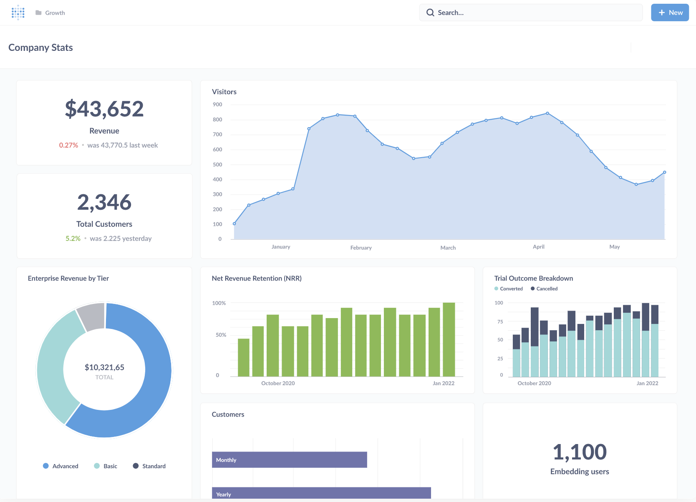

# Metabase documentation

Metabase is an open-source business intelligence platform. You can use Metabase to ask questions about your data, or embed Metabase in your app to let your customers explore their data on their own.

## First steps

### Metabase Cloud

The easiest way to get started with Metabase is to sign up for a free trial of [Metabase Cloud](https://store.metabase.com/checkout). You get support, backups, upgrades, an SMTP server, SSL certificate, SoC2 Type 2 security auditing, and more (plus your money goes toward improving Metabase). Check out our quick overview of [cloud vs self-hosting](https://www.metabase.com/docs/latest/cloud/cloud-vs-self-hosting). If you need to, you can always switch to [self-hosting](./installation-and-operation/installing-metabase.md) Metabase at any time (or vice versa).

### [Installing Metabase](./installation-and-operation/installing-metabase.md)

Run as a JAR, using Docker, or on [Metabase Cloud](https://store.metabase.com/checkout).

### [Setting up Metabase](./configuring-metabase/setting-up-metabase.md)

Once installed, set up your Metabase and connect to your data.

### [Getting started](https://www.metabase.com/learn/metabase-basics/getting-started)

With your data connected, get started asking questions, creating dashboards, and sharing your work.

### [A tour of Metabase](https://www.metabase.com/learn/metabase-basics/overview/tour-of-metabase)

Metabase is a deep product with a lot of tools to simplify business intelligence, from embeddable charts and interactive dashboards, to GUI and SQL editors, to auditing and row and column security, and more.

## Documentation topics

Metabase's reference documentation, organized the same way as the docs navigation.

### Analytics

- [Getting started](https://www.metabase.com/learn/metabase-basics/getting-started)
- [Metabase concepts](https://www.metabase.com/learn/metabase-basics/overview/concepts)

#### Queries and charts

- [Queries and charts overview](./questions/start.md)
- [Introduction to questions](./questions/introduction.md)
- Query builder
  - [The query editor](./questions/query-builder/editor.md)
  - [Filtering](./questions/query-builder/filters.md)
  - [Summarizing and grouping](./questions/query-builder/summarizing-and-grouping.md)
  - [Joining data](./questions/query-builder/join.md)
  - [Custom expressions](./questions/query-builder/expressions.md)
  - [List of expressions](./questions/query-builder/expressions-list.md)
- SQL and native queries
  - [The SQL editor](./questions/native-editor/writing-sql.md)
  - [SQL parameters](./questions/native-editor/sql-parameters.md)
  - [Field filters](./questions/native-editor/field-filters.md)
  - [Basic SQL parameters](./questions/native-editor/basic-sql-parameters.md)
  - [Time grouping parameters](./questions/native-editor/time-grouping-parameters.md)
  - [Table variables](./questions/native-editor/table-variables.md)
  - [Optional variables](./questions/native-editor/optional-variables.md)
  - [Filter widgets](./questions/native-editor/filter-widgets.md)
  - [Referencing models and saved questions](./questions/native-editor/referencing-saved-questions-in-queries.md)
  - [Snippets](./questions/native-editor/snippets.md)
  - [Snippet folder permissions](./permissions/snippets.md)
- Visualizations
  - [Visualizing data](./questions/visualizations/visualizing-results.md)
  - [Box plots](./questions/visualizations/box-plot.md)
  - [Detail](./questions/visualizations/detail.md)
  - [Funnel charts](./questions/visualizations/funnel.md)
  - [Gauge charts](./questions/visualizations/gauge.md)
  - [Line, bar, and area charts](./questions/visualizations/line-bar-and-area-charts.md)
  - [Combo charts](./questions/visualizations/line-bar-and-area-charts.md#combo-charts)
  - [Maps](./questions/visualizations/map.md)
  - [Numbers](./questions/visualizations/numbers.md)
  - [Pie and sunburst charts](./questions/visualizations/pie-or-donut-chart.md)
  - [Pivot tables](./questions/visualizations/pivot-table.md)
  - [Progress bar](./questions/visualizations/progress-bar.md)
  - [Sankey chart](./questions/visualizations/sankey.md)
  - [Scatterplot or bubble chart](./questions/visualizations/scatterplot-or-bubble-chart.md)
  - [Table](./questions/visualizations/table.md)
  - [Treemap](./questions/visualizations/treemap.md)
  - [Trend](./questions/visualizations/trend.md)
  - [Waterfall chart](./questions/visualizations/waterfall-chart.md)
  - [Tooltips](./questions/visualizations/tooltips.md)
  - [Custom visualizations](./questions/visualizations/custom.md)
  - [Drill-through](./questions/visualizations/drill-through.md)
- [Metrics explorer](./questions/metrics-explorer.md)
- [Alerts](./questions/alerts.md)
- [Exporting data](./questions/exporting-results.md)

#### Dashboards

- [Dashboards overview](./dashboards/start.md)
- [Introduction to dashboards](./dashboards/introduction.md)
- [Dashboard heading and text cards](./dashboards/dashboard-markdown.md)
- [Format text with Markdown](./dashboards/markdown.md)
- [Dashboard filters](./dashboards/filters.md)
- [Linked filters](./dashboards/linked-filters.md)
- [Interactive dashboards](./dashboards/interactive.md)
- [Charts with multiple series](./dashboards/multiple-series.md)
- [Dashboard subscriptions](./dashboards/subscriptions.md)
- [Actions on dashboards](./dashboards/actions.md)

#### Data apps

- [Data apps overview](./data-apps/start.md)
- [Build a data app](./data-apps/build.md)
- [Manage data apps](./data-apps/manage.md)

#### Documents

- [Documents overview](./documents/start.md)
- [Introduction to documents](./documents/introduction.md)

#### AI

- [AI overview](./ai/start.md)
- [Introduction to AI in Metabase](./ai/overview.md)
- [Metabot](./ai/metabot.md)
- [Research](./ai/research.md)
- [Metabot in Slack](./ai/metabot-slack.md)
- [AI settings](./ai/settings.md)
- [Supported AI providers](./ai/providers.md)
- [MCP server](./ai/mcp.md)
- [MCP server tools](./ai/mcp-tools.md)
- [Agent API](./ai/agent-api.md)
- [Agent-driven development](./ai/agent-driven-development.md)
- [AI customization](./ai/customization.md)
- [AI system prompts](./ai/system-prompts.md)
- [AI usage auditing](./ai/usage-auditing.md)
- [AI usage controls](./ai/usage-controls.md)
- [AI privacy](./ai/privacy.md)

#### Organization

- [Organization overview](./exploration-and-organization/start.md)
- [Basic exploration](./exploration-and-organization/exploration.md)
- [Keyboard shortcuts](./exploration-and-organization/keyboard-shortcuts.md)
- [Collections](./exploration-and-organization/collections.md)
- [Data reference](./exploration-and-organization/data-model-reference.md)
- [Events and timelines](./exploration-and-organization/events-and-timelines.md)
- [X-rays](./exploration-and-organization/x-rays.md)
- [Content verification](./exploration-and-organization/content-verification.md)
- [History](./exploration-and-organization/history.md)
- [Delete and restore](./exploration-and-organization/delete-and-restore.md)

### Data modeling

- [Data modeling overview](./data-modeling/start.md)
- [Data studio](./data-modeling/data-studio.md)

#### Transforms

- [Transforms overview](./data-modeling/transforms/transforms-overview.md)
- [Query transforms](./data-modeling/transforms/query.md)
- [Python transforms](./data-modeling/transforms/python.md)
- [Python runner](./data-modeling/transforms/python-runner.md)
- [Jobs and runs](./data-modeling/transforms/jobs-and-runs.md)
- [Transform inspector](./data-modeling/transforms/inspector.md)
- [Transform add-ons](./data-modeling/transforms/addons.md)

#### Metadata

- [Managing tables](./data-modeling/metadata/managing-tables.md)
- [Table metadata settings](./data-modeling/metadata/metadata-editing.md)
- [Data and semantic types](./data-modeling/metadata/semantic-types.md)
- [Formatting defaults](./data-modeling/metadata/formatting.md)
- [Working with JSON](./data-modeling/metadata/json-unfolding.md)

#### Semantic layer

- [Library](./data-modeling/semantic-layer/library.md)
- [Published tables](./data-modeling/semantic-layer/published-tables.md)
- [Metrics](./data-modeling/semantic-layer/metrics.md)
- [Measures](./data-modeling/semantic-layer/measures.md)
- [Segments](./data-modeling/semantic-layer/segments.md)
- [Glossary](./data-modeling/semantic-layer/glossary.md)
- [Remote sync](./data-modeling/semantic-layer/remote-sync.md)

#### Data modeling tools

- [Schema viewer](./data-modeling/tools/schema-viewer.md)
- [Dependency graph](./data-modeling/tools/graph.md)
- [Replace data sources](./data-modeling/tools/replace-data-sources.md)

#### Data editing

- [Data actions](./data-modeling/data-actions.md)
- [Editable tables](./data-modeling/editable-tables.md)

#### Models

- [Models](./data-modeling/models/models.md)
- [Model persistence](./data-modeling/models/model-persistence.md)
- Actions
  - [Actions overview](./data-modeling/models/actions/start.md)
  - [Introduction to actions](./data-modeling/models/actions/introduction.md)
  - [Basic actions](./data-modeling/models/actions/basic.md)
  - [Custom actions](./data-modeling/models/actions/custom.md)

### Embedding

- [Embedding overview](./embedding/start.md)
- [Embedding introduction](./embedding/introduction.md)

#### Modular embedding

- [Modular embedding overview](./embedding/modular-embedding.md)
- [Components](./embedding/components.md)
  - [Dashboard](./embedding/dashboard.md)
  - [Dashboard reference](./embedding/dashboard-reference.md)
  - [Chart](./embedding/chart.md)
  - [Query builder](./embedding/query-builder.md)
  - [Question reference](./embedding/question-reference.md)
  - [Collection browser](./embedding/browser.md)
  - [Browser reference](./embedding/browser-reference.md)
  - [AI chat](./embedding/ai-chat.md)
- [Filters and parameters](./embedding/parameters.md)
- [Parameters reference](./embedding/parameters-reference.md)
- [Config](./embedding/config.md)
- [Config reference](./embedding/config-reference.md)
- [Appearance](./embedding/appearance.md)
- [Custom visualizations](./embedding/custom-visualizations.md)
- [Authentication](./embedding/authentication.md)
- [Tenants](./embedding/tenants.md)
- Modular embedding SDK
  - [SDK overview](./embedding/sdk/introduction.md)
  - [Quickstarts](./embedding/sdk/introduction.md#quickstarts)
  - [Plugins](./embedding/sdk/plugins.md)
  - [Actions](./embedding/sdk/actions.md)
  - [Loading and error states](./embedding/sdk/loading-and-errors.md)
  - [Working with Next.js](./embedding/sdk/next-js.md)
  - [Versioning](./embedding/sdk/version.md)
  - [Upgrading](./embedding/sdk/upgrade.md)
  - [SDK API reference](./embedding/sdk/api/index.html)
- [Guest embedding](./embedding/guest-embedding.md)
- [Translate embeds](./embedding/translations.md)

#### Full app embedding

- [Full app embedding overview](./embedding/full-app-embedding.md)
- [Full app embedding quickstart](./embedding/full-app-embedding-quick-start-guide.md)
- [Full app UI components](./embedding/full-app-ui-components.md)

#### More embedding topics

- [Public links and embeds](./embedding/public-links.md)
- [Securing embeds](./embedding/securing-embeds.md)
- [AI agent resources](./embedding/ai-agent-resources.md)

### Administration

#### Installation

- [Installation overview](./installation-and-operation/start.md)
- Installing Metabase
  - [Installing Metabase](./installation-and-operation/installing-metabase.md)
  - [Metabase Cloud](https://www.metabase.com/docs/latest/cloud/start)
  - [Running the JAR file](./installation-and-operation/running-the-metabase-jar-file.md)
  - [Running in Docker](./installation-and-operation/running-metabase-on-docker.md)
  - [Other installation options](./installation-and-operation/installing-metabase.md#other-installation-options)
- [Upgrading Metabase](./installation-and-operation/upgrading-metabase.md)
- [Configuring the Metabase application database](./installation-and-operation/configuring-application-database.md)
- [Activating Enterprise features](./installation-and-operation/activating-the-enterprise-edition.md)
- [Migrating to a production application database](./installation-and-operation/migrating-from-h2.md)

#### Data sources

- [Databases overview](./databases/start.md)
- [Adding and managing databases](./databases/connecting.md)
- [Database users, roles, and privileges](./databases/users-roles-privileges.md)
- [Writable connection](./databases/writable-connection.md)
- [Syncing and scanning databases](./databases/sync-scan.md)
- [Encrypting your database connection](./databases/encrypting-details-at-rest.md)
- [SSH tunneling](./databases/ssh-tunnel.md)
- [SSL certificate](./databases/ssl-certificates.md)
- [Setting up data uploads](./databases/uploads.md)
- [Uploading data](./exploration-and-organization/uploads.md)
- [Metabase Cloud Storage](https://www.metabase.com/docs/latest/cloud/storage)
- [Sync Google Sheets](https://www.metabase.com/docs/latest/cloud/google-sheets)

#### Configuration

- [Configuration overview](./configuring-metabase/start.md)
- [Setting up Metabase](./configuring-metabase/setting-up-metabase.md)
- [General settings](./configuring-metabase/settings.md)
- [Allow iframes and images from other domains](./configuring-metabase/domains.md)
- [Email](./configuring-metabase/email.md)
- [Slack](./configuring-metabase/slack.md)
- [Webhooks](./configuring-metabase/webhooks.md)
- [Environment variables](./configuring-metabase/environment-variables.md)
- [Configuration file](./configuring-metabase/config-file.md)
- [Config file template](./configuring-metabase/config-template.md)
- [Metabase log configuration](./monitor/application-logs.md)
- [Timezones](./configuring-metabase/timezones.md)
- [Languages and localization](./configuring-metabase/localization.md)
- [Appearance](./configuring-metabase/appearance.md)
- [Fonts](./configuring-metabase/fonts.md)
- [Caching query results](./configuring-metabase/caching.md)
- [Custom maps](./configuring-metabase/custom-maps.md)
- [Customizing the Metabase Jetty webserver](./configuring-metabase/customizing-jetty-webserver.md)

#### Operations and monitoring

- [Backing up Metabase](./installation-and-operation/backing-up-metabase-application-data.md)
- [Development instances](./installation-and-operation/development-instance.md)
- [Monitoring your Metabase](./monitor/start.md)
- [Dependency diagnostics](./monitor/dependency-diagnostics.md)
- [Content diagnostics](./monitor/content-diagnostics.md)
- [Observability with Prometheus](./installation-and-operation/observability-with-prometheus.md)
- [Serialization](./installation-and-operation/serialization.md)
- [Metabase JAR commands](./installation-and-operation/commands.md)
- [Metabase CLI](./installation-and-operation/metabase-cli.md)
- [Tools overview](./usage-and-performance-tools/start.md)
- [Usage analytics](./usage-and-performance-tools/usage-analytics.md)
- [API key usage](./monitor/api-key-usage.md)
- [CLI analytics](./monitor/cli-analytics.md)
- [Data app analytics](./monitor/data-app-analytics.md)
- Admin tools
  - [Erroring questions](./monitor/erroring-questions.md)
  - [Alerts management](./monitor/alerts-management.md)
  - [Background tasks](./monitor/background-tasks.md)
  - [Scheduled jobs](./monitor/scheduled-jobs.md)
  - [Application logs](./monitor/application-logs.md)
  - [Model persistence log](./monitor/model-persistence-log.md)

#### Authentication

- [People overview](./people-and-groups/start.md)
- [Account settings](./people-and-groups/account-settings.md)
- [Password complexity](./people-and-groups/changing-password-complexity.md)
- [Session expiration](./people-and-groups/changing-session-expiration.md)
- [Two-factor authentication](./people-and-groups/two-factor-authentication.md)
- [Google Sign-In](./people-and-groups/google-sign-in.md)
- [LDAP](./people-and-groups/ldap.md)
- [User provisioning with SCIM](./people-and-groups/user-provisioning.md)
- [API keys](./people-and-groups/api-keys.md)
- Paid SSO options
  - [JWT-based authentication](./people-and-groups/authenticating-with-jwt.md)
  - [SAML-based authentication](./people-and-groups/authenticating-with-saml.md)
  - [SAML with Auth0](./people-and-groups/saml-auth0.md)
  - [SAML with Microsoft Entra ID](./people-and-groups/saml-azure.md)
  - [SAML with Google](./people-and-groups/saml-google.md)
  - [SAML with Keycloak](./people-and-groups/saml-keycloak.md)
  - [SAML with Okta](./people-and-groups/saml-okta.md)
  - [OIDC-based authentication](./people-and-groups/authenticating-with-oidc.md)
  - [OIDC with Keycloak](./people-and-groups/oidc-keycloak.md)

#### Permissions

- [Permissions overview](./permissions/start.md)
- [Permissions introduction](./permissions/introduction.md)
- [Managing people and groups](./people-and-groups/managing.md)
- [Data permissions](./permissions/data.md)
- [Data isolation methods](./permissions/data-isolation-methods.md)
- [Collection permissions](./permissions/collections.md)
- [Application permissions](./permissions/application.md)
- [Row and column security](./permissions/row-and-column-security.md)
- [Row and column security examples](./permissions/row-and-column-security-examples.md)
- [Database routing](./permissions/database-routing.md)
- [Connection impersonation](./permissions/impersonation.md)
- [Snippets folder permissions](./permissions/snippets.md)
- [Notification permissions](./permissions/notifications.md)
- [Configuring permissions for embedding](./permissions/embedding.md)

#### Security

- [Security best practices for self-hosting](./installation-and-operation/security-best-practices-self-hosting.md)
- [Security center](./installation-and-operation/security-center.md)

### Other resources

#### Metabase API

- [Metabase API documentation](./api.html)
- [API tutorial](https://www.metabase.com/learn/metabase-basics/administration/administration-and-operation/metabase-api)

#### Metabase Cloud

- [Documentation for Metabase Cloud and Store](https://www.metabase.com/docs/latest/cloud/start)
- [Cloud vs self-hosted](https://www.metabase.com/docs/latest/cloud/cloud-vs-self-hosting)
- [Custom domain](https://www.metabase.com/docs/latest/cloud/custom-domain)
- [Cloud limitations](https://www.metabase.com/docs/latest/cloud/limitations)
- [Change region](https://www.metabase.com/docs/latest/cloud/change-region)
- [Metabase IP addresses](https://www.metabase.com/docs/latest/cloud/ip-addresses-to-whitelist)
- [IP allowlist](https://www.metabase.com/docs/latest/cloud/ip-allowlist)
- [Migrate from self-hosted to Cloud](https://www.metabase.com/docs/latest/cloud/migrate/guide)
- [Migrate from Cloud to self-hosted](https://www.metabase.com/docs/latest/cloud/migrate/cloud-to-self-hosted)
- [Migrate from Heroku](https://www.metabase.com/docs/latest/cloud/migrate/heroku)

#### Billing

- [How billing works](https://www.metabase.com/how-billing-works)
- [Accounts and billing](https://www.metabase.com/docs/latest/cloud/accounts-and-billing)

#### More resources

- [Troubleshooting guides](./troubleshooting-guide/index.md)
- [Developer guide](./developers-guide/start.md)
- [Pro and Enterprise features](https://www.metabase.com/paid-features)
- [Accessibility](./installation-and-operation/accessibility.md)
- [Supported browsers](./installation-and-operation/supported-browsers.md)
- [Privacy](./installation-and-operation/privacy.md)
- [About the anonymous usage data we collect](./installation-and-operation/information-collection.md)

## Getting help

### Troubleshooting

- [Troubleshooting guides](troubleshooting-guide/index.md)
- [Metabase forum](https://discourse.metabase.com/)
- [Application logs](./monitor/application-logs.md)

### Tutorials and guides

[Learn Metabase](https://www.metabase.com/learn) has a ton of articles on how to use Metabase, data best practices, and more.

## More resources

### [Discussion](https://discourse.metabase.com)

Share and connect with other Metabasers.

### [Community stories](https://www.metabase.com/community)

Practical advice from our community.

### [Metabase blog](https://www.metabase.com/blog)

News, updates, and ideas.

### [Customers](https://www.metabase.com/case-studies)

Real companies, real data, real stories.

### [Metabase Twitter](https://twitter.com/metabase)

We tweet stuff.

### [Source code repository on GitHub](https://github.com/metabase/metabase)

Follow us on GitHub.

### [List of releases](https://github.com/metabase/metabase/releases)

A list of all Metabase releases, including both the Enterprise Edition and the Open Source Edition.

### [Developers guide](./developers-guide/start.md)

Contribute to the Metabase open source project!

### [Data and Business Intelligence Glossary](https://www.metabase.com/glossary)

Data jargon explained.

### [Metabase Experts](https://www.metabase.com/partners)

If you’d like more technical resources to set up your data stack with Metabase, connect with a [Metabase Expert](https://www.metabase.com/partners).

<!-- bump 2 -->
