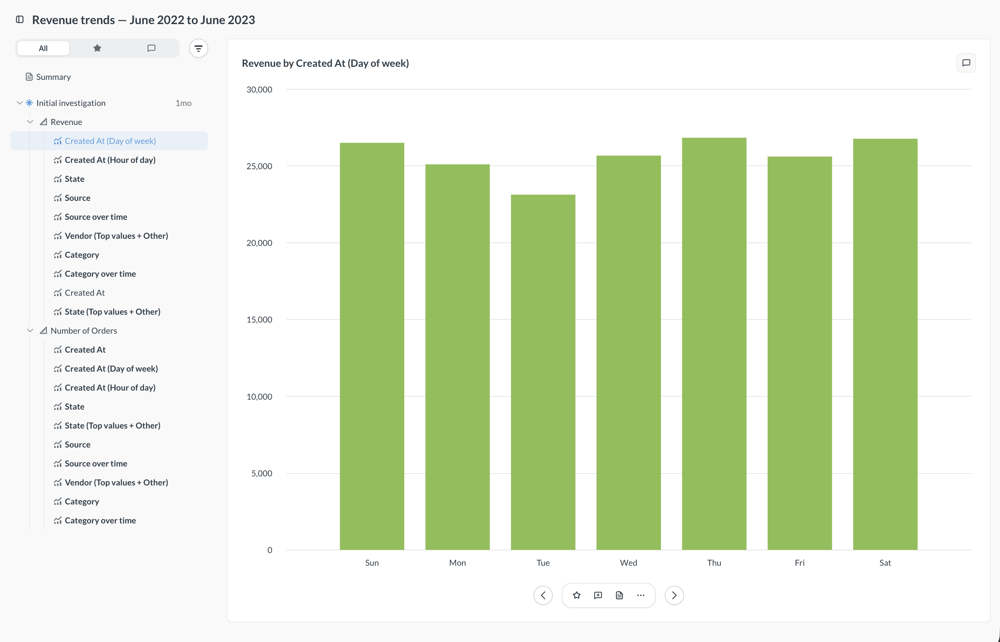
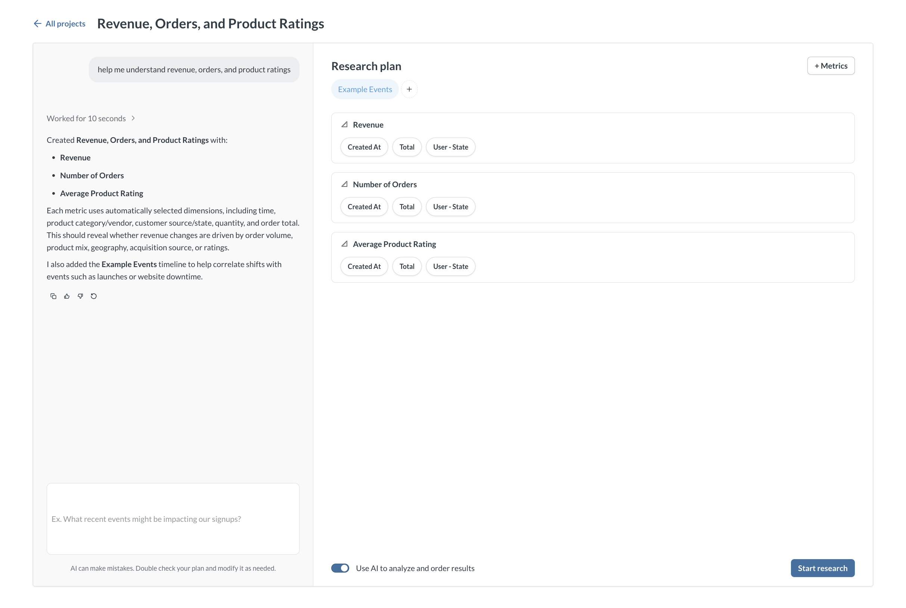
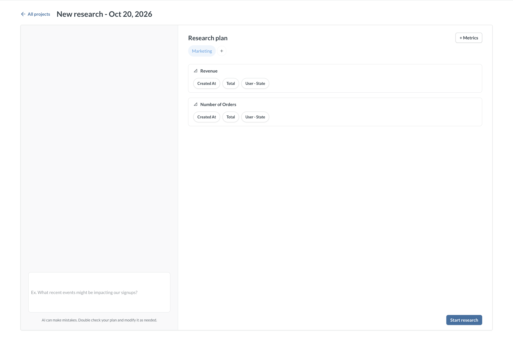

# Research

Use Research to ask broad questions about your data without building charts one at a time. Research is available from the [AI exploration](./metabot.md) page. Describe what you want to investigate, and Metabase creates a bunch of charts, scores them for interestingness, and presents them in a single grouped view. Metabase saves each Research as its own entity, like a question or dashboard, so you can move the Research to a collection and share it.

Research requires an [AI provider](./settings.md). It also requires at least one [metric](../data-modeling/semantic-layer/metrics.md), because Research builds its charts by breaking out your metrics by their dimensions. More metrics give Research more to work with. If an admin turns on [**Disable all AI features**](./settings.md#disable-all-ai-features), Research isn't available.

Research works best for open-ended questions, like "what drove revenue last quarter?" If you already know the chart you want, create a [question](../questions/query-builder/editor.md) instead. To ask one question at a time, use [AI exploration](./metabot.md).

## Create and run a Research plan

To open Research, click **+ New > AI exploration**, then click **Research**. Or press `Cmd+K` to open the command palette and select **New research**.

You can use a prompt or manually build the plan.

### Start from a prompt

1. Write a prompt, like "help me understand revenue, orders, and product ratings."
2. Click **Create plan**.
3. Review your **Research plan**. Metabase adds relevant metrics with their related dimensions and pulls in any relevant timelines. Metabase uses your prompt to name the Research.

   

4. To refine your plan, send another prompt. To edit the plan yourself, use **+ Metrics** to add metrics, or **+ Events** to add timelines. To change which dimensions a metric uses, click the dimensions under the metric.
5. To use AI to rank the charts, turn on **Use AI to analyze and order results**. AI ranking consumes tokens. Turn it off to use a deterministic score.
6. Click **Start research**. Metabase generates the charts in the background, so you can browse the ones that are ready while the rest generate. After you start a Research, you can't add metrics, dimensions, or timelines, or change the prompt.

### Build the plan yourself

1. Click **Manual setup**.
2. Click **+ Metrics** to add metrics. To change which dimensions a metric uses, click the dimensions under the metric.
3. Click **+ Events** to add timelines.

   

4. Click **Start research**. After you start, you can't add more metrics, dimensions, or timelines.

## Explore the results

Metabase generates charts for each metric in your plan, broken out by its dimensions. The sidebar lists charts grouped by metric. Charts appear as they finish, with the most interesting ones first.

To view a chart, click it in the sidebar, or use the left and right arrows to move between charts.

In the sidebar, the **All** tab lists every chart. The star tab lists charts you've starred, and the comment tab lists charts with comments.

To sort the list, click the filter icon and choose **Interestingness** or **Alphabetical**. Interestingness is the AI's ranking, or a deterministic score if you turned off AI ranking.

### Mark up charts

Use the toolbar under the selected chart, or the keyboard shortcut, to:

- **Star** (`S`) a chart to find it later in the star tab.
- **Comment** (`C`) on a chart.
- **Hide** (`H`) a chart you don't need, from the **...** menu. To bring it back, choose **Show hidden items** from the sort menu, select the chart, and click **Show** from the **...** menu. You can't delete charts from a Research.
- **Copy link** to a chart, from the **...** menu.

### Add charts to the Summary

You can add notes and charts to the **Summary** at the top of the sidebar. Click a chart and click **Add to Summary** in the toolbar. The chart added to the Summary keeps any selected timelines and comments. Click **Save** to save your changes to the Summary.

### Explore a data point

Select a data point on a chart to open its menu:

- Click **Explore further** to investigate the value. Metabase creates a chart filtered to that value and adds it to your Research.
- Click **Add comment** to comment on the data point.

## Save and share your Research

Metabase saves each Research to your personal collection. To share a Research, move it to a collection that others can access:

1. Open the collection that contains the Research.
2. Click the **...** on the Research's row.
3. Click **Move** and select a collection.

You can also pin, bookmark, or move a Research to the trash from the same menu.

### Permissions for Research results

Research stores the results of its charts, so a viewer sees stored results rather than running the queries themselves. Metabase still applies data permissions when someone views a Research. A viewer without access to the underlying data source can't see those results, and a viewer with row-level security sees only the rows they're allowed to.

You can't use metrics from a database with [database routing](../permissions/database-routing.md) enabled, because Research stores results and routing can't resolve them at read time.