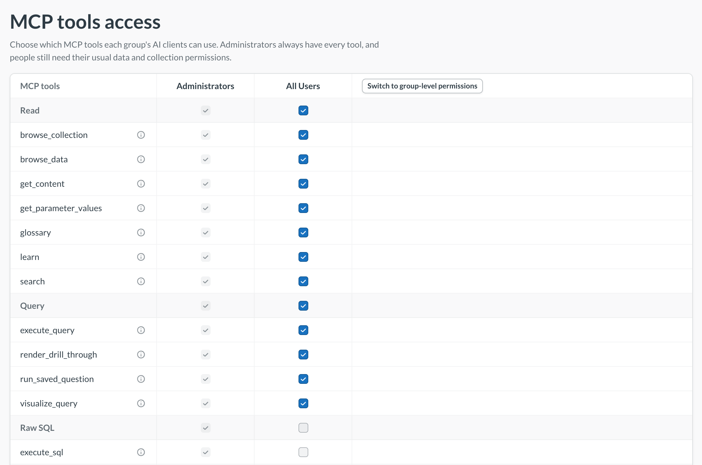
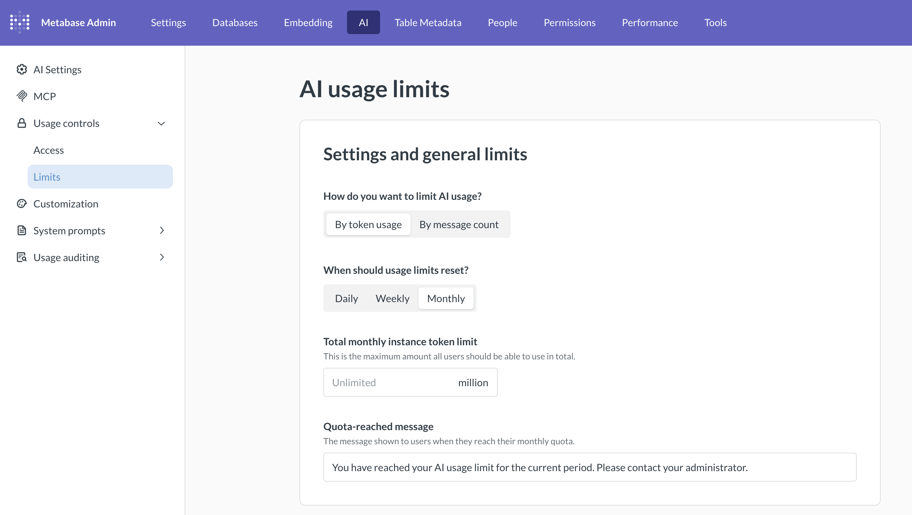

# AI usage controls



_Admin > AI > Usage controls_

Once you've connected an AI provider (see [AI settings](./settings.md)), you can control who can use Metabot and set usage budgets. If you've [turned on the MCP server](./mcp.md#turn-on-the-mcp-server), you can also choose which MCP tools each group can use.

- [AI feature access](#ai-feature-access): which groups can use Metabot, and which of its tools.
- [MCP tools access](#mcp-tools-access): which MCP tools each group's AI clients can use.
- [AI usage limits](#ai-usage-limits): token or message caps by instance, group, or tenant.

## AI feature access

_Admin > AI > Usage controls > AI feature access_

The AI feature access table lets you toggle Metabot on or off per group, and pick what Metabot can do for each group. Rows are your [internal groups](../people-and-groups/managing.md) and [tenant groups](../embedding/tenants.md); columns are Metabot capabilities.

- **AI features** — the master toggle for the group. When off, people in that group won't see the Metabot icon, keyboard shortcuts, or any inline AI affordances.
- **Chat and NLQ** — access to the Metabot [chat sidebar](./metabot.md#the-metabot-chat-sidebar) and [natural language querying](./metabot.md#how-metabot-uses-the-query-builder).
- **SQL generation** — permission to have Metabot write or edit SQL ([from the sidebar](./metabot.md#metabot-in-the-native-editor) or [inline](./metabot.md#inline-sql-editing)).
- **Other tools** — other AI tools like error-fixing and chart analysis.

These controls are granular. If you uncheck SQL generation but leave Chat and NLQ checked, Metabot will try to answer SQL-shaped prompts with a [query builder](../questions/query-builder/editor.md) result.

[Tenant](../embedding/tenants.md) groups follow the same model as regular groups.

## MCP tools access

_Admin > AI > Usage controls > MCP tools access_

MCP tools access lets you choose which [MCP server](./mcp.md) tools each group's AI clients can use. For example, you can let your analysts run raw SQL from Claude or Cursor, and give everyone else only the tools that read content.

By default, everyone can use every MCP tool. The **MCP tools access** page only shows up once you've [turned on the MCP server](./mcp.md#turn-on-the-mcp-server).

Tool access doesn't replace other permissions. People still need the usual [data](../permissions/data.md) and [collection](../permissions/collections.md) permissions, and their client still needs the right [permission scope](./mcp.md#permission-scopes).

### Allow or block MCP tools

[MCP tools](./mcp-tools.md) are grouped under scope rows, named after the [permission scope](./mcp.md#permission-scopes) each tool needs:

| Scope row      | Permission scope       |
| -------------- | ---------------------- |
| **Read**       | `agent:content:read`   |
| **Query**      | `agent:query:run`      |
| **Raw SQL**    | `agent:sql:run`        |
| **Write**      | `agent:content:write`  |
| **Deliveries** | `agent:delivery:write` |

Check or uncheck tools as needed, and click **Save changes**.

The **Administrators** column always has every box checked: admins always get every tool.

### How Metabase applies MCP tool access

- **Groups add up.** A person can use a tool if any of their groups allows it.
- **Changes apply on the next request.** Metabase checks tool access on every request, so you don't need to restart Metabase, and people don't need to reconnect their clients.
- **Blocked tools are hidden.** Metabase leaves blocked tools out of the tool list it gives a client. If a client calls a blocked tool anyway, Metabase refuses, and tells the person to ask an admin to enable the tool under **Admin > AI > Usage controls > MCP tools access**.
- **People with no tools can't connect.** People need to be in at least one group with access to tools to the MCP server.
- **Blocking `execute_sql` also blocks saving SQL questions.** People who can't use the `execute_sql` tool can't save SQL questions with the `question_write` tool either.
- **Tool access stays if you change plans.** If you change to a plan without AI controls, Metabase keeps applying the MCP tool access you set.

### Set MCP tool access for each group

By default, the grid has two columns: **Administrators** and **All Users**. Every person who isn't an admin gets the tools you allow for **All Users**. If you use [tenants](../embedding/tenants.md), the **Tenant groups** tab does the same for **All tenant users**.

To give different groups different tools, switch to group-level permissions:

1. Set up your [groups](../people-and-groups/managing.md#groups).
2. Click **Switch to group-level permissions**.
3. Click **Switch** to confirm.

In group-level mode, **All Users** and **All tenant users** groups lose MCP tool access. That way, groups only get the tools you allow them. Admins always get every tool. When you switch, Metabase gives the [Data Analysts](../people-and-groups/managing.md#data-analysts) group every tool, but you can change its tools like any other group's.

To switch back, click the gear icon, then **Remove group-level access**, then **Remove access from all groups**. Switching back to one set of tools for everyone deletes the tool access you set for each group, and gives **All Users** (and **All tenant users**) every tool.

## AI usage limits

_Admin > AI > Usage controls > AI usage limits_

By default, AI usage is unlimited.

These limits let you cap how much Metabot traffic Metabase allows — either across your whole instance, or for people in specific groups.

### Settings and general limits

- **How do you want to limit AI usage?** Choose between:
  - **By token usage** in millions of tokens, so `2` would be 2 million tokens.
  - **By message count**. Each message someone sends to Metabot counts as one message (not a conversation, but a single message).
- **When should usage limits reset?** The counter resets automatically; the limit values stay put. Pick from:
  - **Daily** (resets at midnight).
  - **Weekly** (resets on Monday).
  - **Monthly** (resets the 1st).

You can also set:

- **Total instance limit**: the total pool of tokens or messages across every person and group. Once this limit is hit, Metabot stops responding to requests until the next reset.
- **Quota-reached message**: the error Metabot shows when someone hits a limit. Write whatever makes sense for your Metabase (like a Slack channel to ping, or a link to a request form).

### Group limits

Group limits set a per-_person_ cap for everyone in a user group. So, each person in the group gets the limit, not the group as a whole.

If a person belongs to multiple groups, Metabase gives them the highest limit across those groups (_not_ the cumulative number across all of their groups). So if someone is in two groups, one group capped to 100 messages per week, and another group capped to 500, that person would enjoy 500 per week (not 600).

### Tenant group limits

You can set a limit for each [tenant group](../embedding/tenants.md#create-tenant-groups). They work just like the group limits described above.

### Specific tenant limits

This specific tenant limit is an aggregate pool shared by everyone in a single tenant. When the pool is empty, no one in that tenant can use Metabot for the rest of the period, regardless of how generous their tenant-group limits are.

Per-tenant limits are handy for billing scenarios. Say you have a customer, Megafauna Analytics, who pays you for 100 million tokens a month. Set Megafauna Analytics's tenant limit to 100, and Metabase enforces that cap across every seat they provision.

## Further reading

- [AI settings](./settings.md)
- [Metabot](./metabot.md)
- [AI customization](./customization.md)
- [AI system prompts](./system-prompts.md)
- [Tenants](../embedding/tenants.md)
- [Permissions overview](../permissions/start.md)
