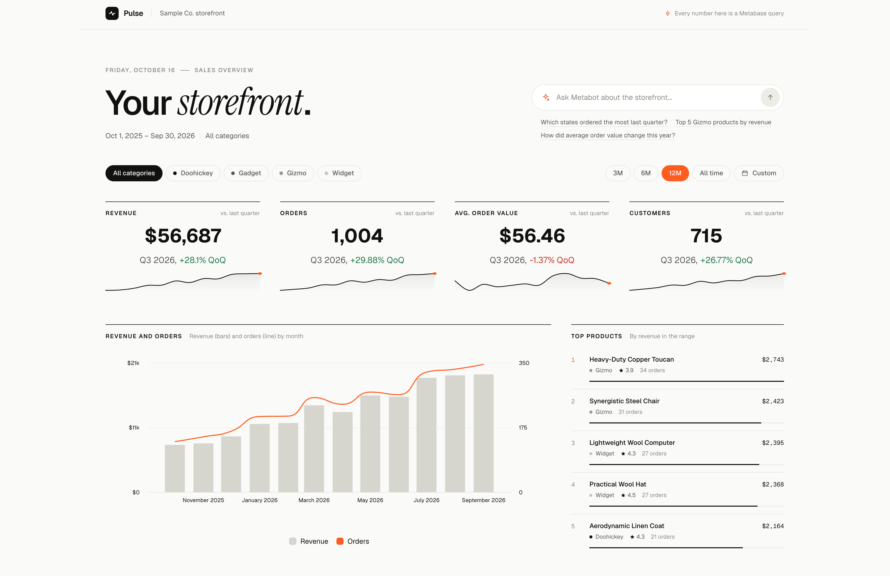
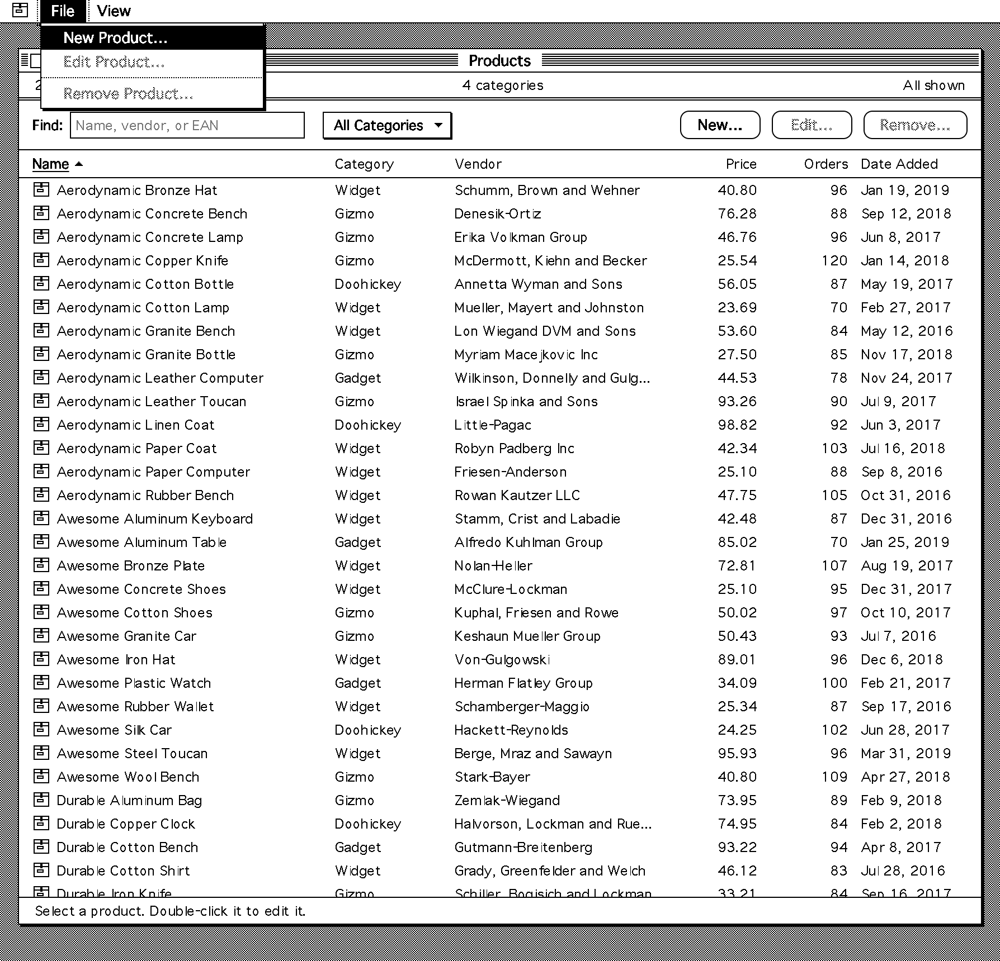

# Data apps (beta)



> **Beta:** Data apps are in beta.



Data apps are custom apps that you build on your Metabase data. Like a dashboard, a data app shows charts and tables from your [semantic layer](../data-modeling/semantic-layer/library.md). But an app isn't limited to cards and filters on a grid: an app can have its own layout, its own pages, and forms that add, edit, or delete rows in your database. An app doesn't have to write data: an app can just show data, from any database. You can build apps like portals, review queues, and forms, without having to stand up a separate app and backend.

A data app runs with the permissions of the person who opens it, so people see only the data that they're allowed to see. And an app can read only from your semantic layer and its own collection, and it can write data only through the actions in its own collection. See [what a data app can read and write](#what-a-data-app-can-read-and-write).

## How data apps work

You build and change data apps on your computer, with an AI coding agent and a development Metabase. Then you commit the app to your Remote Sync repository, pull the app into your production Metabase, and choose who can open the app.

Your agent does most of the work, but here's an overview of the end-to-end process:

1. On your development Metabase, create a [Remote Sync](../installation-and-operation/remote-sync.md) branch for the app, and clone your Remote Sync repository to your computer.
2. Describe the app to an AI coding agent, like Claude Code or Codex, on your computer. For example: "Create a Metabase data app to add, update, and delete products from the products table."
3. The agent uses the [Metabase CLI](../installation-and-operation/metabase-cli.md) to create the app on your development Metabase. The agent saves the questions and actions that the app runs to the [app's collection](#what-a-data-app-can-read-and-write).
4. The agent writes the app's code in your local clone of your Remote Sync repository. While the agent works, you [preview the app](#preview-the-app-on-your-computer) in your browser.
5. The agent builds the app and uploads it to your development Metabase. Admins can open the app there at `/apps/<slug>`.
6. Push the app from your development Metabase to your branch, and commit the app's source code to the same branch.
7. Merge the branch, and pull the changes into your production Metabase.
8. On your production Metabase, [choose which groups can open the app](./manage.md#choose-who-can-open-an-app).

## Requirements for data apps

- A Pro or Enterprise plan.
- An admin account. Only admins can create and manage apps.
- An AI coding agent, like Claude Code or Codex.
- The [Metabase CLI](../installation-and-operation/metabase-cli.md) (`mb`).
- Node.js 22.12 or later on your computer.
- A development Metabase, connected to your data warehouse, where you build and change your apps.
- [Remote Sync](../installation-and-operation/remote-sync.md), to ship your apps from your development Metabase to production. Your Remote Sync repository also keeps each app's source code.
- A [semantic layer](../data-modeling/semantic-layer/library.md) with the [published tables](../data-modeling/semantic-layer/published-tables.md) and metrics that your apps read. Your agent can publish tables and create metrics while it builds an app. But for apps that people rely on, use tables and metrics that you trust.
- If your apps write data, [actions enabled](../data-modeling/models/actions/introduction.md#enabling-actions-for-a-database) on the databases that your apps write to. An app that only shows data doesn't need actions, so the app can read from any database that Metabase connects to, even a database that doesn't support actions.

## What a data app can read and write

A data app runs with the permissions of the person who opens it. Their [data permissions](../permissions/data.md), including [row and column security](../permissions/row-and-column-security.md), apply to everything the app reads. If row and column security applies to a person on any table in a database, that person can't run the app's actions on that database.

An app can read only:

- [Published tables](../data-modeling/semantic-layer/published-tables.md), with their [segments](../data-modeling/semantic-layer/segments.md) and [measures](../data-modeling/semantic-layer/measures.md). The app can query these tables directly, without a saved question, but not with SQL.
- The metrics and dashboards in your [Library](../data-modeling/semantic-layer/library.md).
- The questions and metrics in its own collection.

An app can write data only through the actions in its own collection.

Your agent saves the questions, metrics, and actions that the app needs to the app's collection, and the collection can hold only questions, metrics, and actions. When your agent saves an item to the collection, Metabase refuses the item if it breaks a rule. The main rules are:

- Questions must be built with the query builder, not SQL. Questions can read only [published tables](../data-modeling/semantic-layer/published-tables.md) and metrics from your semantic layer, and the [segments](../data-modeling/semantic-layer/segments.md) and [measures](../data-modeling/semantic-layer/measures.md) of published tables. So questions can't start from or join another saved question or model.
- Actions can be table actions, which insert, update, or delete one row of a published table, or SQL actions.
- Items in the collection can't be archived or made public. Questions and metrics in the collection can't be embedded.

Only admins can edit an app's collection. You can't move the app's collection, move it to the trash, or make it official.

## Build the app with your agent

1. [Install the Metabase CLI](../installation-and-operation/metabase-cli.md#install-the-cli), and [log the CLI in](../installation-and-operation/metabase-cli.md#authenticate-the-cli) as an admin to your development Metabase.
2. Install the [metabase-cli skill](../installation-and-operation/metabase-cli.md#the-metabase-cli-skill) for your agent. The CLI comes with its own skills for building data apps, and the metabase-cli skill tells your agent to load them.
3. On your development Metabase, [create a Remote Sync branch](../installation-and-operation/remote-sync.md#creating-a-branch) for the app.
4. Start your agent in a local clone of your Remote Sync repository, so that the app's source code goes in the repository with the app. See [what syncs with a data app](#what-syncs-with-a-data-app).
5. Ask your agent to create a Metabase data app, and follow its instructions. For example:

   ```text
   Create a Metabase data app that lets people look up product info, and add, edit, or remove products. Make it look cool.
   ```

The agent creates the app on your development Metabase, adds the questions and actions that the app needs to the app's collection, and writes the app's code in `data_apps/<slug>/`. Then the agent builds the app, and uploads the app's bundle (the built app, up to 10 MiB) to your development Metabase. The agent gives you the app's address, `/apps/<slug>`.

To build and preview the app, the agent runs commands on your computer, like `mb` (the Metabase CLI), `npm run build`, and `npm run dev`. Your agent might ask for your permission before it runs these commands.

A new app starts live: it opens at its address. Admins can open the app right away. To let other people open it, [add their groups](./manage.md#choose-who-can-open-an-app) to the app. To take an app offline, [make it a draft](./manage.md#make-an-app-live-or-a-draft).

## Preview the app on your computer

> **The preview changes real data:** The preview runs the app's actions against the database that your development Metabase connects to. If that's your production data warehouse, the adds, edits, and deletes that you try out in the preview change your production data. Try out actions on rows that you add for testing.

The agent starts a preview of the app at a `localhost` address on your computer. The preview runs on your computer, but it gets its data from your development Metabase. Open the preview in your browser, and keep the tab open while the agent works: the agent reads the app's errors from the open preview. To start the preview again later, ask your agent.

The preview needs an admin [API key](../people-and-groups/api-keys.md). The agent creates the key on your development Metabase, writes it into a `.env.local` file that Git ignores, and deletes the key when it's done. Since the preview uses an admin key, it shows what an admin can see, not what the app's viewers can see.

If your agent can't create the key, for example because its permission settings block it, [create an API key](../people-and-groups/api-keys.md#create-an-api-key) in the **Administrators** group yourself. Then put it in a `.env.local` file in the app's directory, next to `package.json`:

```text
DATA_APP_MB_URL=<your development Metabase URL>
DATA_APP_MB_API_KEY=<your API key>
```

Delete the key when you no longer need the preview.

## Ship the app to production with Remote Sync

When [Remote Sync](../installation-and-operation/remote-sync.md) is on, it always syncs your data apps, so an app ships to production like the rest of your synced content. Use the same steps for a new app and for each change to an app:

1. On your development Metabase (in Read-write mode), [push your changes](../installation-and-operation/remote-sync.md#pushing-changes-to-git) to your branch. The push adds the app's manifest, bundle, and collection to the branch.
2. In your local clone, switch to the branch, and pull it.
3. Commit the app's directory, `data_apps/<slug>/`, and push the commit. The commit adds the app's source code to the branch.
4. On your development Metabase, [pull the changes](../installation-and-operation/remote-sync.md#pulling-changes-from-git). If you skip this step, the next push from Metabase has a conflict.
5. Merge your branch into the branch that your production Metabase pulls from, for example with a [pull request](../installation-and-operation/remote-sync.md#step-4-create-a-pull-request).
6. On your production Metabase (in Read-only mode), [pull the changes](../installation-and-operation/remote-sync.md#pulling-changes-from-git). If your production Metabase uses [auto-sync](../installation-and-operation/remote-sync.md#pulling-changes-automatically), it pulls the changes on its own within five minutes.
7. The first time that you ship an app, [add the groups](./manage.md#choose-who-can-open-an-app) that can open the app on your production Metabase.

If you let your agent use Git, the agent can do these steps for you.

Remote Sync doesn't sync an app's group access or its [status](./manage.md#make-an-app-live-or-a-draft) (live or draft), so each Metabase keeps its own. The first pull creates the app on your production Metabase as live, and only admins can open it until you add groups there. Later pulls keep the app's status on production, so you can make the app a draft on production without changing it on development.

Your production Metabase also needs the published tables and metrics that the app reads. A pull doesn't check that the tables are published, but the pull fails if the app's questions use metrics that aren't in your production Library. So add your [Library](../installation-and-operation/remote-sync.md#you-choose-what-to-sync), which holds your semantic layer, to Remote Sync too. If your app uses actions, [enable actions](../data-modeling/models/actions/introduction.md#enabling-actions-for-a-database) on the production databases that the app writes to.

### What syncs with a data app

Remote Sync syncs the app's manifest, its bundle, and its collection with its questions and actions. Remote Sync doesn't sync the app's source code: pushes from Metabase don't change the source code, and pulls ignore it. You commit the source code yourself. In your repository:

- `data_apps/<slug>/data_app.yaml` is the app's manifest.
- `data_apps/<slug>/dist/index.js` is the app's bundle.
- The rest of `data_apps/<slug>/` is the app's source code.
- `collections/data_apps/` holds the app's collection.

When your agent builds the app, it writes the bundle to `build/index.js` and uploads it to your development Metabase. When Metabase pushes the app, it writes the uploaded bundle to `dist/index.js`. So the template's `.gitignore` keeps `build/` out of your repository, together with `node_modules/` and `.env.local`. Don't edit the manifest or the bundle by hand.

## Change a data app

1. On your development Metabase, [create a Remote Sync branch](../installation-and-operation/remote-sync.md#creating-a-branch) for the change.
2. In your local clone of your Remote Sync repository, pull the latest source code, so that you start from the latest version of the app.
3. Start your agent in the clone, and ask for the change. The agent updates the code, builds the app again, and uploads the new version to your development Metabase.
4. [Ship the change to production](#ship-the-app-to-production-with-remote-sync).

Each app has only one bundle, and each upload replaces it, so Metabase has no version history for an app. If two people change the same app at the same time, the last upload wins: an upload from an older copy of the source code removes the changes in the newer bundle. To go back to an earlier version, ask your agent to build the app from an earlier commit of the source code, and upload it again.

Any admin can change an app from their own computer. Clone your Remote Sync repository, do steps 1 and 2 of [Build the app with your agent](#build-the-app-with-your-agent), and start your agent in the clone. Git doesn't keep the app's packages (`node_modules/`) or the preview's API key (`.env.local`), so the agent installs the packages and creates a new API key on each computer.

## Let an app fetch data from other sites

A data app runs in a sandbox, so by default the app can't make network requests to other sites. To let an app get data from a site, add the site's origin to the app's allowed hosts:

```sh
mb data-app update <slug> --body '{"allowed_hosts":["https://api.example.com"]}'
```

The list replaces the app's allowed hosts, so include every origin that the app needs. Your agent can also change the list for you.

The app can then get data from the site with `fetch`. The app can also show the site's images, embed the site's pages, and submit forms to the site. An origin that starts with `*.`, like `https://*.example.com`, matches subdomains, but not the domain itself.

## Have fun

Ask your agent for any style you like.



## Let us know what you think

Data apps are in active development. If you run into a bug or have an idea for how data apps should work, [file an issue](https://github.com/metabase/metabase/issues/new/choose).
