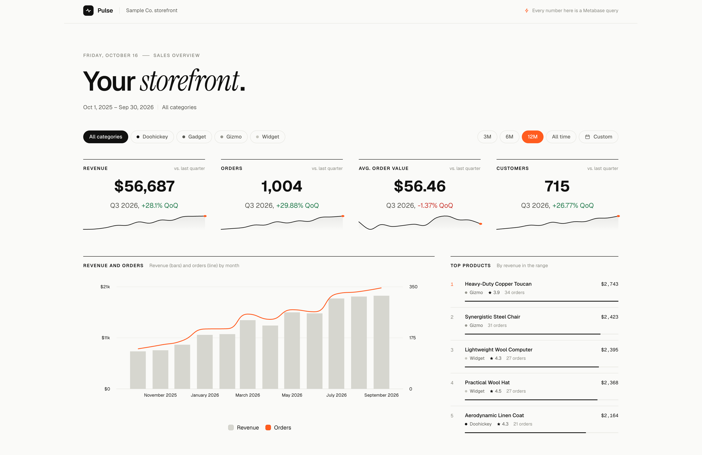
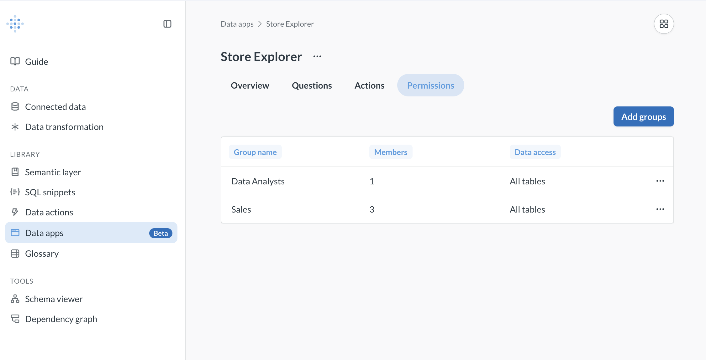
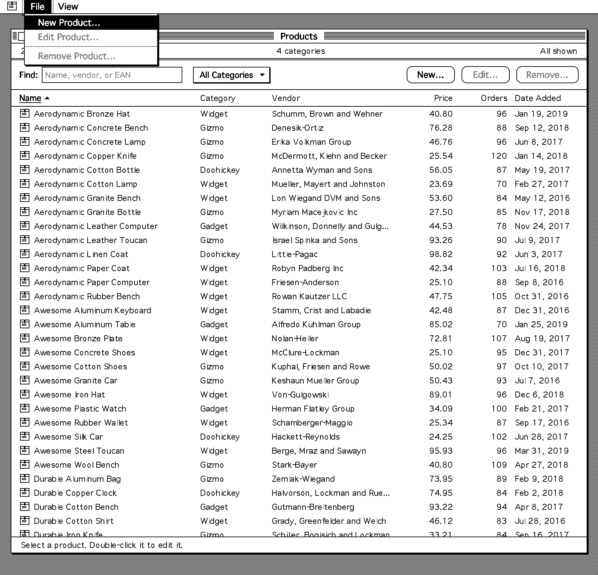

# Data apps (beta)



> **Beta:** Data apps are in beta.



Data apps are custom apps that you build on your Metabase data. Like a dashboard, a data app shows charts and tables from your [semantic layer](../data-modeling/semantic-layer/library.md). But an app isn't limited to cards and filters on a grid: an app can have its own layout, its own pages, and forms that add, edit, or delete rows in your database. You can build apps like portals, review queues, and forms, without having to stand up a separate app and backend.

A data app runs with the permissions of the person who opens it, so people see only the data that they're allowed to see. An app can write data only through the actions in its own collection. See [what a data app can read and write](#what-a-data-app-can-read-and-write).

This page is the reference for data apps. To set up your tools and build your first app step by step, check out [Getting started with data apps](./getting-started.md).

## Requirements for data apps

- A Pro or Enterprise plan.
- An admin account. Only admins can build and manage apps.
- An AI coding agent, like Claude Code or Codex.
- The [Metabase CLI](../installation-and-operation/metabase-cli.md) (`mb`), version 0.5.10 or later. To update the CLI, run `mb upgrade`.
- Node.js 22.12 or later on your computer.
- A Git repository that your Metabases connect to with [Remote sync](../data-modeling/semantic-layer/remote-sync.md), and permission to push to it. Apps get into Metabase only when Metabase pulls them from the repository, and the repository also keeps each app's source code.
- A Metabase where your agent builds each app. See [Choose where to build apps](#choose-where-to-build-apps).
- A [semantic layer](../data-modeling/semantic-layer/library.md) with the [published tables](../data-modeling/semantic-layer/published-tables.md) and metrics that your apps read. Your agent can publish tables and create metrics on a Metabase in Read-write mode while it builds an app. See [Publish tables to your semantic layer](#publish-tables-to-your-semantic-layer).
- If your apps write data, a PostgreSQL or MySQL database with [data actions turned on](../data-modeling/data-actions.md#turn-on-data-actions-for-a-database). Only these databases support actions. An app that only shows data can read from any database that Metabase connects to.

## Choose where to build apps

Your agent builds and ships each app from a Metabase that it logs in to. You can set this up in two ways:

- **A development Metabase and a production Metabase (recommended).** Set up two Metabases: one for trying things out, and one for the content that people rely on. Your agent builds each app on the development Metabase, where it can also publish tables and create metrics for the app. You review the app before it reaches production. To set this up, connect both Metabases to the same Git repository with [Remote sync](../data-modeling/semantic-layer/remote-sync.md): your development Metabase in Read-write mode, and your production Metabase in Read-only mode.
- **Only your production Metabase.** This setup has fewer steps, but each change that your agent ships goes to production without review. [Getting started with data apps](./getting-started.md) uses this setup.

The rest of this page uses a development Metabase and a production Metabase. Here's how an app gets from your agent to the people who open it:

![A flow diagram of the development to production workflow for a data app. An AI coding agent starts a local app preview, which reads and writes data through a development Metabase. The agent also pushes the app to a Git repository. If the development Metabase has changes to tables or metrics, it pushes those changes to the repository too. First, the development Metabase, in Read-write mode, pulls the app's branch, and you check the app. Then you merge the branch, and a production Metabase, in Read-only mode, pulls the app. You set permissions on the production Metabase, and people open the app.](./images/data-app-flow.png)

To see how this works with only one Metabase, check out the [single Metabase workflow](./getting-started.md).

## Publish tables to your semantic layer

Your agent builds your app on the tables that are [published](../data-modeling/semantic-layer/published-tables.md) to your [semantic layer](../data-modeling/semantic-layer/library.md). The semantic layer is the place to store your set of curated tables and metrics. Building on your semantic layer means that your app shows the same vetted numbers as the rest of your Metabase, so publish only trusted tables that are ready for analysis.

If your app needs a table that isn't published, your agent stops and tells you what's missing. How you publish depends on how your Metabase syncs with your Git repository:

- **No repository yet.** Ideally, publish your tables now, before you connect a repository. You can [publish the tables yourself](../data-modeling/semantic-layer/published-tables.md#publish-a-table-from-the-semantic-layer). Or start your agent in any folder, and ask it to create your semantic layer and publish the tables that your app needs.
- **Read-write mode** (Metabase can also write to the repository). Publish the tables yourself, or ask your agent to publish them. Your agent pushes the tables to the repository when it [ships the app](#ship-the-app-to-your-development-metabase).
- **Read-only mode** (Metabase only reads from the repository). You can't change your semantic layer in Metabase directly. You (or your agent) can only change the semantic layer via Remote sync.

## What a data app can read and write

A data app runs with the permissions of the person who opens it. Their [data permissions](../permissions/data.md), including [row and column security](../permissions/row-and-column-security.md), apply to everything the app reads. If row and column security applies to a person on any table in a database, that person can't run the app's actions on that database.

An app can read:

- Tables, with their [segments](../data-modeling/semantic-layer/segments.md) and [measures](../data-modeling/semantic-layer/measures.md).
- The metrics in your [semantic layer](../data-modeling/semantic-layer/library.md), but no other metrics.
- The questions in the app's own collection, but no other questions.

An app can write data only through the actions in its own collection.

Your agent writes the questions and actions that the app needs in the app's code, and generates the app's collection with those items. The collection can hold only questions and actions. Items follow these rules:

- Questions must be built with the query builder, not SQL, and must start from a table. So a question can't start from another saved question or model, even one in the app's collection. Questions also can't have explicit joins, custom columns, parameters, or more than one stage. But a question can use columns from linked tables through foreign keys, and the metrics in your semantic layer.
- Actions are table actions, which insert, update, or delete one row of a table by its primary key. Apps can't use SQL actions or model actions.
- Items in the collection can't be archived or made public. Questions in the collection can't be embedded.

Your agent follows these rules for you, but the rules limit what you can ask for. Some tips for guiding your agent:

- **Describe the result, not the SQL.** An app can't run SQL. So instead of pasting a query, ask for "revenue by month for each product category."
- **Name tables, not saved questions.** Instead of "Use our Weekly sales question," ask for "weekly sales from the Orders table." If the table isn't in your semantic layer, the agent stops and tells you what's missing.
- **Ask for columns from related tables.** "Show each order with its product's category" works if the Orders table has a foreign key to the Products table. Without a foreign key, the question can't get that column, because questions can't have explicit joins.
- **Ask for calculated values.** Like: "show each order's discount as a percentage", because the agent can calculate the value in the app's code.
- **Keep writes to one row.** "Let people edit a product" works. "Mark all of a customer's orders as refunded" doesn't, because an action changes only one row at a time.

The app's collection changes only when Metabase pulls it from your repository. You can't move the app's collection, move it to the trash, or make it official.

## Build an app on a development Metabase

For every step, from installing your tools to opening the app, check out [Getting started with data apps](./getting-started.md). That guide builds on one Metabase. With a development Metabase, do these things differently:

- **Log the CLI in to your development Metabase**, not your production Metabase.
- **Build each app on its own branch.** Ask your agent to create the branch on your development Metabase and in your clone, or [create a branch](../data-modeling/semantic-layer/remote-sync.md#creating-a-branch) on your development Metabase and switch your clone to it. If you build on the branch that your production Metabase pulls from (by default, your main branch), the app goes to production without review.

The agent stops if the directory isn't a clone of the repository that your development Metabase syncs with, or if the clone isn't on the branch that your development Metabase tracks. See [what syncs with a data app](#what-syncs-with-a-data-app).

The agent creates the app in `data_apps/<slug>/`, and writes the app's code there, with the questions and actions that the app needs. Then the agent generates the app's collection in `collections/data_apps/`, and builds the app's bundle (the built app, up to 10 MiB). When the app is ready, ask the agent to ship it. The agent [ships the app](#ship-the-app-to-your-development-metabase) to your branch, and pulls the branch into your development Metabase, where the app opens at `/apps/<slug>`.

Until that pull, the app is only files in your clone. The agent reads from your development Metabase to see which tables and metrics it can use, but it doesn't create the app, its questions, or its actions there. Metabase creates them when it pulls the files.

To build, preview, and ship the app, the agent runs commands on your computer, like `mb`, `npm run build`, `npm run dev`, and `git`. Your agent might ask for your permission before it runs these commands.

The first time that a Metabase pulls an app, the app is [live](./manage.md#make-an-app-live-or-a-draft) on that Metabase: admins can open it at `/apps/<slug>`. To let other people open it, [add their groups](./manage.md#choose-who-can-open-an-app) to the app. To take an app offline, [make it a draft](./manage.md#make-an-app-live-or-a-draft).



## Preview the app on your computer

> **The preview changes real data:** The preview runs the app's actions against the database that your development Metabase connects to. If that's your production data warehouse, the adds, edits, and deletes that you try out in the preview change your production data. Try out actions on rows that you add for testing.

The agent starts a preview of the app at a `localhost` address on your computer. The preview gets its data from your development Metabase, but it runs the app's questions and actions from the app's code, so your development Metabase doesn't need the app yet. Open the preview in your browser, and keep the tab open while the agent works: the agent reads the app's errors from the open preview. To start the preview again later, ask your agent.

In the preview, the app has a **Diagnostics** button, which shows the errors that the agent reads. The app in Metabase doesn't have this button.

The preview needs an admin [API key](../people-and-groups/api-keys.md). The agent asks before it creates the key on your development Metabase. Then the agent writes the key into a `.env.local` file that Git ignores, and deletes the key when it's done. If your session ends before the agent deletes the key, [delete the key](../people-and-groups/api-keys.md#deleting-api-keys) yourself. The key's name starts with `data-app`. Since the preview uses an admin key, it shows what an admin can see, not what the app's viewers can see.

If your agent can't create the key, for example because its permission settings block it, [create an API key](../people-and-groups/api-keys.md#create-an-api-key) in the **Administrators** group yourself. Then put it in a `.env.local` file at the root of your clone of the repository:

```text
DATA_APP_MB_URL=<your development Metabase URL>
DATA_APP_MB_API_KEY=<your API key>
```

Delete the key when you no longer need the preview.

## Ship the app to your development Metabase

Your data apps always reach Metabase through your Git repository. When the app is ready, tell your agent:

```text
Ship the app to my development Metabase.
```

The agent does these steps for you, for a new app and for each change to an app:

1. If your development Metabase has changes to synced content that the app reads, like a table that your agent just published, [push your changes](../data-modeling/semantic-layer/remote-sync.md#pushing-changes-to-git) to the app's branch. Then pull the branch in your local clone.
2. Commit the app's directory, `data_apps/<slug>/`, and the `collections/data_apps/` directory, which holds the app's collection, together, and push the branch.
3. On your development Metabase, [pull the changes](../data-modeling/semantic-layer/remote-sync.md#pulling-changes-from-git).

Then check the app at `/apps/<slug>` on your development Metabase.

## Move the app to production

After you check the app on your development Metabase, do these steps yourself:

1. Merge your branch into the branch that your production Metabase pulls from, for example with a [pull request](../data-modeling/semantic-layer/remote-sync.md#step-4-create-a-pull-request).
2. On your production Metabase (in Read-only mode), [pull the changes](../data-modeling/semantic-layer/remote-sync.md#pulling-changes-from-git). If your production Metabase uses [auto-sync](../data-modeling/semantic-layer/remote-sync.md#pulling-changes-automatically), it pulls the changes on its own within five minutes.
3. The first time that you move an app to production, [add the groups](./manage.md#choose-who-can-open-an-app) that can open the app on your production Metabase. Then check the **Data access** column on the app's **Permissions** tab. If it says **Missing N tables**, [give the group access to those tables](./manage.md#check-that-groups-can-see-the-apps-data).

Metabase doesn't sync an app's group access or its [status](./manage.md#make-an-app-live-or-a-draft) (live or draft), so each Metabase keeps its own. The first pull creates the app on your production Metabase as live, and only admins can open it until you add groups there. Later pulls keep the app's status on production, so you can make the app a draft on production without changing it on development.

Your production Metabase also needs the tables and metrics that the app reads. They go to production with the app when you pull in the changes from the repo via Remote sync. If your app uses actions, you must [turn on data actions](../data-modeling/data-actions.md#turn-on-data-actions-for-a-database) on the production databases that the app writes to.

## What syncs with a data app

Metabase pulls the app's manifest, its bundle, and its collection with its questions and actions. Pulls ignore the app's source code. You (or your agent) commit all of these to your repository:

- `data_apps/<slug>/data_app.yaml` is the app's manifest, with the app's slug, name, description, data apps version, bundle path, and [allowed hosts](#let-an-app-fetch-data-from-other-sites).
- `data_apps/<slug>/dist/index.js` is the app's bundle.
- The rest of `data_apps/<slug>/` is the app's source code.
- `collections/data_apps/` holds the collections of all your apps. This app's collection is `data_app__<slug>.yaml` and the `data_app__<slug>/` directory.

When your agent builds the app, it writes the bundle to `dist/index.js`. Commit the bundle with the app's collection: the bundle runs the questions and actions in the collection, so a bundle without them fails. The `.gitignore` files in your repository keep `node_modules/` and `.env.local` out of it. In the manifest, you can edit the app's `name`, `description`, and `allowed_hosts`. Don't edit the rest of the manifest, the bundle, or the collection by hand.

## Change a data app

Start your agent in your local clone of your Git repository, and tell it what to change. For example:

```text
Create a new branch from main on my development Metabase and in this clone. Then add a filter by product category to the orders-overview app, and ship the app to my development Metabase.
```

Then [move the app to production](#move-the-app-to-production).

To set up the branch yourself:

1. On your development Metabase, [switch to the branch](../data-modeling/semantic-layer/remote-sync.md#switching-branches) that your production Metabase pulls from, and [pull the changes](../data-modeling/semantic-layer/remote-sync.md#pulling-changes-from-git). Then [create a branch](../data-modeling/semantic-layer/remote-sync.md#creating-a-branch) for the change.
2. In your local clone of your Git repository, pull the latest changes, and switch to the new branch.
3. Start your agent in the clone, and ask for the change. The agent updates the code, generates the app's collection, and builds the app again. When the change is ready, ask the agent to [ship it to your development Metabase](#ship-the-app-to-your-development-metabase).
4. [Move the change to production](#move-the-app-to-production).

Your repository keeps each version of the app, with the bundle and the source code that it was built from. To go back to an earlier version, revert the change in your repository, merge the revert, and pull the changes into your Metabases. If two people change the same app on different branches, the app's bundle and collection conflict when you merge the second branch. Merge the source code, and ask your agent to generate the collection and build the app again.

Any admin can change an app from their own computer. Git doesn't keep the app's packages (`node_modules/`) or the preview's API key (`.env.local`), so the agent installs the packages and creates a new API key on each computer.

### Fix an app after a Metabase upgrade

Most Metabase upgrades don't change your apps. But if an upgrade makes a breaking change to data apps, apps that were built for the older version of data apps stop opening, and show as **outdated** in the [list of data apps](./manage.md). To fix an app, ask your agent to migrate the app to the current version of data apps, build it again, and [ship it to your development Metabase](#ship-the-app-to-your-development-metabase). Then [move it to production](#move-the-app-to-production).

## Let an app fetch data from other sites

A data app runs in a sandbox, so by default the app can't make network requests to other sites. To let an app get data from a site, add the site's origin to `allowed_hosts` in the app's manifest, `data_apps/<slug>/data_app.yaml`:

```yaml
allowed_hosts:
  - https://api.example.com
```

Then [ship the change](#ship-the-app-to-your-development-metabase), and [move it to production](#move-the-app-to-production). Your agent can also change the list for you.

The app can then get data from the site with `fetch`. The app can also show the site's images, embed the site's pages, and submit forms to the site. An origin that starts with `*.`, like `https://*.example.com`, matches subdomains, but not the domain itself.

## Have fun

Ask your agent for any style you like. You can even travel through time:


