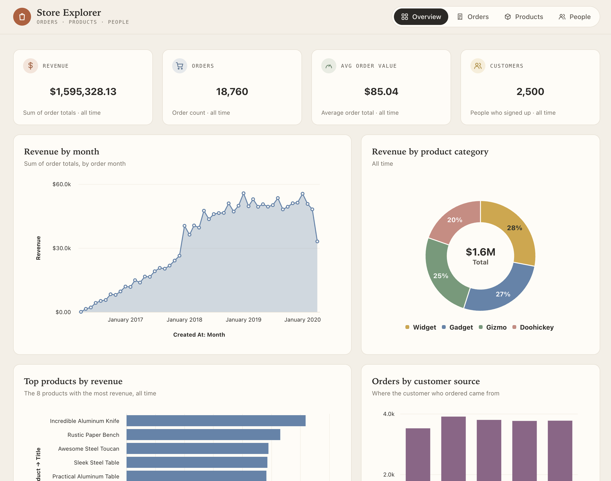

# Getting started with data apps



> **Beta:** Data apps are in beta.



This page is a step-by-step guide to using an AI coding agent to build a [data app](./build.md) with Metabase.

The basic setup:

- You build an app locally with an agent.
- You can preview the app on your machine.
- When you're happy with it, you commit your changes, then pull the changes into your Metabase with remote sync.

The app we build in this guide only shows data, so it works with any database that Metabase connects to. If your data warehouse is PostgreSQL or MySQL, you can also add a [form that changes data](#add-a-form-that-changes-data).

## What you need

- An admin account on a Metabase on a Pro or Enterprise plan.
- An AI coding agent, like Claude Code or Codex.

## Set up your tools

You do these steps once.

### 1. Make sure you have tables published to your Library

Your agent builds your app on the tables that are [published](../data-modeling/semantic-layer/published-tables.md) to your Library.

1. Click the **grid** icon in the upper right, and select **Data Studio**.
2. In the left sidebar, click **Semantic layer**. If Metabase asks you to create your semantic layer, click **Create my semantic layer**.
3. Look in the **Data** section. If the tables that your app needs are there, go to [step 2](#2-connect-your-metabase-to-a-git-repository).
4. Otherwise, publish some tables that you know have trustworthy data.

If your Metabase already syncs in Read-only mode, and the tables that your app needs aren't published, build your apps on a development Metabase in Read-write mode instead. See [Choose where to build apps](./build.md#choose-where-to-build-apps).

### 2. Connect your Metabase to a Git repository

Skip this step if your Metabase already syncs with a Git repository.

1. Create a new repository on GitHub, GitLab, or Bitbucket, and initialize it with a README file. See [Set up a repository](../data-modeling/semantic-layer/remote-sync.md#1-set-up-a-repository-to-store-your-content).
2. Create an access token that can read and write content  from the repository. For the permissions that each provider needs, see [Create a token for your production Metabase](../data-modeling/semantic-layer/remote-sync.md#5-create-a-token-for-your-production-metabase).
3. On your Metabase, go to **Admin** > **Settings** > **Remote sync**.
4. In **Repository URL**, enter the repository's URL, for example `https://github.com/your-org/your-repo`.
5. Since this is your production Metabase, you should select **Read-only**. This means that everything in Library must be edited through Remote Sync. In Read-only mode, you and your agent won't be able to update the Library via the app or CLI. If you're just trying out Remote Sync for data apps, you can set it to Read-Write.
6. In **Access Token**, paste the token.
7. Click **Set up remote sync**.

Metabase pulls from the repository's default branch, usually `main`. 

**Anyone who can push to the repository can change the content in your Metabase, so give write access only to people that you trust as admins.** For auto-sync, local repositories, and the other options, see [Remote sync](../data-modeling/semantic-layer/remote-sync.md).

This guide assumes your Remote Sync setup in your production Metabase is set to "Read only."

### 3. Install Node.js

Install [Node.js](https://nodejs.org/) 22.12 or later. To check which version you have, run:

```sh
node --version
```

### 4. Install the Metabase CLI, and log in to your production Metabase

Your agent uses the [Metabase CLI](../installation-and-operation/metabase-cli.md) (`mb`) to work with your production Metabase. Install the CLI:

```sh
npm install -g @metabase/cli
```

If you already have the CLI, run `mb upgrade` to get the latest version.

Then log the CLI in to your production Metabase. Use your Metabase's URL:

```sh
mb auth login --url https://metabase.example.com
```

The CLI offers to open Metabase in your browser. Sign in with your admin account, and approve the CLI.

### 5. Add the metabase-cli skill to your agent

The [metabase-cli skill](../installation-and-operation/metabase-cli.md#the-metabase-cli-skill) tells your agent how to use the CLI, and how to build data apps. To add the skill to Claude Code, run:

```sh
npx skills add metabase/agent-skills --skill metabase-cli -a claude-code
```

For other ways to install the skill, check out [The metabase-cli skill](../installation-and-operation/metabase-cli.md#the-metabase-cli-skill).

### 6. Clone the repository

Clone the repository to your computer, and go into its folder. Use your repository's URL:

```sh
git clone https://github.com/your-org/your-repo
cd your-repo
```

Your agent works in this folder, on the branch that your production Metabase pulls from. To find that branch, go to **Admin** > **Settings** > **Remote sync** on your production Metabase, and look at **Sync branch**. It's probably `main` or `master`. 

## Build the app

### 7. Ask your agent for the app

Start your agent in the folder of your clone, and describe the app. For example:

```text
Create a Metabase data app that shows our orders by month, and a table of the latest orders. Make it look cool.
```

The agent:

- Writes the app's code in `data_apps/<slug>/`, where `<slug>` is the app's short name. The code includes the questions that the app runs.
- Generates the [app's collection](./build.md#what-a-data-app-can-read-and-write) in `collections/data_apps/` from the app's questions.
- Starts a preview of the app.

Ask for an app that uses the tables and metrics that are already in your Library. If the app needs a table or a metric that isn't in your Library, the agent stops and tells you what's missing.

The agent runs commands on your computer, like `mb`, `npm`, and `git`, and it might ask for your permission first.

### 8. Preview the app

The agent starts the [data app preview](./build.md#preview-the-app-on-your-computer) at a `localhost` address on your computer. Open the preview in your browser, and keep the tab open while the agent works: the agent reads the app's errors from the open preview. The preview gets its data from your production Metabase with an admin [API key](../people-and-groups/api-keys.md), so the preview shows what an admin can see, not what the app's viewers can see.

Ask your agent for changes until the app looks the way you want.

### 9. Ship the app

When the app is ready, tell your agent to:

```text
Ship the app to my Metabase.
```

The agent will

- Build the app.
- Commits the app's source code, bundle, and collection to the branch that your production Metabase pulls from.
- Pushes the branch to your remote repo.
- Then the agent pulls the branch into your production Metabase via the CLI.

If your agent can't commit or push (for example because you don't trust it), you'll need to run the commands yourself in your clone. Use your app's slug. Add the `.env.local` to your `.gitignore` file to keep the preview's API key out of Git, so commit that file too:

```sh
git add .gitignore data_apps/<slug> collections/data_apps
git commit -m "Add the <slug> data app"
git push
```

Then, on your production Metabase, [pull the changes](../data-modeling/semantic-layer/remote-sync.md#pulling-changes-from-git).

Open the app at `/apps/<slug>` on your production Metabase, for example `https://metabase.example.com/apps/orders-overview`.

## Grant permissions to groups

### 10. Add groups to the app

1. In your Metabase, click the **grid** icon in the upper right, and select **Data studio**.
2. Click **Data apps**, and click the app.
3. On the **Permissions** tab, add the groups that can open the app.

People in those groups can now open the app at `/apps/<slug>`. The app runs with each person's [data permissions](../permissions/data.md), so people see only the data that they're allowed to see. For more, see [Choose who can open an app](./manage.md#choose-who-can-open-an-app).

## Edit the app

1. In your clone of your Remote Sync repository, pull the latest changes:

   ```sh
   git pull
   ```

2. Start your agent in the directory and ask it for the changes you want.
3. Check the change in the preview.
4. When the change is ready, ask your agent:

   ```text
   Ship the app to my Metabase.
   ```

5. Check the app on your production Metabase.

## Add a form that changes data

An app can also add, edit, and delete rows in your database, with actions. Actions only work on tables in [PostgreSQL and MySQL](../data-modeling/data-actions.md#databases-that-support-data-actions) databases.

> **The preview changes production data:** The preview runs the app's actions against the database that your production Metabase connects to. Try out the form on rows that you add for testing.

1. On your production Metabase, [turn on data actions](../data-modeling/data-actions.md#turn-on-data-actions-for-a-database) for the database.
2. Do the steps in [Edit the app](#edit-the-app), and ask your agent for the form. For example:

   ```text
   Add a form to the app that lets people add a product.
   ```

For the rules that an app's actions follow, see [What a data app can read and write](./build.md#what-a-data-app-can-read-and-write).

## Let us know what you think

Data apps are in active development. If you run into a bug or have an idea for how data apps should work, [file an issue](https://github.com/metabase/metabase/issues/new/choose).

## Next steps

- [Data apps](./build.md): The full reference for building, previewing, shipping, and changing apps.
- [Manage data apps](./manage.md): Make apps live or drafts, and check which data each app reads and writes.
