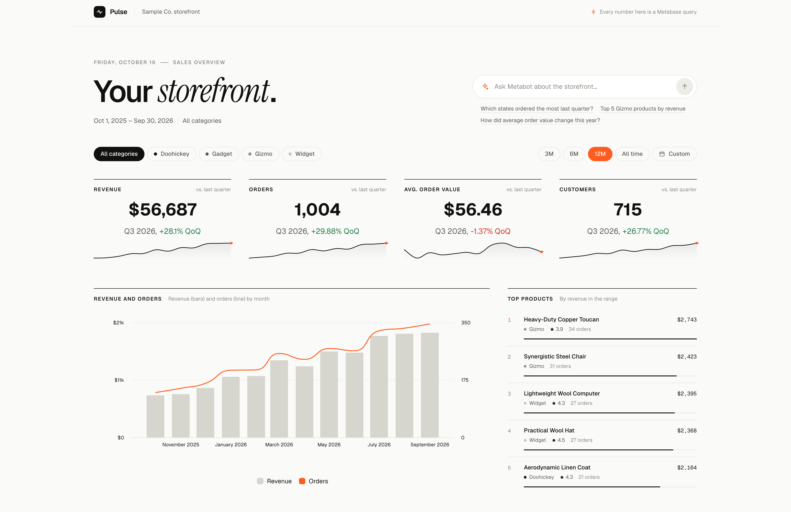

# Introduction to data apps



Data apps let you build small internal tools on your Metabase data, like portals, review queues, and forms, without standing up a separate app and backend. An app reads questions and metrics built on your [Library](../data-modeling/semantic-layer/library.md), and writes data through data actions that insert, update, or delete rows.

A data app runs with the permissions of the person who opens it. Their [data permissions](../permissions/data.md), including [row and column security](../permissions/row-and-column-security.md), apply to everything the app reads and writes.

An AI coding agent (like Claude Code or Codex) [builds the app](./build.md) on a development Metabase with the [Metabase CLI](../installation-and-operation/metabase-cli.md). You [ship it to production](./build.md#ship-the-app-to-production-with-remote-sync) with Remote Sync, and admins [manage it in Data Studio](./manage.md).

## Requirements

- A Pro or Enterprise plan
- An admin account, to manage apps in Data Studio and to create apps.
- An AI coding agent, like Claude Code or Codex.
- Node.js (LTS version) on the computer where you build the app.
- [Remote Sync](../installation-and-operation/remote-sync.md), to ship apps to production.
- The tables and metrics your apps read, [published to the Library](../data-modeling/semantic-layer/published-tables.md).
- [Actions enabled](../data-modeling/models/actions/introduction.md#enabling-actions-for-a-database) on the databases your apps write to.

## How people open data apps

People in an app's groups can open a live app at its address, `/apps/<slug>`. People can also open an app from the **Data apps** section of the left navigation sidebar, which lists the live apps they can open.

People can also find an app by searching for its name or description. Clicking the result opens the app. Search shows people only the live apps in their groups. Admins see every app.
