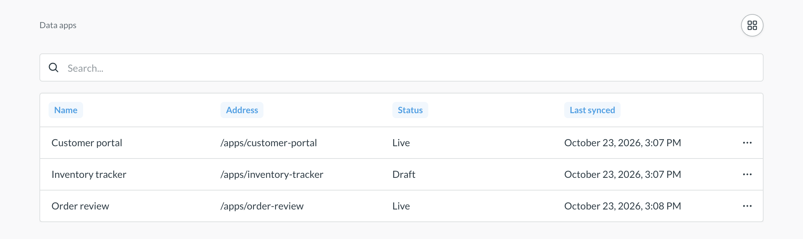
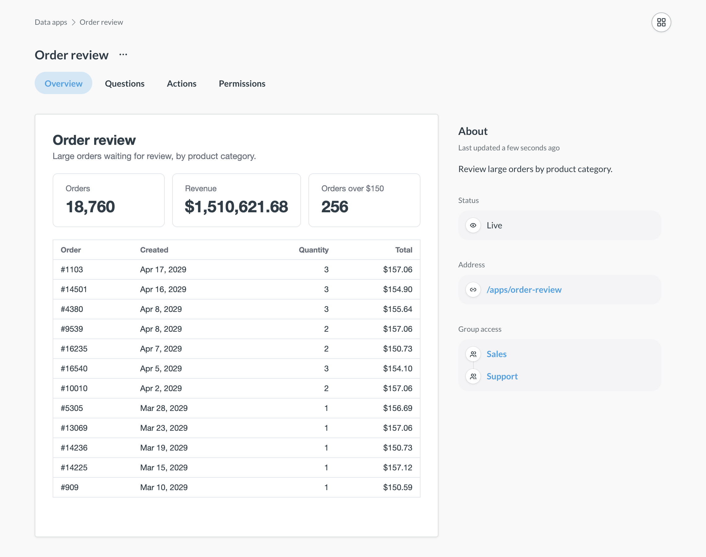
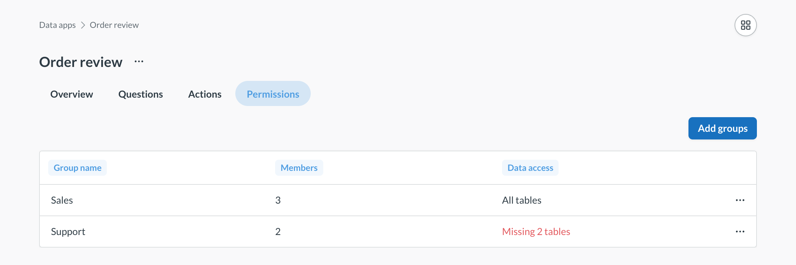

# Manage data apps

_Data Studio > Data apps_

> **Beta:** Data apps are in beta.



Only admins can manage data apps.

1. Click the **grid** icon in the upper right and select **Data studio**.
2. In the left sidebar, under **Library**, click **Data apps**.

The list shows each app's **Name**, **Address**, **Status**, and **Last synced** time. The address, `/apps/<slug>`, is where people open the app. The slug is the app's short name. **Last synced** is the last time the app itself changed, like a new bundle or a status change. Edits to the app's questions and actions don't update it.



To open a live app, click the **three dots** on the app's row and select **Open app**.

To embed a live app in your own site, click the **three dots** and select **Embed**. Metabase gives you the code to add to your site. To embed an app, you also need to set up [JWT SSO or SAML](../embedding/authentication.md).

## See what an app reads and writes

Before you let more people open an app, check which data the app reads and writes. In the list of data apps, click the app. The app's **Overview** tab has a preview of the app. The **Questions** and **Actions** tabs list the questions and actions in the app's collection, and the **Permissions** tab lists the groups that can open the app.



These tabs don't show everything that the app can read. The app can also query any table that the person who opens it can access, and the metrics in your semantic layer. The app can also get data from, and send data to, the [sites in `allowed_hosts`](./build.md#let-an-app-fetch-data-from-other-sites) in its manifest in your repository, `data_apps/<slug>/data_app.yaml`. See [what a data app can read and write](./build.md#what-a-data-app-can-read-and-write).

To see what a question or action depends on, open the question or action, and go to its **Dependencies** tab. To see the whole app, look up the app in the [dependency graph](../data-modeling/tools/graph.md).

To see the questions and actions that your apps run, who runs them, and what fails, check out [Data app analytics](../monitor/data-app-analytics.md) in Monitor. Data app analytics doesn't log requests to other sites.

## Make an app live or a draft

An app's status controls whether the app opens at its address:

- **Live**: Admins, and people in the app's groups, can open the app at its address.
- **Draft**: Nobody can open the app at its address, not even admins. Admins can only preview the app on its **Overview** tab in Data Studio.

New apps start live. Make an app a draft to take it offline, for example while you fix a problem. To change an app's status:

1. In the list of data apps, click the **three dots** on the app's row.
2. Select **Make draft** (or **Make live**), and confirm.

## Choose who can open an app

On the app's **Permissions** tab:

1. Click **Add groups**.
2. Search for one or more groups, and select them.
3. Click **Add**.

Admins can always open live apps, so you can't add the **Administrators** group. If an app has no groups, only admins can open it.

If you've [enabled tenants](../embedding/tenants.md#enable-multi-tenant-strategy), you can also add [tenant groups](../embedding/tenants.md#create-tenant-groups), including **All tenant users**. [Tenant users](../embedding/tenants.md#user-types) can open an app only if you add one of their tenant groups to it. Adding an [internal group](../embedding/tenants.md#group-types), like **All internal users**, doesn't give tenant users access.

### Check that groups can see the app's data

Adding a group to an app lets people in that group open the app, and gives the group read access to the app's collection. Adding a group doesn't change their [data permissions](../permissions/data.md).

If the Data access column shows Missing N tables, that group lacks [suspicious link removed] access to some tables used by the app's questions and actions. Keep these details in mind:

If the **Data access** column shows **Missing N tables**, that group lacks [Can view](../permissions/data.md#can-view-data-permission) access to some tables used by the app's questions and actions. Some notes on the permission check:

- **Group scope:** The check includes the group's permissions plus All Users (or All tenant users for tenant groups), but excludes access from other groups.
- **Row and column security:** Not checked. A group with [row and column security](../permissions/row-and-column-security.md) may show **All tables**, yet still be unable to run the app's actions on that database.
- **Sync lag:** Warnings rely on the [dependency graph](../data-modeling/tools/graph.md), which updates in the background and may lag behind recent edits.



To fix the group's access:

1. Click the group's row. A sidebar opens with the group's **Missing tables**.
2. Click a table, and select **Change permissions** to open that table's data permissions.

## Delete a data app

Data Studio doesn't have an option to delete apps. To delete an app, ask your agent, or delete these from your Git repository on a branch:

- `data_apps/<slug>/`
- `collections/data_apps/data_app__<slug>.yaml`
- `collections/data_apps/data_app__<slug>/`

Then merge the branch into the branch that your production Metabase pulls from, and [pull the changes](../data-modeling/semantic-layer/remote-sync.md#pulling-changes-from-git) into each Metabase that has the app.

Deleting an app also deletes its collection (with its questions and actions), its bundle, and its group access. To take an app offline without deleting it, [make it a draft](#make-an-app-live-or-a-draft).

## Isolate app code on a separate domain

By default, an app's code runs in a sandbox at your [Site URL](../configuring-metabase/settings.md#site-url), the same address where people log in to Metabase. If you self-host Metabase, you can add another layer of protection by running the app's code at a second address, where no one is logged in.

People don't go to the second address themselves. They still open apps at your Site URL, like `https://metabase.example.com/apps/sales`. The Metabase page at your Site URL shows the app in a frame, and only that frame uses the second address. The app's code can't send requests to Metabase on its own. To read or write data, the app asks the Metabase page, and the page makes the request for the person who's logged in.


[What an app can read and write](./build.md#what-a-data-app-can-read-and-write) stays the same.

Once you set up a second address, apps open only at your Site URL. If people can also reach your Metabase at other addresses, like an internal host name, the app page there shows an **Open data app** button that takes them to your Site URL.

Embedded data apps don't use the second address.

### Set up a second address

1. Make sure you've set your [Site URL](../configuring-metabase/settings.md#site-url).

2. Pick a host name on a separate domain, not a subdomain of your Metabase's domain. For example, if your Metabase is at `metabase.example.com`, use `example-isolated.com` instead of `apps.example.com`.

   Browsers treat subdomains of the same domain as one site. If app code at `apps.example.com` tried to send a request to `metabase.example.com`, the browser would include the person's session cookie. Metabase guards against these requests either way, but with a separate domain, the browser leaves out the cookie in the first place, as long as [`MB_SESSION_COOKIE_SAMESITE`](../configuring-metabase/environment-variables.md#mb_session_cookie_samesite) is `lax` (the default) or `strict`.

3. Point the host name at the same Metabase. Your reverse proxy must pass on the host name in the `Host` or `X-Forwarded-Host` header, so that Metabase can tell the two addresses apart. Otherwise, apps won't load. If Metabase runs under a path, use the same path on both addresses.

4. Set the [`MB_ISOLATED_ORIGIN`](../configuring-metabase/environment-variables.md#mb_isolated_origin) environment variable to the second address, then restart Metabase:

   ```
   MB_ISOLATED_ORIGIN=https://example-isolated.com
   ```

   The value can have only a scheme, host name, and port. Leave out the path, even if Metabase runs under one. The host name must differ from the Site URL's (a different port isn't enough), and the value must use `https` if the Site URL uses it.

If the value breaks these rules, or you haven't set a Site URL, Metabase turns off data apps (except embedded apps) until you fix the problem. The app page says **Data apps are unavailable**, and the [server logs](../monitor/application-logs.md) say why.
