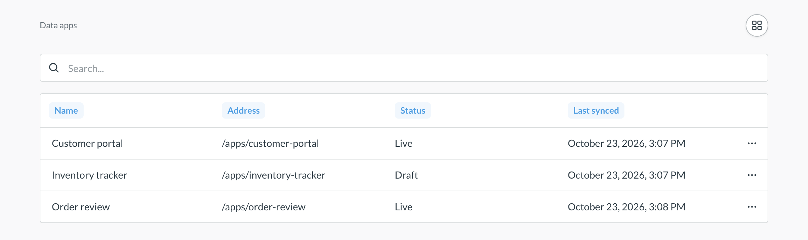
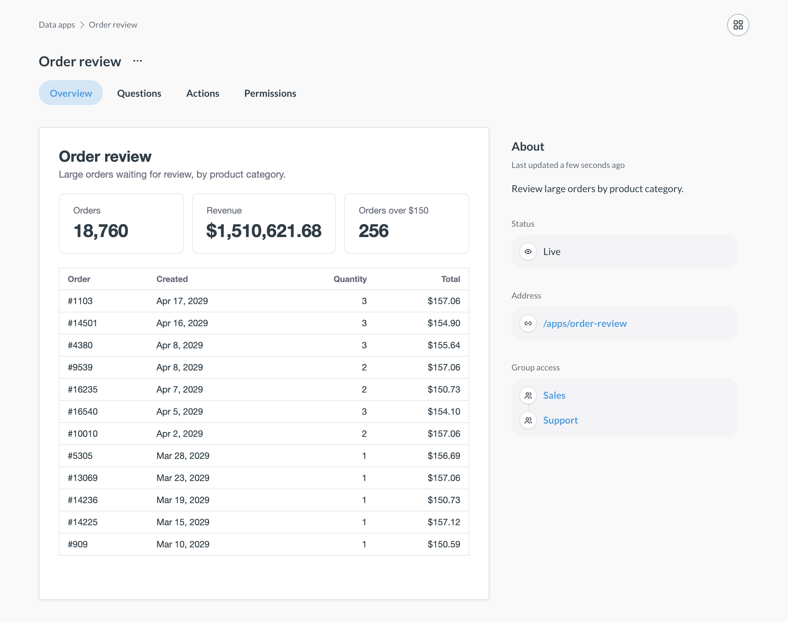
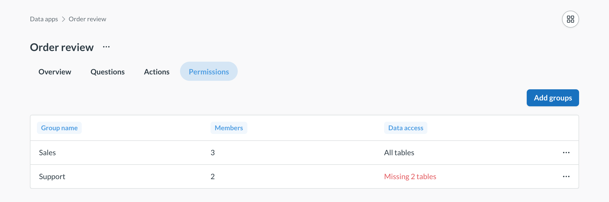

# Manage data apps

_Data Studio > Data apps_



Only admins can manage data apps. People in the [Data Analysts](../people-and-groups/managing.md#data-analysts) group can open Data Studio, but they don't see the **Data apps** tab.

1. Click the **grid** icon in the upper right and select **Data studio**.
2. In the left sidebar, under **Library**, click **Data apps**.

The list shows each app's **Name**, **Address**, **Status**, and **Last synced** time. The address is where people open the app, `/apps/<slug>`. **Last synced** is the last time the app itself changed, like a new bundle or a status change. Edits to the app's questions and actions don't update it.



To open a live app, click the **three dots** on the app's row and select **Open app**.

## See what an app reads and writes

Click an app in the list to see its details. Each app has four tabs:

- **Overview**: A live preview of the app, and the app's **Status**, **Address**, and **Group access**.
- **Questions**: The questions the app reads. Click a question to see it.
- **Actions**: The data actions the app uses to write data. Click an action to see its **Definition** and **Fields**.
- **Permissions**: The groups whose people can open the app.



If your Metabase has the [dependency graph](../data-modeling/tools/graph.md), each question and action also has a **Dependencies** tab. You can also [see the whole app in the dependency graph](../data-modeling/tools/graph.md#data-apps-in-the-dependency-graph).

To see the questions and actions that your apps run, who runs them, and what fails, check out [Data app analytics](../monitor/data-app-analytics.md) in Monitor.

## Make an app live or a draft

| Status                                    | Who can open the app                    |
| ----------------------------------------- | --------------------------------------- |
| **Live**                                  | Admins, and people in the app's groups. |
| **Draft**                                 | Nobody.                                 |
| **Live, outdated** or **Draft, outdated** | Nobody, until you migrate the app.      |

New apps start live. To change an app's status:

1. In the list of data apps, click the **three dots** on the app's row.
2. Select **Make draft** (or **Make live**), and confirm.

With the CLI, run `mb data-app set-enabled <slug> false` to make an app a draft, or `true` to make it live.

Making an app a draft doesn't change the app. To see a draft, preview it on its **Overview** tab.

An outdated app was built for an older version of data apps. To open it again, ask your agent to migrate the app to the current version, then build it and upload the new bundle.

## Choose who can open an app

On the app's **Permissions** tab:

1. Click **Add groups**.
2. In **Groups**, pick one or more groups.
3. Click **Add**.

You can add any group except **Administrators** and [tenant](../embedding/tenants.md) groups. People in tenants can't open data apps. If an app has no groups, only admins can open it.

### Check that groups can see the app's data

Adding a group to an app lets people in that group open the app, and gives the group read access to the app's collection. It doesn't change their [data permissions](../permissions/data.md). If the **Data access** column says **Missing N tables**, people in that group don't have [Can view](../permissions/data.md#can-view-data-permission) access to some of the tables that the app's questions and actions read. The check counts the group's own access and the access everyone gets from All Users, but not access that people get from their other groups.



The check uses the [dependency graph](../data-modeling/tools/graph.md). Without the graph, the **Data access** column can't warn you, and since the graph updates in the background, a warning can lag behind your latest edits.

To fix the group's access:

1. Click the group's row. A sidebar opens with the group's **Missing tables**.
2. Click a table, and select **Change permissions** to open that table's data permissions.

## How people open data apps

People in an app's groups can open a live app at its address, `/apps/<slug>`. People can also open an app from the **Data apps** section of the left navigation sidebar, which lists the live apps they can open.

People can also find an app by searching for its name or description. Clicking the result opens the app. Search shows people only the live apps in their groups. Admins see every app.

## Delete a data app

Data Studio doesn't have an option to delete apps. To delete an app, ask your agent, or run:

```sh
mb data-app delete <slug>
```

Deleting an app also deletes its collection (with its questions and actions), its bundle, and its group access. The groups themselves stay.

## What you can change in Read-only mode

If your Metabase uses [Remote Sync](../installation-and-operation/remote-sync.md) in Read-only mode, [pulls](./build.md#ship-the-app-to-production-with-remote-sync) are the only way to change an app. You can't create, edit, or delete apps, upload bundles, or edit an app's collection. A pull deletes an app when the app's files are gone from the repository. You can still make an app live or a draft, and choose its groups.
