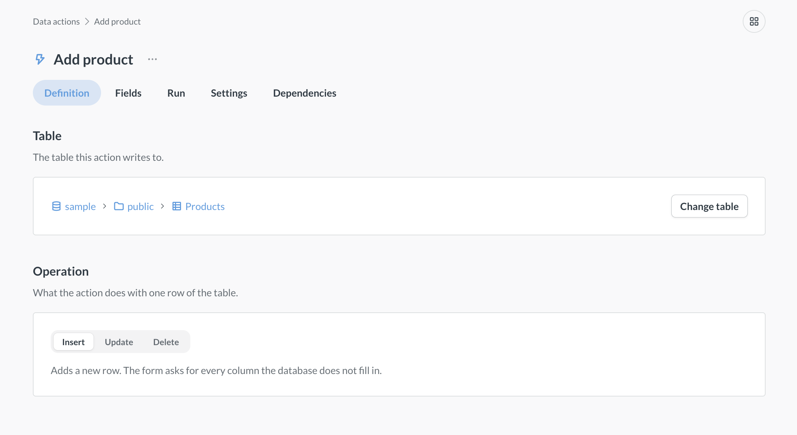
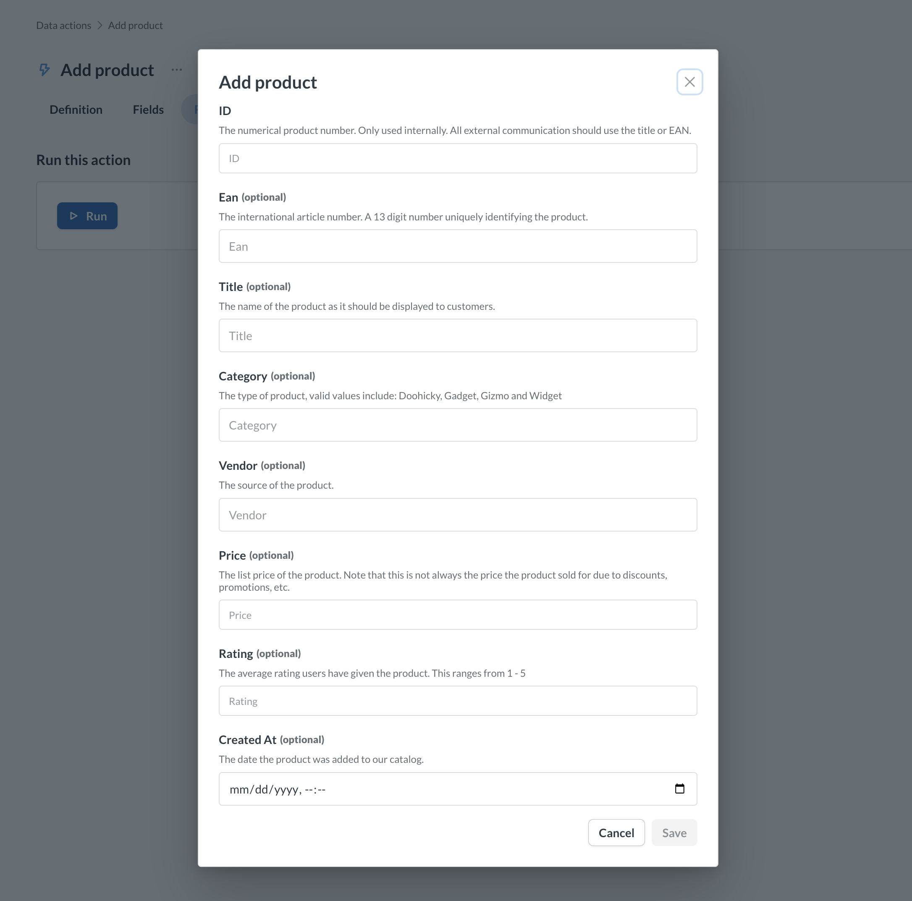

# Data actions

_Data Studio > Data actions_

Data actions are how [data apps](../data-apps/build.md) write to your database. A data app reads questions and metrics built on your [Library](./semantic-layer/library.md), and it saves changes through data actions. For example, a review queue can use a data action to approve a request, and an order portal can use one to mark an order as refunded.

Each data action does one job: it inserts, updates, or deletes rows. An admin sets up the action once, and people can only make the changes that the action allows. To see which actions an app can use, check out [What a data app can read and write](../data-apps/build.md#what-a-data-app-can-read-and-write).

You can also run data actions without a data app:

- **In Data Studio**, to test an action or make a one-off change. See [Run a data action](#run-a-data-action).
- **As a public form**, to collect data from people outside Metabase, like event sign-ups or feedback. See [Share a data action as a public form](#share-a-data-action-as-a-public-form).

Unlike [model actions](./models/actions/introduction.md), data actions don't belong to a [model](./models/models.md). You don't need to create a model first, and data actions stay put when someone moves a model to the trash. But you can't add data actions to [dashboard buttons](../dashboards/actions.md). For a dashboard button, use a model action.

If you [sync the Library](./semantic-layer/library.md#versioning-the-library) with [Remote Sync](../installation-and-operation/remote-sync.md), your data actions sync with it.

## Create a data action

Only admins can create data actions. The **New** button only shows up if an admin has [turned on data actions](./models/actions/introduction.md#enabling-actions-for-a-database) for at least one database.

You can create a data action in two ways:

- **[Write SQL](#create-a-data-action-with-sql)** for changes that need your own logic, like updating every order for a customer.
- **[Pick a table](#create-a-data-action-that-changes-one-row)** for an action that adds, updates, or deletes one row. Metabase builds the form from the table's columns.

### Create a data action with SQL

1. Go to [Data Studio](./data-studio.md#get-to-data-studio) > **Data actions**.
2. Click **New** > **SQL query**.
3. Write your SQL. Each {{ variable }} in the SQL becomes a field on the action's form. For examples, see [Example custom actions](./models/actions/custom.md#example-custom-actions).
4. Click **Save**, enter a **Name**, pick a **Folder**, and click **Save** again.

### Create a data action that changes one row

Pick a table and an operation, and Metabase builds the form from the table's columns. The table must have exactly one primary key.

1. Go to [Data Studio](./data-studio.md#get-to-data-studio) > **Data actions**.
2. Click **New** > **Table**, and pick a table. The picker only lists tables in databases with data actions turned on.
3. Under **Operation**, pick **Insert** to add a row, **Update** to change a row, or **Delete** to remove a row. Update and Delete find the row by its primary key, and Update keeps the current value of any field you leave empty.
4. Click **Save**, enter a **Name** (Metabase suggests one, like "Insert Orders"), pick a **Folder**, and click **Save** again.

## Run a data action

1. Go to **Data Studio** > **Data actions** and click the action.
2. Go to the **Run** tab and click the **Run** button.
3. Fill out the form and submit it. Metabase makes the change in your database.

If the **Run** button is grayed out, data actions are turned off for the action's database, or you don't have access to that database.

## Edit a data action

Go to **Data Studio** > **Data actions** and click the action.

- **To change what the action does**, go to the **Definition** tab. For a SQL action, click **Edit definition**. For a table action, click **Change table** or pick another **Operation**.
- **To change the action's form**, go to the **Fields** tab and click a field to change its type, input, default value, and more. A SQL action has one field for each {{ variable }} in the SQL. A table action has one field for each column that it writes (for Delete, only the primary key), and you can only show or hide these fields. If you turn off **Show field**, the action uses the field's default value.

## Share a data action as a public form

A public form lets anyone with the link run the action without signing in to Metabase.

1. Open the action and go to the **Settings** tab.
2. Turn on **Make public**, and copy the **Public link**.
3. Optional: Enter a **Success message** that people see after they submit the form.

Only admins can make an action public, and [public sharing](../embedding/public-links.md) must be on.

Public forms don't check [row and column security](../permissions/row-and-column-security.md#people-with-row-and-column-security-cant-run-actions). Anyone with the link can run the action, even on a database where row and column security applies to some groups.

## Check what uses a data action before you change it



Open the action and go to the **Dependencies** tab to see the action's [dependency graph](./tools/graph.md).

## Use folders to control who can run data actions

Anyone who can view a folder can run the actions in it. So use folders to give each group the actions it needs. For example, put the actions that your support team uses in a "Support" folder, and give only the Support group view access to that folder.

- **Create a folder**: Click **New** > **Collection**.
- **Change who can run a folder's actions**: Click the **three-dot** menu next to the folder, and select **Change permissions**. For actions that aren't in a folder, click the **three-dot** menu next to the **New** button, and select **Change permissions**.
- **Move an action to another folder**: Open the action, click the **three-dot** menu next to its name, and select **Move**.

## Archive and unarchive data actions

- **Archive an action**: Open the action, click the **three-dot** menu next to its name, and select **Archive**. Public forms that use an archived action stop working until you unarchive the action.
- **Archive a folder**: Click the **three-dot** menu next to the folder, and select **Archive**. Metabase archives the folder's actions with it.
- **Unarchive an action or folder**: Click the **three-dot** menu next to the **New** button, select **View archived actions**, and click the **Unarchive action** or **Unarchive folder** icon. Unarchiving a folder brings back the actions that Metabase archived with it, but not actions that someone archived on their own.

## Data action permissions

Anyone who can view a data action's folder can run the action. To run an action in Data Studio, people also need [access to Data Studio](./data-studio.md#permissions-for-data-studio). People without access to Data Studio can run an action through a [public form](#share-a-data-action-as-a-public-form), or through a [data app that they can open](../data-apps/manage.md#choose-who-can-open-an-app).

Only admins can create, edit, move, archive, or unarchive data actions and their folders. You can't give other groups [Curate access](../permissions/collections.md#collection-permission-levels) to data actions folders.

## Further reading

- [Introduction to actions](./models/actions/introduction.md)
- [Basic actions](./models/actions/basic.md)
- [Custom actions](./models/actions/custom.md)
- [Data Studio](./data-studio.md)
