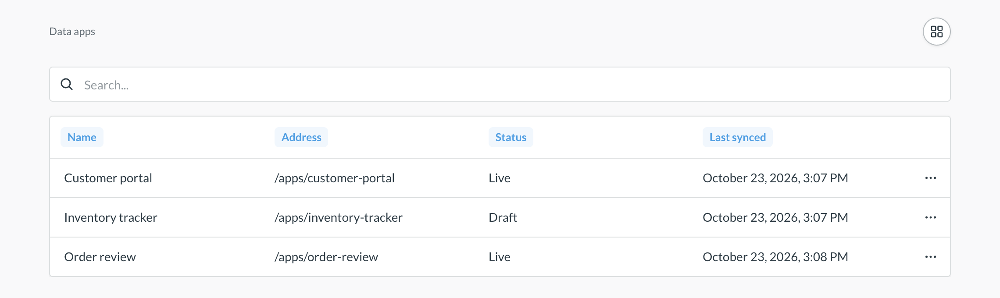
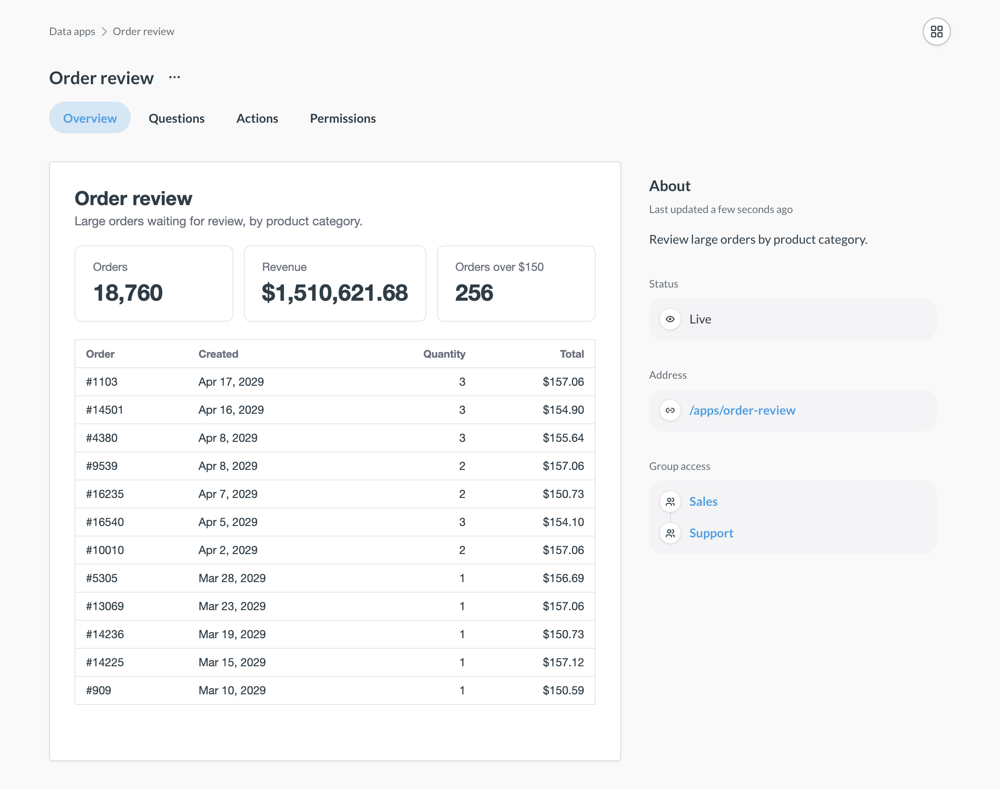
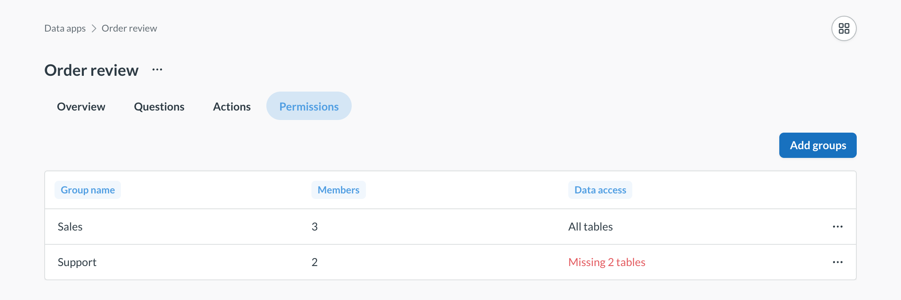

# Data apps

_Data Studio > Data apps_



Data apps let you build small internal tools on your Metabase data, like portals, review queues, and forms, without standing up a separate app and backend. An app reads questions and metrics built on your [Library](./semantic-layer/library.md), and writes data through data actions that insert, update, or delete rows.

An app runs with the permissions of the person who opens it. Their [data permissions](../permissions/data.md), including [row and column security](../permissions/row-and-column-security.md), apply to everything the app reads and writes.

You describe the app, and an AI coding agent (like Claude Code or Codex) builds it on a development Metabase with the [Metabase CLI](../installation-and-operation/metabase-cli.md). You then ship the app to production with [Remote Sync](../installation-and-operation/remote-sync.md). Admins manage the apps in Data Studio: they see what each app reads and writes, make apps live or drafts, and choose which groups can open them.

## Requirements

- A plan that includes data apps. Without it, Data Studio doesn't show the **Data apps** tab.
- An admin account, to manage apps in Data Studio and to create apps.
- An AI coding agent, like Claude Code or Codex.
- Node.js (LTS version) on the computer where you build the app.
- [Remote Sync](../installation-and-operation/remote-sync.md), to ship apps to production.
- The tables and metrics your apps read, [published to the Library](./semantic-layer/published-tables.md).
- [Actions enabled](./models/actions/introduction.md#enabling-actions-for-a-database) on the databases your apps write to.

## Build an app with your agent

### Set up your agent

1. [Install the Metabase CLI](../installation-and-operation/metabase-cli.md#install-the-cli), and [log it in](../installation-and-operation/metabase-cli.md#authenticate-the-cli) to your development Metabase as an admin.
2. Install the [metabase-cli skill](../installation-and-operation/metabase-cli.md#the-metabase-cli-skill) for your agent.

The CLI comes with its own data app skills, so the instructions your agent reads always match the version of the CLI it runs.

### Ask your agent to build the app

Metabase stores an app's built bundle, not its source code. The source code stays in the directory where your agent builds the app, and the agent needs it to change the app later. If you use Remote Sync, start your agent in a local clone of your Remote Sync repository. The agent then puts the source code in `data_apps/<slug>/`, so the code goes in the repository with the app. See [Keep an app's source code in your repository](#keep-an-apps-source-code-in-your-repository).

Ask your agent to create a Metabase data app, and follow its instructions. For example:

```text
Create a Metabase data app that lets people look up product info, and add, edit, or remove products.
```

Your agent might ask for permission to run commands on your computer, like `mb data-app create`, `npm run dev`, and `npm run build`. Approve them.

The agent creates the app on your Metabase, adds the questions and actions the app needs to the [app's collection](#what-a-data-app-can-read-and-write), writes the code, and uploads the built app. When it's done, it gives you the app's address, `/apps/<slug>`. Admins can open the app right away. To let other people open it, [add their groups](#choose-who-can-open-an-app) to the app.

Until an app has a bundle, its address shows **This data app isn't ready yet**. The agent uploads the bundle when it builds the app, and Remote Sync brings the bundle to each Metabase that pulls the app. A bundle can be up to 10 MiB.

### Preview the app on your computer

The agent starts a preview of the app with `npm run dev`. The `Local:` line in the command's output shows the preview URL. Open the preview in your browser, and keep the tab open while the agent works: the agent reads the app's errors from the open preview.

To start the preview yourself, change into the app's directory and run:

```sh
npm run dev
```

The preview needs an admin [API key](../people-and-groups/api-keys.md). The agent creates the key on your development Metabase, writes it into a `.env.local` file that Git ignores, and deletes the key when it's done. Don't paste API keys into the chat. Since the preview uses an admin key, it shows what an admin can see, not what the app's viewers can see.

> **The preview changes your data:** The local preview runs the app's actions against your development Metabase's databases. Use test data when you try out adds, edits, or deletes.

### Change an app later

To change an app, start your agent in the app's directory (or in your Remote Sync repository), and ask for the change. The agent updates the code, builds the app again, and uploads the new version. People see the new version right away.

### What a data app can read and write

An app's collection can hold only questions, metrics, and data actions. When your agent saves an item to the collection, Metabase refuses it if it breaks one of these rules:

- Questions must be built with the query builder, not SQL. They can read only [tables published to the Library](./semantic-layer/published-tables.md) and metrics from the Library, so they can't start from or join another saved question or model. If a question reads something else, the error names what it read.
- Questions and metrics in the collection can't be archived, public, or embedded, and they can't be in a dashboard or a document.
- Actions can be table actions, which insert, update, or delete one row of a table published to the Library, or query actions, which run SQL. Actions can't belong to a model, and they can't be archived or public. An action can refer only to questions in the app's collection, and its fields can't get their values from a question.

Only admins can edit an app's collection. You can't move the app's collection, move it to the trash, or make it official.

### Let an app fetch data from other sites

A data app runs in a sandbox. By default, the app can't make network requests to other sites. To let an app fetch data from a site, ask your agent to add the site's origin, like `https://api.example.com`, to the app's `allowed_hosts`. An origin that starts with `*.`, like `https://*.example.com`, matches subdomains, but not the domain itself.

## Manage data apps in Data Studio

Only admins can manage data apps. People in the [Data Analysts](../people-and-groups/managing.md#data-analysts) group can open Data Studio, but they don't see the **Data apps** tab.

1. Click the **grid** icon in the upper right and select **Data studio**.
2. In the left sidebar, under **Library**, click **Data apps**.

The list shows each app's **Name**, **Address**, **Status**, and **Last synced** time. The address is where people open the app, `/apps/<slug>`. **Last synced** is the last time the app itself changed, like a new bundle or a status change. Edits to the app's questions and actions don't update it.



### See what an app reads and writes

Click an app in the list to see its details. Each app has four tabs:

- **Overview**: A live preview of the app, and the app's **Status**, **Address**, and **Group access**.
- **Questions**: The questions the app reads. Click a question to see it.
- **Actions**: The data actions the app uses to write data. Click an action to see its **Definition** and **Fields**.
- **Permissions**: The groups whose people can open the app.



If your Metabase has the [dependency graph](./tools/graph.md), each question and action also has a **Dependencies** tab. You can also [see the whole app in the dependency graph](./tools/graph.md#data-apps-in-the-dependency-graph).

To see the questions and actions that your apps run, who runs them, and what fails, check out [Data app analytics](../monitor/data-app-analytics.md) in Monitor.

### Make an app live or a draft

| Status                                    | Who can open the app                    |
| ----------------------------------------- | --------------------------------------- |
| **Live**                                  | Admins, and people in the app's groups. |
| **Draft**                                 | Nobody.                                 |
| **Live, outdated** or **Draft, outdated** | Nobody, until you migrate the app.      |

New apps start live. To change an app's status:

1. In the list of data apps, click the **three dots** on the app's row.
2. Select **Make draft** (or **Make live**), and confirm.

With the CLI, run `mb data-app set-enabled <slug> false` to make an app a draft, or `true` to make it live.

Making an app a draft doesn't change the app. At a draft's address, people see **You don't have access to this data app**, and admins see **Data app not found**. To see a draft, preview it on its **Overview** tab.

An outdated app was built for an older version of data apps. Everyone who opens it, admins too, sees **This data app is outdated**. To open it again, migrate it to the current version, then build it and sync it again.

### Choose who can open an app

On the app's **Permissions** tab:

1. Click **Add groups**.
2. In **Groups**, pick one or more groups.
3. Click **Add**.

You can add any group except **Administrators** and [tenant](../embedding/tenants.md) groups. People in tenants can't open data apps. If an app has no groups, only admins can open it. People who aren't in any of the app's groups see **You don't have access to this data app**.

### Check that groups can see the app's data

Adding a group to an app lets people in that group open the app, and gives the group read access to the app's collection. It doesn't change their [data permissions](../permissions/data.md). If the **Data access** column says **Missing N tables**, people in that group don't have [Can view](../permissions/data.md#can-view-data-permission) access to some of the tables that the app's questions and actions read. The check counts the group's own access and the access everyone gets from All Users, but not access that people get from their other groups.



Metabase finds those tables with the [dependency graph](./tools/graph.md). Without the dependency graph, the **Data access** column can't warn you about missing tables. The graph updates in the background, so a warning can lag behind your latest edits.

To fix the group's access:

1. Click the group's row. A sidebar opens with the group's **Missing tables**.
2. Click a table, and select **Change permissions** to open that table's data permissions.

## How people open data apps

People in an app's groups can open a live app at its address, `/apps/<slug>`. If no app has that slug, the address shows **Data app not found**. People can also open an app from the **Data apps** section of the left navigation sidebar, which lists the live apps they can open.

People can also find an app by searching for its name or description. Clicking the result opens the app. Search shows people only the live apps in their groups. Admins see every app.

To open a live app from Data Studio, click the **three dots** on the app's row and select **Open app**.

## Ship an app to production with Remote Sync

When [Remote Sync](../installation-and-operation/remote-sync.md) is on, it always syncs your data apps.

1. On your development Metabase (in Read-write mode), [push your changes](../installation-and-operation/remote-sync.md#pushing-changes-to-git).
2. On your production Metabase (in Read-only mode), [pull the changes](../installation-and-operation/remote-sync.md#pulling-changes-from-git).

   If the pull fails with **A data app named "`<slug>`" already exists on this instance**, another app on that Metabase already uses the slug. Give the app in the repository another slug, or delete the other app. You can't delete apps in Read-only mode, so switch that Metabase to Read-write mode first.

3. On your production Metabase, [add groups](#choose-who-can-open-an-app) to the app.

Remote Sync doesn't sync an app's status (live or draft) or its group access, so each Metabase keeps its own. A new app starts live on your production Metabase, and only admins can open it until you add groups there.

On a Metabase in Read-only mode, you can't create, edit, or delete apps, upload bundles, or edit an app's collection: pulls are the only way to change an app. You can still make an app live or a draft, and choose its groups.

### What syncs with a data app

Remote Sync syncs the app's manifest, its bundle, and its collection with its questions and actions. You can't sync an app's collection on its own: the collection syncs with its app. In your repository:

- `data_apps/<slug>/data_app.yaml` is the app's manifest.
- `data_apps/<slug>/` also holds the app's bundle.
- `collections/data_apps/` holds the app's collection.

If a pull fails with **Bundle file "`<path>`" not found**, the app's bundle isn't in the repository at the path that the app's manifest names.

### Keep an app's source code in your repository

Pushes from Metabase write the app's `data_app.yaml` and bundle to the app's directory, `data_apps/<slug>/`, and leave your source code alone. Don't edit those two files by hand. The template's `.gitignore` keeps `node_modules/`, `build/`, and `.env.local` out of your repository.

To commit the source code, ask your agent. The agent pushes your changes from Metabase, pulls the branch that Metabase pushed to, and commits and pushes the source code. Then it pulls the changes into Metabase, so that Metabase's next push doesn't conflict with the commit.

## Delete a data app

Data Studio doesn't have an option to delete apps. To delete an app, ask your agent, or run:

```sh
mb data-app delete <slug>
```

Deleting an app also deletes its collection (with its questions and actions), its bundle, and its group access. The groups themselves stay.

On a Metabase in Read-only mode, you can't delete apps, but a pull deletes an app when its files are gone from the repository.
