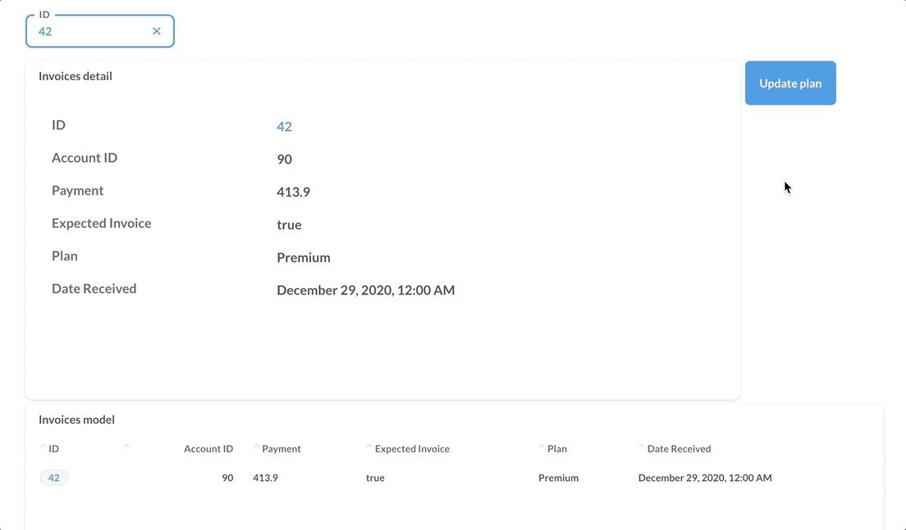

# Model actions

Model actions are actions that belong to a [model](../models.md). We recommend [data actions](../../data-actions.md) over model actions, since data actions don't need a model. Create a model action only when you need an action button on a dashboard.

## [Introduction to model actions](./introduction.md)

Use model actions to update your data based on user input or values on the page.

## [Basic actions](./basic.md)

Metabase will create basic actions that auto-track a model's schema.

## [Custom actions](./custom.md)

Write SQL to create new actions.

## [Actions on dashboards](../../../dashboards/actions.md)

Add actions on dashboards as buttons that you can pass filter values to.
