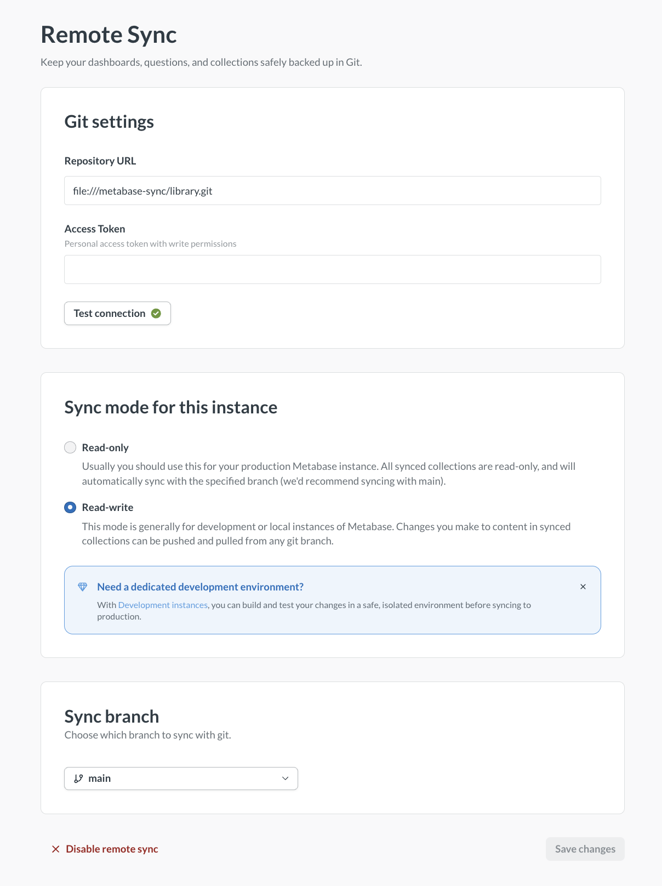
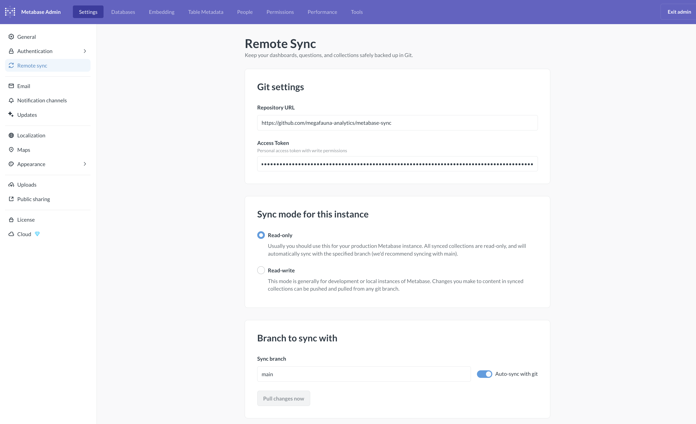

# Remote sync



Remote sync stores your [Library](./library.md) and [transforms](../transforms/transforms-overview.md) in a Git repository. You develop the Library in a development Metabase, push it to Git, review it in a pull request, and a read-only production Metabase pulls in the merged result.

Remote sync syncs:

- The Library: published tables with their segments and measures, metrics, dashboards, documents, data apps, SQL snippets, data actions, and the glossary.
- Transforms: their tags, tests, folders, and Python libraries.

Metabase doesn't sync any of your data. All Metabase stores in Git are [YAML files](./serialization.md#example-of-a-serialized-question) that describe your analytics content. Your actual data stays in your databases and never leaves your Metabase.

> **Metabase 65 and later syncs the Library and transforms.** Earlier versions let you pick which top-level collections to sync. Starting in Metabase 65, Remote sync syncs the Library and transforms, and there is no list of collections to choose from. If you already synced other collections before upgrading, your setup keeps working. See [Syncing other collections](#syncing-other-collections).

## How Remote sync works

Here's a basic Remote sync workflow:

1. Publish a table, create a metric, or build a dashboard in the Library of a **Metabase in Read-write mode**.
2. Push the change to a Git branch.
3. Open a pull request for review.
4. Merge the pull request to your main branch.
5. Your **Metabase in Read-only mode** pulls in the change.

Two Metabases that point at the same branch share the same Library. A new Metabase has nothing to push, so its first pull doesn’t conflict.

## Treat write access to your repository like admin access

When a Metabase pulls from your repository, it loads the YAML files on its branch _without_ checking who wrote them. Anyone who can push to that branch can change that Metabase's synced content. If you turn on [auto-sync](#pulling-changes-automatically), changes merged to the branch show up in your Metabase within minutes, and no one in Metabase approves them first.

Your repository can't change users, groups, or permissions, because those [don't sync](#what-metabase-syncs). But when a pull creates a new collection, that collection gets the same permissions as its parent.

## Key concepts

### Remote sync has two modes for different roles

- **Read-write mode**: Create and edit Library content and transforms. You can [push](#pushing-changes-to-git) and [pull](#pulling-changes-from-git) changes to and from your repository. Multiple Metabases can connect in Read-write mode, each working on [different branches](#branch-management).
- **Read-only mode**: Read-only Metabases only [pull](#pulling-changes-from-git) changes, typically from your main branch. In Read-only mode, you can't edit Library content, create segments or measures on published tables, or edit transforms. You can set up [auto-sync](#pulling-changes-automatically) to pull approved changes every five minutes.

### Content is stored as YAML files

Remote sync stores your content as [YAML files](./serialization.md#example-of-a-serialized-question) in your Git repository. Each published table, metric, dashboard, document, and transform becomes a YAML file that can be reviewed in pull requests and versioned like code.

### Remote sync excludes table metadata

Table metadata doesn't sync. Table metadata includes things like table names, column types, descriptions, and visibility settings. If you need to version table metadata, use [serialization](./serialization.md) instead.

### One branch at a time per Metabase

You can only have [one branch at a time per Metabase](#branching-limitations).

## Setting up Remote sync

You'll need to be an admin to set up Remote sync.

1. [Set up a repository to store your content](#1-set-up-a-repository-to-store-your-content)
2. [Create a token for your read-write Metabase](#2-create-a-token-for-your-read-write-metabase)
3. [Connect your development Metabase to your repository](#3-connect-your-development-metabase-to-your-repository)
4. [Push your changes to your repository](#4-push-your-changes-to-your-repository)
5. [Create a token for your read-only Metabase](#5-create-a-token-for-your-read-only-metabase)
6. [Connect your production Metabase to your repository](#6-connect-your-production-metabase-to-your-repository)

### 1. Set up a repository to store your content

Before you connect Metabase to your Git repository, create a new repository. Supported providers include:

- [GitHub](https://docs.github.com/en/repositories/creating-and-managing-repositories/creating-a-new-repository)
- [GitLab](https://docs.gitlab.com/user/project/index.html#create-a-blank-project)
- [Bitbucket](https://support.atlassian.com/bitbucket-cloud/docs/create-a-repository/)
- [Local repo](#local-file-repositories): a bare git repo on your own filesystem.

Initialize the repo with a README.md.

Anyone who can push to this repository can change content in your synced Metabases, so [limit who has write access](#treat-write-access-to-your-repository-like-admin-access).

### 2. Create a token for your read-write Metabase

> Skip this step if you're using a [local repo](#local-file-repositories).

Create a personal access token with read and write repository access. Copy the token immediately; you won't be able to see the token again.

- **GitHub**: Create a [fine-grained personal access token](https://docs.github.com/en/authentication/keeping-your-account-and-data-secure/managing-your-personal-access-tokens) with **Contents: Read and write** and **Metadata: Read-only** permissions.
- **GitLab**: In **User Settings** > **Personal access tokens**, [create a token](https://docs.gitlab.com/user/profile/personal_access_tokens/) with **read_repository** and **write_repository** scopes. Tokens have an expiration date (your admin may set a maximum lifetime).
- **Bitbucket**: In your Bitbucket repository, go to **Repository settings** > **Security** > **Access tokens** and click **Create access token**. Give it a name and, under **Scopes**, select:
  - **Repositories**: **Read** and **Write**
  - **Pull requests**: **Read** and **Write**

  Click **Create** and copy the token immediately, you can't view the token again after closing the dialog.

  The created token must have these scopes (visible in the **View access token** dialog after creation):
  - `repository`
  - `repository:write`
  - `pullrequest`
  - `pullrequest:write`

### 3. Connect your development Metabase to your repository



You can put any Metabase into Read-write mode. We also offer [Development instances](./development-instance.md) that you can use for Remote sync or any other kind of development.

In the Metabase that you use for development:

1. Go to **Admin** > **Settings** > **Remote sync**. You can also click **Set up remote sync** at the bottom of the Data Studio sidebar.

2. Enter your repository URL:
   - For example, `https://github.com/your-org/your-repo` or `https://bitbucket.org/your-workspace/your-repo` (note the `https`). The repository must already exist and be initialized with at least one commit.

3. Select **Read-write mode**.

4. Add your access token:
   - Paste the personal access token (PAT) you created earlier. Make sure the token has [read and write permissions](#2-create-a-token-for-your-read-write-metabase). Metabase encrypts your token before storing it.

5. Test the connection:
   - Click **Test connection** to check whether Metabase can reach your repository. If the connection fails, make sure your token has the appropriate permissions and hasn't expired. If you copied the token incorrectly, generate a new one.
   - Metabase also checks the connection when you save your settings.

6. Save your settings.

When you save, Metabase creates the Library if it doesn’t exist yet and turns on syncing for the Library and transforms. There are no collections to choose.

### 4. Push your changes to your repository

Once you've added content to your Library, a yellow dot appears next to the Library section that changed (for example, **Semantic layer**), indicating uncommitted changes.

1. At the top of the Data Studio sidebar, click the branch name and select **Push changes**.

2. (Optional) Describe your changes (e.g., "Published the Mammoth Populations table").

3. Click **Push changes** to commit and push your changes to your repository.

Check your repository. You should see a `collections` folder with the Library and a `databases` folder with your published tables.

By default, you push to your repository's main branch. You can choose (or create) a different branch so you can open pull requests for review. See [Branch management](#branch-management) for details on creating and switching branches.

### 5. Create a token for your read-only Metabase

Create a personal access token with read-only repository access. Copy the token immediately; you won't be able to see the token again.

- **GitHub**: Create a [fine-grained personal access token](https://docs.github.com/en/authentication/keeping-your-account-and-data-secure/managing-your-personal-access-tokens) with **Contents: Read-only** and **Metadata: Read-only** permissions.
- **GitLab**: In **User Settings** > **Personal access tokens**, [create a token](https://docs.gitlab.com/user/profile/personal_access_tokens/) with **read_repository** scope only.
- **Bitbucket**: In your Bitbucket repository, go to **Repository settings** > **Security** > **Access tokens** and click **Create access token**. Under **Scopes**, select:
  - **Repositories**: **Read**
  - **Pull requests**: **Read**

  Leave Write and all other scope groups unchecked. Click **Create** and copy the token immediately.

  The created token must have these scopes (visible in the **View access token** dialog after creation):
  - `repository`
  - `pullrequest`

### 6. Connect your production Metabase to your repository



In your production Metabase:

1. Go to **Admin** > **Settings** > **Remote sync**.

2. Enter your repository URL:
   - Use the same repository as your development Metabase, for example, `https://github.com/your-org/your-repo` (note the `https`).

3. Select **Read-only mode**.

4. Add your access token:
   - Paste the read-only personal access token you created for this production Metabase.

5. Test the connection:
   - Click **Test connection** to check whether Metabase can reach your repository. If the connection fails, verify your token has the appropriate permissions and hasn't expired.
   - Metabase also checks the connection when you save your settings.

6. Sync your content:
   - Click **Pull changes now** to immediately sync content from your repository.
   - To keep your production Metabase automatically updated, toggle on **Auto-sync with git**. Metabase pulls changes from your main branch every five minutes.

A Read-only Metabase doesn’t create a Library of its own. It gets the Library from the pull.

At this point, you should be all set up. Exit Admin, then reload your browser. You should see the Library in your production Metabase.

## Syncing transforms

Remote sync versions your [transforms](../transforms/transforms-overview.md), including their tags, tests, folders, and Python libraries. Some things to keep in mind:

- **Jobs don't sync.** Each Metabase keeps its own jobs. Tag your transforms with the built-in hourly, daily, weekly, or monthly tags so the matching built-in jobs run them on every Metabase, or create the jobs you need on each Metabase.
- **Built-in tags and the default `common.py` don't sync.** Only custom tags and Python libraries you've changed are tracked.
- **Transform syncing is all or nothing.** Metabase syncs your entire transforms namespace. You can't selectively sync specific transform folders.
- **You can't edit transforms in Read-only mode.** Keeping transforms read-only prevents unintended overwrites on subsequent pulls.
- **Use different databases for dev and production.** If you use transforms with Remote sync, your development and production Metabases should connect to separate databases that share _identical_ schemas. If you use the same database for both, dev transforms would also change production data.

## Local file repositories

Remote sync can point at a bare git repo on the same filesystem as your Metabase process, via a `file://` URL. Local repos come in handy for local development, especially alongside the [agent-driven development workflow](../ai/agent-driven-development.md).

Create a bare git repo on the same filesystem as your Metabase process:

```sh
git init --bare /path/to/your-repo.git
```

Remote sync needs at least one commit on the repository. To add one, clone the bare repo, make an empty commit, and push it:

```sh
git clone /path/to/your-repo.git seed && cd seed
git commit --allow-empty -m "init" && git push origin HEAD:main
```

A bare repo is required because Remote sync pushes into it the same way it would push to a hosted remote. Non-bare repos refuse pushes to a checked-out branch.

### Point Metabase to your local repo

Use the `file://` scheme with an absolute path:

```
file:///absolute/path/to/your-repo
```

Note the three slashes: `file://` plus the leading `/` of the absolute path.

Leave the access token field blank. Local `file://` repositories don't need one.

If Metabase runs in Docker, you'll need to mount the directory as a volume and the **`file://` URL must use the container's path**, not the host path. Metabase's process runs inside the container and can only see paths visible from inside it.

With `docker-compose.yml`:

```yaml
services:
  metabase:
    image: metabase/metabase
    ports:
      - "3000:3000"
    volumes:
      - /Users/you/local-repo:/Users/you/local-repo
```

Then in Metabase, you'd enter:

```
file:///Users/you/local-repo
```

## An example dev-to-production workflow

Let's say your team wants to publish a new table and build a dashboard with it. Here's a workflow that ensures all production content goes through a review process.

### Step 1: Create a new branch

In your development Metabase, go to **Admin** > **Settings** > **Remote sync** and [create a new branch](#creating-a-branch) for your work, like `feature/megafauna-dashboard`.

### Step 2: Create content in your development Metabase

In Data Studio, publish the `Megafauna` table to the Library and add a measure to it. Create a dashboard called "Megafauna Analytics" in the Library and add some questions to it.

### Step 3: Push to your development branch

[Push your changes](#committing-and-pushing-your-changes) to `feature/megafauna-dashboard` with a commit message like "Add a Megafauna table and dashboard".

### Step 4: Create a pull request

In your Git repository:

1. Create a pull request from your branch, `feature/megafauna-dashboard`, to the main branch `main`.
2. Review the changes to the YAML files representing your published table, measure, dashboard, and questions.
3. Someone who knows what they're doing approves and merges the PR.

### Step 5: Production automatically updates

On your production Metabase:

1. Within five minutes, Auto-sync detects the new commits on `main` (you can also manually pull the changes).
2. The published table and the "Megafauna Analytics" dashboard appear in the Library with all their questions.
3. The content is read-only (people can view and use it, but can't edit it).

## How the Library works in Read-write mode

### The Library in the UI

When the Library has unsynced changes, a yellow dot appears next to the Library section that changed (for example, **Semantic layer**). At the top of the Data Studio sidebar, click the branch name to push or pull changes.

In the main Metabase sidebar, the Library sections (Data, Metrics, and Dashboards) show a sync icon to indicate that they are versioned.

### Moving and deleting Library content

When you remove content from the Library in Read-write mode and push that change, Metabase also removes the content from your production Metabase when it syncs. This applies to moving content out of the Library or deleting it entirely.

Content in other Metabases that depended on this item may break, because the dependency is no longer in the Library.

### Library content must be self-contained

Everything a Library dashboard or question needs must be in the Library. This includes:

- Questions that reference other questions
- Dashboards with questions
- Click behaviors linking to other items
- Filters that pick values from other questions
- @ mentions of other items in documents

## What Metabase syncs

Remote sync uses the same serialization format as the [Metabase CLI serialization feature](./serialization.md), storing your content as YAML files in your Git repository.

**What syncs:**

- The Library's collection structure
- Published tables with their segments and measures
- Metrics
- Dashboards and their cards
- Documents
- Data apps
- SQL snippets
- Data actions
- The glossary
- Timelines and events
- Transforms, including tags, tests, folders, and Python libraries

**What doesn't sync:**

- Users, groups, and permissions
- Alerts and subscriptions
- Database connections (see [Synced content that uses a database your Metabase doesn't have](#synced-content-that-uses-a-database-your-metabase-doesnt-have))
- Transform jobs
- Built-in transform tags and the default `common.py`
- Collections outside the Library, including personal collections (see [Syncing other collections](#syncing-other-collections))
- Table metadata (table names, column types, descriptions, visibility settings, etc.)
- A data app's live or draft status, and its group access

### Synced content that uses a database your Metabase doesn't have

Synced content points to databases by their display name, so give the database the same name on your development and production Metabases. If a pull brings in content that uses a database your Metabase doesn't have, Metabase creates a placeholder for that database, without connection details. In **Admin** > **Databases**, the placeholder's status is **Stubbed**. Questions and transforms that use the database can't run until an admin opens the stubbed database and enters its connection details. Once you save the connection details, the status changes to **Active**.

## Branch management

Branching is only available in Read-write mode.

### Creating a branch

You can create branches in Metabase or directly in your Git repository. Branches created in Git appear in Metabase once Metabase syncs with your repository.

Before creating branches, push an initial commit to your main branch.

To create a new branch in Metabase:

1. Go to **Admin** > **Settings** > **Remote sync**.
2. Under **Sync branch**, click the current branch.
3. Type a name for the new branch and click **Create branch "[name]"**.

The new branch is created from your current commit (not the latest commit from the remote), and Metabase switches to it.

### Switching branches

1. Go to **Admin** > **Settings** > **Remote sync**.
2. Under **Sync branch**, click the current branch and select a different branch. This will change the branch for everyone in your Metabase (see [limitations](#branching-limitations)).

If the branch doesn't appear, ensure it exists in your Git repository and that the name matches exactly (branch names are case-sensitive).

If you have unsynced changes, Metabase lists them and asks what to do:

- **Push changes to the current branch, [branch]:** Commits your changes to the current branch. You stay on that branch, so pick the other branch again afterward.
- **Create a new branch and push changes there:** Commits your changes to a new branch and switches you to it.
- **Delete unsynced changes (can't be undone):** Throws away your uncommitted changes and switches you to the branch you picked.

You can't switch to Read-only mode while you have unpushed changes.

### Branching limitations

- **Only admins can manage branches**. Non-admins don't see the branch controls.
- **The current branch is instance-wide**. This means that everyone on the same Metabase is on the same branch at the same time. You can't have different people working on different branches in a single Metabase.

Limiting a Metabase to a single branch at a time means that the typical Git feature-branch workflow is a bit different here: only admins can switch branches, create new branches, or push and pull changes. If you need multiple branches worked on simultaneously, the workaround is to spin up multiple Metabases in Read-write mode, one Metabase per branch.

These limits only apply in Metabase. In your Git repository, anyone with write access can create branches and push changes, and Metabase loads those changes when it pulls. See [Treat write access to your repository like admin access](#treat-write-access-to-your-repository-like-admin-access).

## Pushing changes to Git

You can only push changes in a Metabase with Remote sync set to Read-write mode.

### Committing and pushing your changes

When you make changes to the Library or to transforms, a yellow dot appears next to the section that changed (indicating uncommitted changes). To commit and push your changes:

1. At the top of the Data Studio sidebar, click the branch name and select **Push changes**.
2. (Optional) Describe your changes.
3. Click **Push changes** to push your changes to Git.

If the branch has new commits since you last pulled, Metabase asks how to handle them before it pushes yours: merge them with yours (when they don't conflict), push your changes to a new branch, or force push over them.

## Pulling changes from Git

You can pull changes when in Read-write or Read-only mode.

In Read-write mode, click the branch name at the top of the Data Studio sidebar and select **Pull changes**. Metabase imports the latest content from Git.

In Read-only mode, go to **Admin** > **Settings** > **Remote sync** and click **Pull changes now**.

If changes don't appear after pulling:

- Verify you're on the correct branch.
- Hard refresh your browser (Cmd/Ctrl + Shift + R).
- If you encounter sync errors, review error messages in the sync dialog, manually resolve conflicts in your Git repository, then pull again.

### Handling unsynced changes when you pull

If you have local uncommitted changes when you pull, Metabase lists them and asks what to do:

- **Merge the remote changes into your local content:** Only offered when the changes merge cleanly.
- **Create a new branch and push changes there:** Saves your work to a new branch.
- **Force push to [branch], discarding and overwriting everything (can't be undone):** Overwrites the remote branch with your local content.
- **Delete unsynced changes (can't be undone):** Throws away your uncommitted changes to accept what's in Git.

When in doubt, create a new branch and push changes to that branch. That way you won't lose any work.

### Pulling changes automatically

In Read-only mode, you can set Metabase to auto-sync changes from your main branch.

1. Go to **Admin** > **Settings** > **Remote sync**.
2. Turn on **Auto-sync with git**.

By default, Metabase pulls changes from the branch you specify every five minutes. You can also manually sync as needed.

## Syncing other collections

Remote sync is built around the Library. Syncing other collections (also called custom collections) is off by default. To sync a collection outside the Library, including [shared tenant collections](../../embedding/tenants.md#collection-types), set the environment variable `MB_REMOTE_SYNC_CUSTOM_COLLECTIONS_ENABLED=true` and restart Metabase. There's no toggle for this setting in the UI.

With custom collections turned on, **Admin** > **Settings** > **Remote sync** lists the Library, Transforms, and the top-level collections under Our Analytics so you can choose which to sync.

With custom collections turned off:

- Metabase refuses to mark a collection outside the Library as synced.
- A pull or a serialization import that contains a synced collection outside the Library fails. To pull a branch that contains custom collections, you need to set `MB_REMOTE_SYNC_CUSTOM_COLLECTIONS_ENABLED=true`.

### If you synced other collections before Metabase 65

Your setup keeps working. On the first startup after you upgrade, if your Metabase already syncs a collection outside the Library, Metabase turns on custom collections for you. Metabase Cloud sets the environment variable for you.

You can't turn custom collections off while any collection outside the Library is synced. Metabase refuses to start with `MB_REMOTE_SYNC_CUSTOM_COLLECTIONS_ENABLED=false` while a custom collection is synced. To turn custom collections off, first stop syncing those collections.

### Items in synced collections must be self-contained

The same rule that applies to the Library applies to any synced collection. Everything a dashboard or question needs must be inside one of the synced collections. See [Library content must be self-contained](#library-content-must-be-self-contained) for the list of dependencies.

### Moving and deleting content in synced collections

When you remove content from a synced collection in Read-write mode and push that change, Metabase also removes the content from your production Metabase when it syncs. This applies to moving content out of a synced collection or deleting it entirely.

Content in other Metabases that depended on this item may break, because the dependency is no longer in a synced collection.

### Making sub-collections appear at the top level

Sometimes you might want synced content to appear at the top level of your navigation rather than nested under a synced collection. If you use [Tenants](../embedding/tenants.md), you can accomplish that with synced shared collections.

If you aren't using tenants, you can use permissions to control how the collection hierarchy appears to different groups.

1. **Organize content in sub-collections of your synced collection**. For example, you might have `Analytics/Mammoth Statistics` and `Analytics/Giant Sloth Statistics`.

2. In your production Metabase, **set up permissions for embedded groups:** Groups should have:
   - **No view access** to the top-level synced collection itself
   - **View access** to specific sub-collections within the synced collection

For groups with these permissions, the sub-collections they can access appear at the top level of navigation, as if they were root-level collections. They won't see the top-level synced collection that you have in your development Metabase.

What you see in Read-write mode:

```
Collections
└── Analytics
    ├── Mammoth Statistics
    ├── Giant Sloth Statistics
```

What embedding groups see in Read-only mode (with no access to Analytics, but access to Mammoth Statistics and Giant Sloth Statistics):

```
Collections
├── Mammoth Statistics
└── Giant Sloth Statistics
```

## Disabling Remote sync

To disable Remote sync:

1. Go to **Admin** > **Settings** > **Remote sync**.
2. Click **Disable remote sync**.
3. In the confirmation dialog, click **Disable**.

- Metabase clears all Remote sync settings, including the repository URL, access token, and branch information.
- Your Library, transforms, and any other synced content remain in your Metabase (they're not deleted).
- Synced collections become regular collections that you can edit like any other collection.
- You can re-enable Remote sync later by reconnecting to a repository, but any changes you made after disabling can be overwritten when you enable sync again.

## Migrating existing content to Remote sync

If you already have content in your Metabase, you can adopt Remote sync gradually. Content that lives outside the Library remains unaffected. You can keep working with it normally while you move content into the Library over time.
 
Make sure you move any dependencies (like models referenced by questions) into the Library, since [Library content must be self-contained](#library-content-must-be-self-contained).

### If you already have a repo with serialized Metabase data

Keep doing what you're doing.

If you want to switch fully to Remote sync, we recommend starting with a new repo:

1. Check out a new branch in your Metabase in Read-write mode.
2. Import your data to your Metabase with the serialization command as you normally would.
3. Move the content you want to sync into the Library.
4. Push up your changes to the new repo.

Remote sync does NOT sync table metadata, so if you're importing and exporting your [table metadata](../data-modeling/metadata/metadata-editing.md), you should stick with serialization.

## Further reading

- [Library](../data-modeling/semantic-layer/library.md)
- [Transforms](../transforms/transforms-overview.md)
- [Serialization](./serialization.md)
