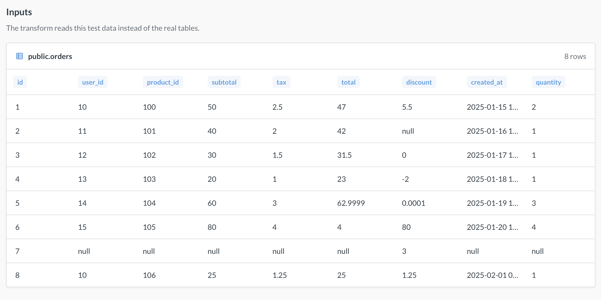
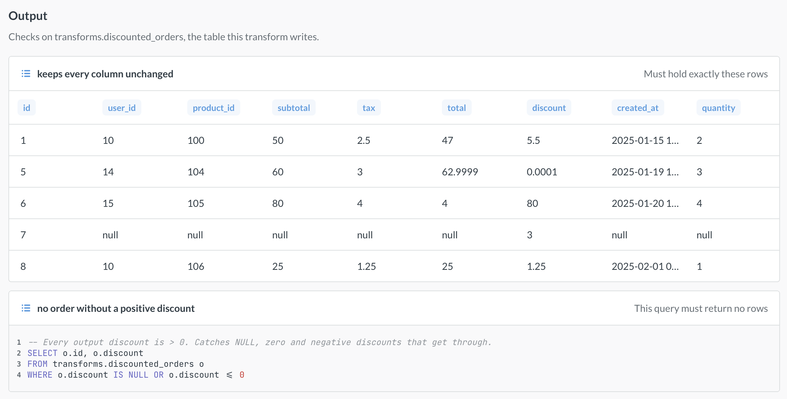
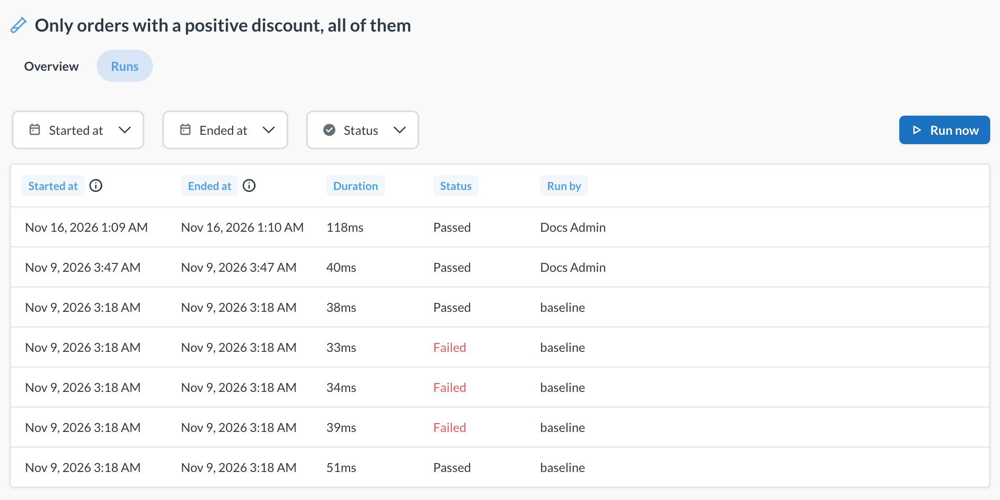

# Transform tests



_Data Studio > Data transformation > [transform name] > Tests_

A transform test runs your transform on test data you provide, then checks the output against what you expected. Your actual data tables aren't touched: Metabase loads the test data into temporary tables, swaps them in for the tables your transform reads, and drops them once the test is done.

Use transform tests to verify that your transforms work as expected, and to catch problems before a scheduled job writes wrong data to your warehouse.

## Prerequisites and permissions

Transform tests are supported on a subset of [databases that support transforms](./transforms-overview.md#databases-that-support-transforms): ClickHouse, MySQL/MariaDB, PostgreSQL, Redshift, and SQL Server. You can test [query-based transforms](query.md), but not currently [Python transforms](python.md).

Transform tests follow the permissions of the transform they belong to. To see a transform's tests, you need to be able to see the transform. To run a test, you need to be able to run the transform. See [Permissions for transforms](transforms-overview.md#permissions-for-transforms) for more.

## Write transform tests

Transform tests are designed to be created with an AI coding agent. To create a test:

1. Install the [Metabase CLI](../../installation-and-operation/metabase-cli.md).
2. Add the [`/metabase-cli` skill](../../installation-and-operation/metabase-cli.md#the-metabase-cli-skill) to your coding agent. The skill teaches the agent how to plan and write transform tests.
3. Prompt the coding agent to create a test by describing the conditions the transform's output should meet.

For example, here's a prompt for a transform on an **Orders** table that has a **Discount** column:

> Write a new transform for the Orders table in the Warehouse database
> that keeps only orders with a positive discount. Add a test to
> check that only orders with a discount are returned, and that all
> of them are in the result. Also add tests for any edge cases that apply.
> Add it to a new folder called "Warehouse." Run the test and iterate
> if necessary until the tests pass.

Using this prompt, the agent creates a transform that writes a table with the same columns as **Orders**, and a test with:

- **Input** data with **Discount** values like 0, 0.0001, -2, 80, and `null`, to cover edge cases.
- **Checks** for each condition the output should meet:
  - No order without a positive discount.
  - Every order with a positive discount is in the output, unchanged.
  - No order that isn't in the input.
  - Each order appears at most once.
  - The output has as many orders as the input has with a positive discount.

Agents don't produce the same result every time, so your test will probably look different.

To review the checks the agent wrote, go to your Metabase instance and navigte to **Data Studio > Data Tranformation > [your transform]**. Open the transform's **Tests** tab and click the test's name. The **Inputs** section shows the test data the agent generated:

The **Output** section lists the checks, along with the rows or queries each check uses:

## Components of a test

Each test has a name, an optional description, inputs, and checks.

**Inputs** are the test data that stands in for the tables the transform reads. You can specify the data values, or use the results of a SQL query that runs against the transform's source database. An input is required for every table the transform reads, or the test won't run.

For example, the input for the discount test shown above is a short list of orders with a range of **Discount** values, including zero, negative, and empty ones.

**Checks** describe the output you expect. A check can require the output to contain exactly the rows you list or the rows a query returns. Checks can also require a query against the output to return no rows.

For example, the check _no order without a positive discount_ is a query that selects every output row whose discount is zero, negative, or empty. If that query returns no rows, the check passes.

## Run a test

To run a test:

1. In Data Studio, go to **Data transformation** and open the transform.
2. Click the **Tests** tab.
3. Click the test's name.
4. On the test's **Overview** tab, click **Run now**.

You can also run a test from the transform's **Tests** tab: click the **...** menu next to the test and select **Run test**.

A test run can end with one of these statuses:

- **Passed**: every check passed.
- **Failed**: at least one check didn't pass, including a check that couldn't run, for example because its SQL query has a mistake.
- **Error**: the test itself couldn't finish, for example because the database couldn't load the test data or run the transform's query.
- **Timeout**: the run took too long and Metabase stopped it.

## See test results

_Data Studio > Data transformation > [transform name] > Tests_

The **Tests** tab on a transform page lists the transform's tests, their checks, and the time and status of each test's last run.

On a test's **Overview** tab, you'll see the status of the last run and the test's **Inputs** and **Output** sections. To see every run of the test, click the **Runs** tab. Click a run to see when it started and ended, its status, and who ran it.

## Run transform tests in CI

You can have CI run your transform tests before changes reach production. For example, a GitHub Action can start a temporary Metabase instance in Docker, import the content from the pull request's commit, and use the Metabase CLI to run every test.

If you use [Remote Sync](../semantic-layer/remote-sync.md), your transform tests are exported to your Git repository along with the transforms they test, so CI can import and run them.

## Further reading

- [Transforms overview](transforms-overview.md)
- [Transform inspector](inspector.md)
- [Remote Sync](../semantic-layer/remote-sync.md)
