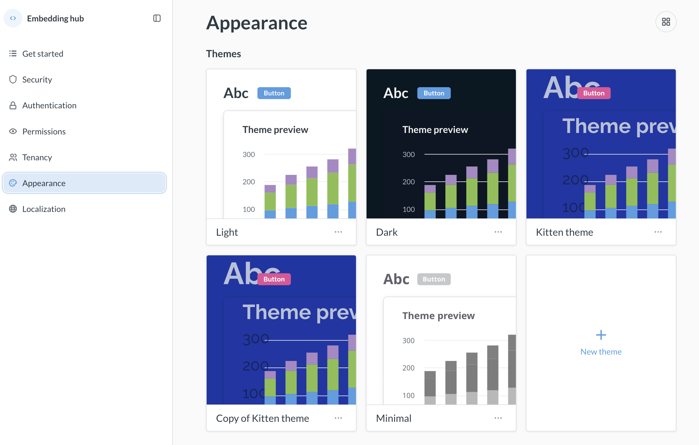
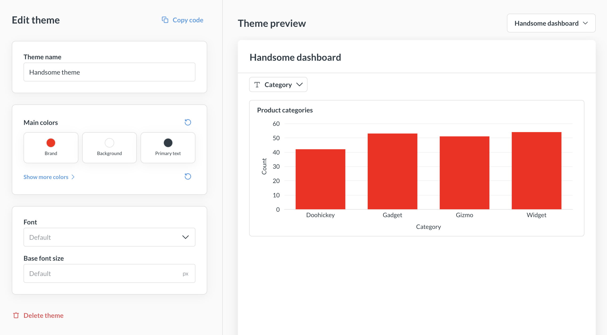
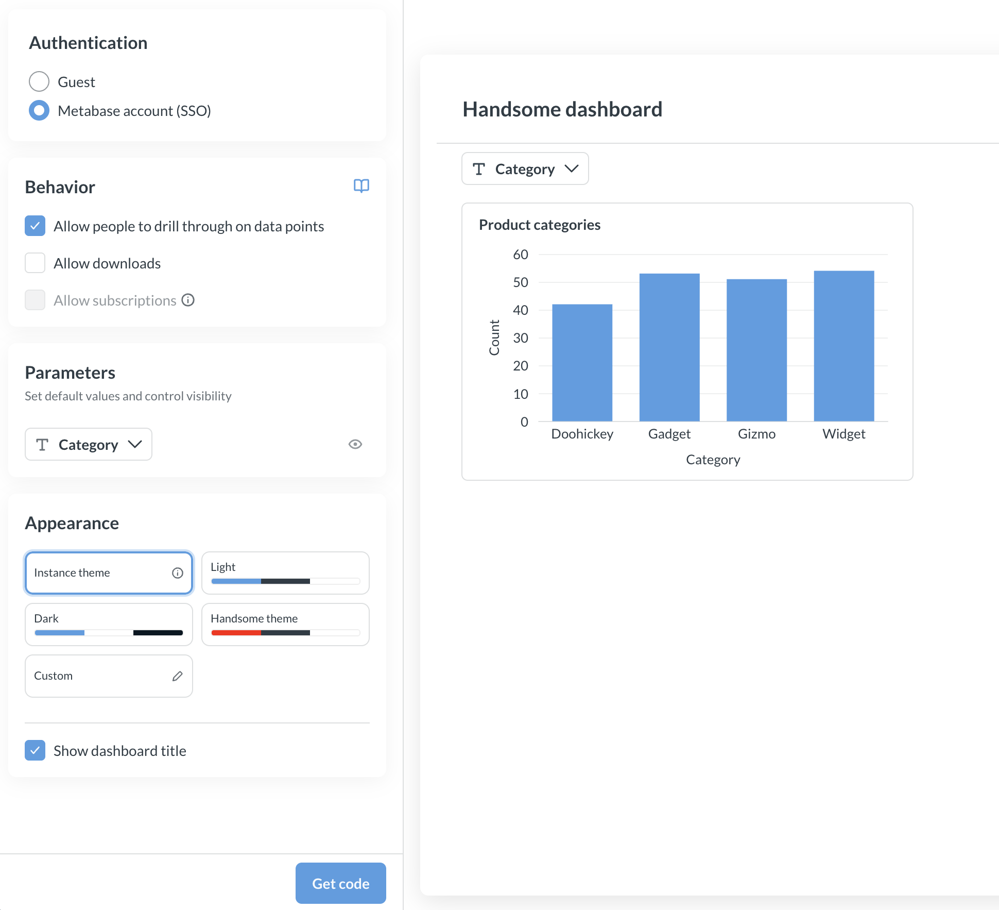

# Customize the appearance of your embeds

Every modular embed on a page shares one theme. The theme object is the same for web components and the React SDK, so every example on this page works with both.

On all plans, you can [pick a light or dark theme](#pick-a-light-or-dark-theme). On Pro and Enterprise plans, you can also save reusable themes in Metabase and set individual colors, fonts, and component options.

For every option in the theme object, see [Appearance reference](./appearance-reference.md).

## Add a theme to your embeds

Set the theme in your [shared embed configuration](./config.md):

- **Web components:** Add `theme` to `defineMetabaseConfig()`.
- **React SDK:** Create the theme with `defineMetabaseTheme()` and pass it to `MetabaseProvider`.

### Web component theme

```html
<script>
  defineMetabaseConfig({
    instanceUrl: "https://your-metabase.example.com",
    theme: {
      colors: {
        brand: "#509EE3",
      },
    },
  });
</script>
```

### React SDK theme

```tsx

```

The examples below show only the theme object.

## Pick a light or dark theme

Embeds use the light theme by default. To switch to dark, set `preset` to `"dark"`:

```js
{
  preset: "dark", // or "light"
}
```

Presets are available on all plans. Any colors you set alongside a preset override that preset's colors.

## Save a theme in Metabase





A saved theme is a named set of colors and fonts. The embed wizard copies the theme into each new embed's config, and you can copy the theme's values into your code.

To manage themes, go to **Embedding hub** > **Appearance**. Metabase includes a light and a dark theme that use the appearance settings of your Metabase.

In the **Themes** section, you can:

- **Create a theme:** Click **New theme**, then set a name, colors, and font.
- **Edit a theme:** Click a theme card to open the editor. View your changes in the live preview.
- **Choose what the preview renders:** Pick the dashboard or question the preview shows.
- **Duplicate a theme:** Useful for varying an existing theme.
- **Delete a theme:** Deleting is permanent.



Use **Branding elements** to set the [loading message](../configuring-metabase/appearance.md#loading-message) and the [illustrations](../configuring-metabase/appearance.md#metabase-illustrations) for empty results. Both are the same settings as in **Admin** > **Settings** > **Appearance**.

### Use a saved theme in the embed wizard

In the last step of the [embed wizard](./modular-embedding.md#3-customize-your-embed), you can pick:

- **A saved theme** from your list.
- **Instance theme** to use your Metabase's defaults.
- **Custom** to set colors on this embed only, without saving a theme.



The wizard copies the theme's values into the generated `theme` object. Each embed has its own copy, so editing or deleting the saved theme doesn't change the embeds you already generated. To apply changes to an existing embed, regenerate the snippet in the wizard or edit the `theme` object in your code.

### Use a saved theme in code

To use a saved theme outside the wizard, copy its values into your theme object. A saved theme has the same structure as the theme object:

```js
{
  fontFamily: "Lato",
  colors: {
    brand: "#50E397",
    background: "#11123D",
    "text-primary": "#F9F9FC",
  },
}
```

## Set colors and fonts



To change the colors and font of your embeds, set `colors` and `fontFamily`:

```js
{
  fontFamily: "Inter",
  colors: {
    brand: "#9B5966",
    "text-primary": "#4C5773",
    background: "#FFFFFF",
    "background-hover": "#F9FBFC",
    border: "#EEECEC",
  },
}
```

Each color in `colors` accepts any CSS color string, but not a CSS variable. For `fontFamily`, use any [font that Metabase supports](../configuring-metabase/fonts.md), or `"Custom"` to use your instance's custom font.

For the full list of colors, see [Colors](./appearance-reference.md#colors).

## Set chart colors

To change the series colors in charts, set `colors.charts`. You can set up to eight colors. Each one is either a color string or an object with a `base` color, where `tint` and `shade` are optional lighter and darker variations:

```js
{
  colors: {
    charts: [
      "#9B59B6",
      { base: "#E74C3C", tint: "#EE6B56", shade: "#CB4436" },
    ],
  },
}
```

If you set a custom series color in a chart's visualization settings, that color overrides the theme.

## Style individual components

To style specific components, like dashboard cards or data tables, set options under `components`:

```js
{
  components: {
    dashboard: {
      backgroundColor: "#2F3640",
      card: {
        backgroundColor: "#2D2D30",
        border: "1px solid #EEECEC",
      },
    },
    table: {
      cell: {
        fontSize: "12.5px",
      },
    },
  },
}
```

For the full list of component options, see [Component options](./appearance-reference.md#component-options).

## Fix overlays hidden behind your app's modals

Metabase overlays, like click-action menus and save dialogs, have a z-index of `200`. If your app renders its own modal, drawer, or backdrop with a higher z-index, it hides the Metabase overlay.

To raise the Metabase overlay above your app's overlay, set `components.popover.zIndex`:

```js
{
  components: {
    popover: {
      zIndex: 1001, // one above your app's modal
    },
  },
}
```

## Other appearance settings

The theme controls colors, fonts, and component styling. Other parts of an embed's appearance are set elsewhere.

- **Titles, download buttons, and card menus:** Set these on each component. See [Customize dashboard appearance](./dashboard.md#customize-dashboard-appearance) and [Customize chart appearance](./chart.md#customize-chart-appearance).
- **Query builder layout (React SDK):** Build your own layout from the `InteractiveQuestion` namespaced components. See [Customize the query builder's layout](./query-builder.md#customize-the-query-builders-layout).
- **Loading and error screens (React SDK):** Replace them with your own components. See [Customize loading and error states](./config.md#customize-loading-and-error-states-react-sdk-only).
- **Custom visualizations:** Render your own chart types in embeds. See [Custom visualizations in embeds](./custom-visualizations.md).
- **Logo, favicon, and custom font:** Set these for your whole Metabase in **Admin** > **Settings** > **Appearance**. See [Appearance settings](../configuring-metabase/appearance.md).

## Further reading

- [Appearance reference](./appearance-reference.md)
- [Configure your embeds](./config.md)
- [Modular embedding components](./components.md)
- [Translate embeds](./translations.md)
