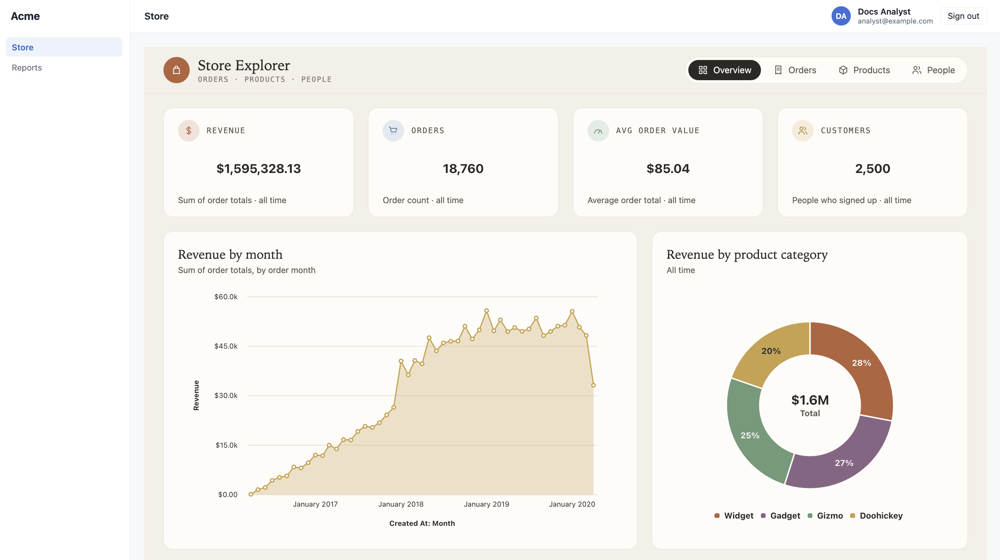
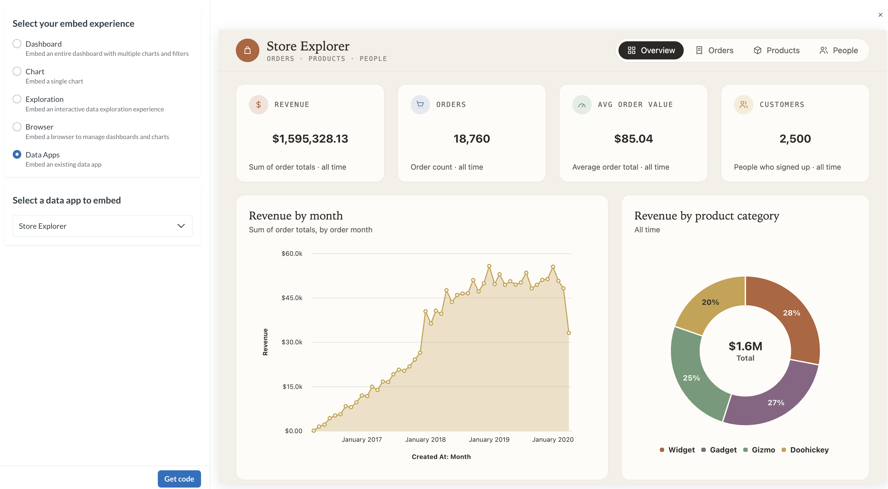
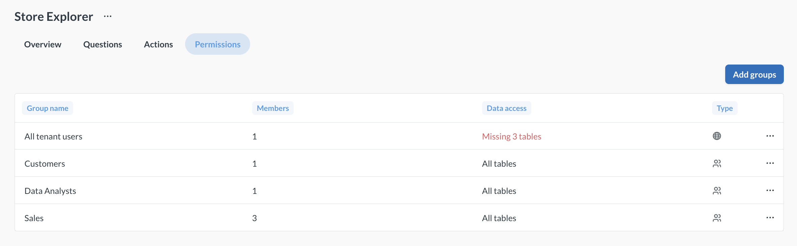

# Embed a data app



A [data app](../data-apps/build.md) is a custom app you build on your Metabase data with an AI coding agent. Describe the data app, let the agent build it, and host it on Metabase. You can give a data app its own layout, pages, and navigation, as well as forms that add, edit, or delete rows in your database.

> You can only embed a data app with [SSO](./authentication.md). You can't embed a data app with [guest embeds](./guest-embedding.md).



Embed a data app when a dashboard or a chart can't give you the interface you want in your product. Otherwise, [embed a dashboard](./dashboard.md) or [embed a chart](./chart.md), which both need less setup.

You embed a data app with [modular embedding](./modular-embedding.md) as a web component or with the React SDK. People sign in to your product, and each person sees only the data their permissions allow.

## Before you start

To embed a data app, you need:

- **A product to embed the data app in:** Your own web app, where people sign in.
- **A data app:** Build one with an AI coding agent, such as Claude Code or Codex. See [Getting started with data apps](../data-apps/getting-started.md).
- **Remote sync:** Metabase loads data apps from a Git repository through [Remote sync](../data-modeling/semantic-layer/remote-sync.md).
- **A development Metabase and a production Metabase:** [Build and review the data app](../data-apps/build.md) on your development Metabase. Your production Metabase then pulls it from the repository.
- **SSO:** Embedded data apps require [JWT or SAML authentication](./authentication.md). Data apps don't support guest embeds.
- **Modular embedding:** Turn it on in **Embedding hub** > **Security**.

## Embed a data app

To get a code snippet for your data app, use the embed wizard:

1. Click the **grid** icon in the upper right, and select **Data studio**.
2. Click **Data apps**, then click the data app.
3. Click the **three dots** next to the data app's name, and click **Embed**.
4. Check the preview, then click **Get code**.
5. Copy the code snippet.



An embed shows only a live data app. See [Make an app live or a draft](../data-apps/manage.md#make-an-app-live-or-a-draft).

People see the embedded data app only if they're in a group that can open it. See [Give people access to a data app](#give-people-access-to-a-data-app).

### Web component data app

To embed a data app with a web component, add `<metabase-data-app>` to your page:

```html
<script defer src="https://your-metabase.example.com/app/embed.js"></script>
<script>
  function defineMetabaseConfig(config) {
    window.metabaseConfig = config;
  }
</script>
<script>
  defineMetabaseConfig({
    instanceUrl: "https://your-metabase.example.com",
  });
</script>

<metabase-data-app path="store-explorer"></metabase-data-app>
```

### React SDK data app

To embed a data app with the React SDK, render the `DataApp` component:

```tsx

```

The `DataApp` component requires SDK version 66 or later.

## Open the data app on a specific page

To open the data app on one of its pages, add the path of the page after the data app's slug:

```html
<metabase-data-app path="store-explorer/orders"></metabase-data-app>
```

The slug is the last part of the data app's address. In `/apps/store-explorer`, the slug is `store-explorer`. You can also add query parameters, such as `store-explorer/orders?active=true`.

To send people to another page of the data app, change `path`. The data app opens the page without reloading.

## Set the height of the data app

### Web component height

To set the height of your data app, set the `height` CSS property on the component:

```html
<metabase-data-app
  path="store-explorer"
  style="display: block; height: 100vh"
></metabase-data-app>
```

### React SDK height

To set the height of your data app, set the `height` prop:

```tsx

```

## Give people access to a data app

To give people access, add their groups to the data app. See [Choose who can open an app](../data-apps/manage.md#choose-who-can-open-an-app).

Remote sync doesn't copy group access between Metabases. After your production Metabase pulls the data app from the repository, add the groups there as well.

When people sign in with SSO, Metabase assigns them to groups based on their SSO token. To give people access, include a group that you added to the data app in each person's token. See [Authentication](./authentication.md).

### Give tenants access to a data app

If you've turned on [tenants](./tenants.md), the **Add groups** list also includes your tenant groups. In the **Type** column on the **Permissions** tab, tenant groups have a globe icon, and internal groups have a people icon.



Tenant users can open a data app only through a tenant group. Internal users can open a data app only through an internal group.

A tenant group needs data access like any other group. After you add a tenant group, check the **Data access** column. If it says **Missing N tables**, see [Check that groups can see the app's data](../data-apps/manage.md#check-that-groups-can-see-the-apps-data).

## Troubleshooting

| Error message                                                                            | Cause                                                                | Fix                                                                                                    |
| ---------------------------------------------------------------------------------------- | -------------------------------------------------------------------- | ------------------------------------------------------------------------------------------------------ |
| `You don't have access to this data app.`                                                | The person isn't in a group that can open the data app.              | [Add the person's group to the data app](#give-people-access-to-a-data-app).                           |
| `Data app "your-app-slug" was not found or is disabled. Check the app slug in the path.` | No data app with that slug exists on your Metabase.                  | Check the slug, and check that your production Metabase has pulled the data app.                       |
| `Sorry, you don't have permission to run this query.`                                    | The person's group can open the data app, but can't view its tables. | [Give the group access to the tables](../data-apps/manage.md#check-that-groups-can-see-the-apps-data). |

## Further reading

- [Getting started with data apps](../data-apps/getting-started.md)
- [Build a data app](../data-apps/build.md)
- [Manage data apps](../data-apps/manage.md)
- [Modular embedding components](./components.md)
- [Authentication](./authentication.md)
- [Tenants](./tenants.md)
