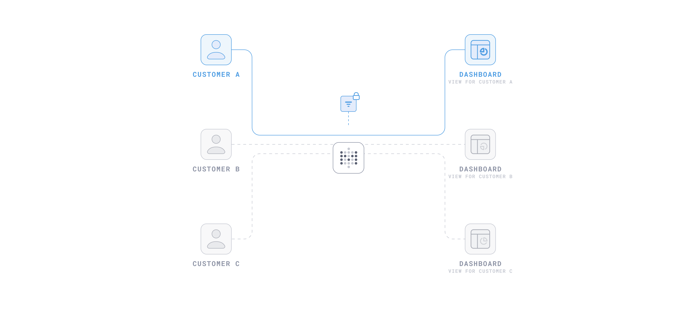

# Embedding parameters

This page covers how to pass parameter values to embedded dashboards and SQL questions in [modular embeds](./modular-embedding.md), with either the web components or the React SDK.

If you're embedding with an iframe instead, check out [Parameters in iframe embeds](#parameters-in-iframe-embeds).

## Parameters differ between guest and SSO embeds

Depending on which authentication method you pick for an embed, the embedding wizard will offer different parameter options:

### SSO embed parameters

With **SSO** authentication, you can set a default value and choose whether to hide a parameter's widget. Your Metabase knows who's viewing, so [data permissions](../permissions/embedding.md) and [row and column security](../permissions/row-and-column-security.md) filter the rows for you.

### Guest embed parameters

With **guest** authentication, every parameter starts out **Disabled**, and for each parameter you can pick from:

- **Disabled**: no widget, and nobody can set a value.
- **Editable**: the widget shows, people can change the value, and your page can set a [starting value](#set-starting-values).
- **Locked**: no widget. Your server sets the value in the signed token. Check out [Restrict data on guest embeds](#restrict-data-on-guest-embeds).

You can't disable a filter that [always requires a value](../dashboards/filters.md#make-a-filter-or-parameter-required).

## Restrict data on guest embeds



Say you want each customer to see only their own rows. On an embed with guest authentication, nobody's signed in to your Metabase, so permissions can't scope rows per person. Instead, you can lock the parameter: your server sets the parameter's value in the signed token, and Metabase applies the value before running anything. And because the value is set by the token, the viewer won't be able to change it.

### Lock a parameter

1. Visit the dashboard or question, click the **Share** icon, and select **Embed**.
2. Under **Parameters**, set the parameter to **Locked**.
3. Optional: pick a value under **Previewing locked parameters**. The wizard writes it into the server code it generates, so you can see the exact format Metabase expects.
4. Click **Publish**.
5. On your server, put the value in the `params` object when you sign the token:

```javascript

```

Then pass the token to the component, as the `token` attribute on `<metabase-dashboard>` or the `token` prop on `StaticDashboard` in the SDK, or have the embed fetch it from your server. The dashboard shows only customer 13's rows, with no **Customer ID** widget. On a legacy [static embed](./introduction.md#static-embedding-is-deprecated), the token goes in the iframe URL instead. For fetching and refreshing the token, check out [Guest embeds](./guest-embedding.md#refreshing-or-initializing-the-jwt-from-your-server).

Some notes on locked parameters:

- **Every token has to include every locked parameter.** If you leave out a parameter, Metabase refuses the request. The dashboard still renders its frame and widgets, and each card shows `You must specify a value for :slug in the JWT.` in place of its chart.
- **A locked value narrows the options in editable widgets.** Lock **State** to Vermont, and an editable **City** filter on the same dashboard only lists Vermont cities (like [linked filters](../dashboards/filters.md#linking-filters)).
- **Multiple locked parameters combine with AND.**
- **To turn a locked parameter off for a given token, pass `[]` as its value.** The token still has to name the parameter; the filter just doesn't apply.
- **The key in `params` is the parameter's slug.** On a dashboard, that's the dashboard filter's slug, even when the filter is connected to a [SQL variable](../questions/native-editor/sql-parameters.md). If you rename a locked dashboard filter, update the key in your server code to match. On an embedded SQL question, the key is the variable's name: changing the widget's label doesn't affect it, but renaming the variable in the SQL does.
- **A locked filter only restricts the cards it's connected to.** A dashboard filter with no connected cards still shows up in the wizard, still has to be in the token, but it won't do anything. The embed renders fine, so nothing in the browser tells you.
- **Pass one value to a locked filter that's connected to a plain SQL variable.** Metabase substitutes several values as a comma-separated list, which only works if the query is written for one, like `IN ({{variable}})`. To send several values, connect the filter to a [field filter](../questions/native-editor/field-filters.md) instead.

See [params in a signed token](./parameters-reference.md#params-in-a-signed-token).

## Set starting values

To open an embed with some filters already applied, pass starting values keyed by slug. On a dashboard, people can still change them in the widgets. A SQL question in an SSO embed [doesn't show widgets for its variables](#hide-parameter-widgets), so there the starting values are the values people get.

Without starting values, an SSO embed of a dashboard opens with the values the signed-in person last applied to that dashboard, so two people can see different starting values. Pass starting values, or [controlled values](#control-values-from-your-app), when the embed should open the same way for everyone.

If instead you want your app to be able to push values, or see when people change a widget's values, use [controlled values](#control-values-from-your-app).

- [Web component](#web-component-starting-values)
- [React SDK](#react-sdk-starting-values)

### Web component starting values

```html
<metabase-dashboard
  dashboard-id="1"
  initial-parameters='{"state": "NY", "category": ["Gadget", "Gizmo"]}'
></metabase-dashboard>

<metabase-question
  question-id="42"
  initial-sql-parameters='{"product_id": 50}'
></metabase-question>
```

Changing the attribute after load reloads the embed and discards whatever people had picked.

### React SDK starting values



Dashboards take `initialParameters`:

```typescript

```

SQL questions take `initialSqlParameters`:

```typescript

```

## Control values from your app

When your app needs to be the source of truth for filter values, use the `parameters` attribute on the web component or the `parameters` prop in the SDK (`sql-parameters` and `sqlParameters` for SQL questions). They work like a controlled `<input>` in React: you hold the values, the embed applies whatever you hand it, and it calls you back whenever someone changes the value in the filter widget. Use controlled values when you want to [build your own filter widgets](#build-your-own-filter-ui).

> _Don't_ combine controlled values with starting values: if you pass both, the embed uses the controlled values and logs a warning to the console.

Controlled values work with either authentication method. On a [guest embed](./guest-embedding.md), they apply to parameters you've set to **Editable** in the embed wizard. To restrict data rather than just set a value, [lock the parameter](#restrict-data-on-guest-embeds) instead.

The [callback's payload](./parameters-reference.md#change-payload) includes the applied values, each parameter's default, and a `source` that says why it fired. For what each parameter type accepts, and how to clear or reset a value, see [Value formats by parameter type](./parameters-reference.md#value-formats-by-parameter-type).

Metabase stores dashboard values as arrays and hands them back that way. Push arrays, like `{ min_rating: [4] }`, if you want the callback's payload to match what you sent. A bare value works too, but Metabase normalizes it and reports the change with `source: "auto-change"`.

- [Web component](#web-component-controlled-values)
- [React SDK](#react-sdk-controlled-values)

### Web component controlled values

Set the value as an attribute. To catch edits people make in Metabase's widgets, listen for `parameters-change` on the element:

```html
<metabase-dashboard
  id="my-dashboard"
  dashboard-id="1"
  parameters='{"state": "NY"}'
></metabase-dashboard>

<script>
  const el = document.getElementById("my-dashboard");

  // Fires on load, when someone changes a widget, and when Metabase
  // normalizes a value you pushed. `source` says which.
  el.addEventListener("parameters-change", (event) => {
    const { source, parameters } = event.detail;
    console.log(source, parameters);
  });

  // Push a new value. The embed re-queries without reloading.
  el.parameters = { state: "CA" };
</script>
```

For a SQL question, use the `sql-parameters` attribute or `sqlParameters` property on `<metabase-question>`, and listen for `sql-parameters-change`.

To hand control back to the embed, assign `null` or `undefined` to the `parameters` or `sqlParameters` property. That removes the attribute and returns the element to uncontrolled mode. A dashboard keeps the last applied values. A SQL question reloads with its `initial-sql-parameters`, or with the variables' defaults if you haven't set any.

### React SDK controlled values



Pair `parameters` with `onParametersChange`, and keep the values in state:

```typescript

```

For SQL questions, pair `sqlParameters` with `onSqlParametersChange`:

```typescript

```

You must update your state from the callback. If you don't, the embed reverts to the values in your prop on the next render (which may wipe out edits people have made).

## Control values on linked dashboards and questions



[Controlled values](#control-values-from-your-app) only reach the dashboard you embed. When you [let people follow links](./dashboard.md#let-people-follow-links-to-other-dashboards-and-questions) to other dashboards and SQL questions, the dashboard or question that a [click behavior](../dashboards/interactive.md#custom-destinations) opens gets the values that the click [passes to it](../dashboards/interactive.md#passing-values-to-the-destination), and your `parameters` don't apply to it. To see and set the values of those linked dashboards and SQL questions, use `navigated-entity-parameters` and the `navigated-entity-parameters-change` event on the web component, or `navigatedEntityParameters` and `onNavigatedEntityParametersChange` in the SDK.

These need entity navigation, so they work on `<metabase-dashboard>` with SSO and drills on, and on `InteractiveDashboard` and `EditableDashboard` in the SDK. View-only dashboards and guest embeds can't follow links, so they don't take these values.

Each time someone opens a linked dashboard or question, the visit gets a new `navigationId`, even if they opened the same dashboard before. When they go back, they return to the earlier visit, with its `navigationId`. A click that links to the dashboard that's already on screen isn't a new visit: it changes the filters or the tab in place. You key your values by `navigationId`, so the values you store for a visit apply only to that visit, and come back with it. Inside each visit's values, the keys are filter slugs for a linked dashboard, and variable names for a linked SQL question.

You get the `navigationId` from the callback, which fires with:

- `initial-state` after each navigation to a linked item, including when people go back to it.
- `manual-change` when someone changes a filter on the linked item.
- `auto-change` when Metabase applies something different from what you pushed.

The [payload](./parameters-reference.md#linked-dashboard-and-question-payload) has the same fields as the dashboard or SQL question payload, plus the `navigationId`, the item's `entityType` and `entityId`, and `clickParameters`: the values the click set.

To stay in sync:

1. On `initial-state`, check whether you already have values for the `navigationId`. If you do, the person went back: keep your values, so their edits come back with the visit. If you don't, it's a new visit: store values for it.
2. On `manual-change` and `auto-change`, store the payload's `parameters` for the `navigationId`.

For a new visit, you pick the values:

- **Keep what Metabase applied** with the payload's `parameters`: the click's values and the other filters' defaults, or the person's last used values if the click sets no filter. Storing these doesn't re-run any queries.
- **Use the click's values and the defaults, but never last used values,** with `{ ...defaultParameters, ...clickParameters }`.
- **Add your own values.** Put them before `clickParameters` to fill in the other filters, or after it to override the click.
- **Ignore the click** by leaving out `clickParameters`.

The values for a visit work like `parameters` on the dashboard you embed: they replace all the values of that visit. Filters you leave out use their default, and `null` clears a filter. So if you want the click's values, start from `clickParameters`.

Because you get the `navigationId` from the first callback, the linked item has already started its queries with the click's values, so storing other values can run them again.

A visit that you don't store values for works as before: the linked item opens with the click's values, and your app doesn't control it.

Questions built with the query builder can't be controlled: a click to one opens a pre-filtered question with no parameters, and sends no event. Neither does a SQL question without variables. A linked dashboard without filters sends events with empty `parameters`.

- [Web component](#web-component-values-on-linked-content)
- [React SDK](#react-sdk-values-on-linked-content)

### Web component values on linked content

Listen for `navigated-entity-parameters-change` on the element, and store the values with the `navigatedEntityParameters` property:

```html
<metabase-dashboard
  id="my-dashboard"
  dashboard-id="1"
  enable-entity-navigation="true"
></metabase-dashboard>

<script>
  const el = document.getElementById("my-dashboard");

  el.addEventListener("navigated-entity-parameters-change", (event) => {
    const { source, navigationId, parameters } = event.detail;
    // Undefined until you set it
    const values = el.navigatedEntityParameters ?? {};

    // People went back to a visit: keep the values they had.
    if (source === "initial-state" && values[navigationId]) {
      return;
    }

    // A new visit, or someone changed a filter: store what's applied.
    el.navigatedEntityParameters = { ...values, [navigationId]: parameters };
  });
</script>
```

To change the values of a linked item from your page, assign new values for its `navigationId` to the property. The dashboard you embed keeps reporting through `parameters-change`.

### React SDK values on linked content



Pair `navigatedEntityParameters` with `onNavigatedEntityParametersChange`, and keep the values in state, keyed by `navigationId`:

```typescript

```

`EditableDashboard` takes the same props. The dashboard you embed keeps reporting through `onParametersChange`, which doesn't fire for linked items.

## Hide parameter widgets

On an [SSO embed](./introduction.md#components-with-sso-authentication), every dashboard filter shows a widget by default. To hide a filter's widget without disabling the filter, list its slug in `hidden-parameters` (web component) or `hiddenParameters` (SDK).

SQL questions work differently. In an SSO embed, a SQL question doesn't show widgets for its variables, so there's nothing to hide: the values come from `initial-sql-parameters` or `sql-parameters`, or from the variables' defaults. On a guest embed, a SQL question shows a widget for each **Editable** variable, and `hidden-parameters` hides it. In the SDK, you can add the widgets to an SSO embed yourself with `InteractiveQuestion.SqlParametersList` in a [custom layout](./question-reference.md#customize-the-layout-of-an-interactive-chart), and `hiddenParameters` applies to that list too.

On a [guest embed](./guest-embedding.md), only **Editable** parameters get a widget in the first place, so the embed wizard won't generate `hidden-parameters` for you. To remove a widget in a guest embed, set the parameter to **Disabled** or **Locked** in the wizard. You can still add `hidden-parameters` by hand to hide a widget for a parameter you've made editable.

Hiding a widget doesn't restrict anything: the value is still set from the browser, which means that anyone can open the console to change the value. To restrict what people can query, [lock the parameter](#restrict-data-on-guest-embeds) on a guest embed, or use [permissions](../permissions/embedding.md) on an SSO embed.

- [Web component](#web-component-hidden-widgets)
- [React SDK](#react-sdk-hidden-widgets)

### Web component hidden widgets

```html
<metabase-dashboard
  dashboard-id="1"
  initial-parameters='{"state": "NY"}'
  hidden-parameters='["state"]'
></metabase-dashboard>
```

### React SDK hidden widgets



```typescript

```

The same prop works on `StaticQuestion` and `InteractiveQuestion`, wherever a SQL question shows variable widgets: on a guest embed, or in a custom layout that includes `SqlParametersList`.

## Build your own filter UI

If Metabase's widgets don't fit your app, you can hide them and make your own. How you push values to the charts depends on what the parameter is for. If your widget just sets a value that anyone could set, control the value from the page. That works on SSO embeds and on guest embeds where the parameter is **Editable**.

- [Editable parameters](#control-editable-parameters-from-your-own-widgets)
- [Change a locked value from your page](#change-a-locked-value-from-your-page)

### Control editable parameters from your own widgets

Hold the values in your app with the [controlled props](#control-values-from-your-app), hide Metabase's widgets, and the embed re-queries whenever your widget changes the value. On a guest embed, the parameter has to be **Editable** in the embed wizard.

#### Web component custom filter UI

Push your widget's value with the `parameters` property, and hide Metabase's widget with `hidden-parameters`:

```html
<select id="state-picker">
  <option value="NY">New York</option>
  <option value="CA">California</option>
</select>

<metabase-dashboard
  id="my-dashboard"
  dashboard-id="1"
  parameters='{"state": "NY"}'
  hidden-parameters='["state"]'
></metabase-dashboard>

<script>
  const el = document.getElementById("my-dashboard");

  document
    .getElementById("state-picker")
    .addEventListener("change", (event) => {
      // Your widget owns the value. The embed re-queries without reloading.
      el.parameters = { state: event.target.value };
    });
</script>
```

#### React SDK custom filter UI

Pass your widget's value in `parameters`, and hide Metabase's widget with `hiddenParameters`:

```typescript

```

If you'd rather use Metabase's own widgets for a SQL question's variables, the SDK's `InteractiveQuestion.SqlParametersList` renders them wherever you put them in a [custom layout](./question-reference.md#customize-the-layout-of-an-interactive-chart). That's also the only way to get variable widgets on a SQL question in an SSO embed, since the default layout leaves them out.

### Change a locked value from your page

Sometimes one viewer is allowed more than one value, but not every value. Say an account manager covers three customers. The **Customer ID** parameter has to stay locked so the manager can't query a fourth customer, but they still need to switch between their three. A widget on your page picks the customer, your server signs a new token with that value in `params`, and you hand the token to the component. The embed re-queries with the new locked value.

Because the parameter is locked, your server should check that the viewer is allowed the value before it signs the new token. If the endpoint signs whatever value it's sent, anyone can request a token for any value, and the parameter is no safer than an editable parameter that you've [hidden](#hide-parameter-widgets).

#### Web component re-signed token

```html
<!-- Render this token on your server for each page load. Don't let
     guestEmbedProviderUri fetch the first one; see below. -->
<metabase-dashboard
  id="my-dashboard"
  token="INITIAL_SIGNED_TOKEN"
></metabase-dashboard>

<script>
  async function onCustomerChange(customerId) {
    // Your endpoint checks that this viewer may see `customerId`,
    // then signs a token with params: { customer_id: [customerId] }
    const response = await fetch(
      `/api/metabase-token?customer_id=${encodeURIComponent(customerId)}`,
    );
    const { jwt } = await response.json();
    document.getElementById("my-dashboard").setAttribute("token", jwt);
  }
</script>
```

Render the first token into the `token` attribute yourself rather than letting [`guestEmbedProviderUri`](./guest-embedding.md#refreshing-or-initializing-the-jwt-from-your-server) fetch it. An embed that starts without a token fetches one on load, and that token would overwrite the value your widget just set.

There are two endpoints in play, and only one of them gets the value your widget picked. The `/api/metabase-token` endpoint in the example is yours: it signs a token for a value your page passes. The [`guestEmbedProviderUri`](./guest-embedding.md#refreshing-or-initializing-the-jwt-from-your-server) endpoint, if you've set one, signs the token the embed fetches on its own: on load when there's no `token` attribute, and after the current token expires.

Once the token expires, the embed asks the provider endpoint for a fresh one the next time it needs data, like when someone changes a filter. That request carries only the resource id and the `custom-context` attribute, not the value your widget picked. So unless the endpoint can work the value out on its own, from `custom-context` or from your app's session, the locked value snaps back to whatever the endpoint signs by default. Check out [Sending custom context](./guest-embedding.md#sending-custom-context) for the shape the provider endpoint receives.

#### React SDK re-signed token

Hold the token in state, pass it to the `token` prop on `StaticDashboard`, and set `key={token}` so the component remounts when the token changes. Without the key, the new token is stored but the dashboard doesn't re-query. Guest token refresh with `guestEmbedProviderUri` isn't supported in the SDK, so the caveats in the web component section don't apply: your app is the only thing that sets the token, including when it expires. Guest embeds in the SDK need `isGuest: true` in the `MetabaseProvider` auth config, and a page can use only one authentication method. Check out [Using guest embeds with the SDK](./guest-embedding.md#using-guest-embeds-with-the-sdk).

```typescript

```

## Parameters in iframe embeds

Everything above applies to [modular embeds](./modular-embedding.md). The iframe-based embeds set parameters through the URL instead:

- **[Public links and public embeds](./public-links.md#public-embed-parameters)**: add `?slug=value` to set a filter, and `#hide_parameters=slug` to hide its widget. Anyone can edit the URL, so these don't restrict data.
- **[Static embeds](./introduction.md#static-embedding-is-deprecated)** (deprecated): same token and rules as guest embeds. Set a parameter to **Locked** and pass its value in `params`. Editable parameters get a widget in the iframe, and take starting values from the URL with the same syntax as public embeds. Hide a widget with `#hide_parameters=slug`, and set appearance with the same [hash parameters as public embeds](./public-links.md#appearance-parameters).
- **[Full app embedding](./full-app-embedding.md)**: filter values go in the Metabase URL you load in the iframe, the same way as in Metabase itself.

## Further reading

- [Parameters reference](./parameters-reference.md)
- [Guest embeds](./guest-embedding.md)
- [Data isolation methods](../permissions/data-isolation-methods.md)
