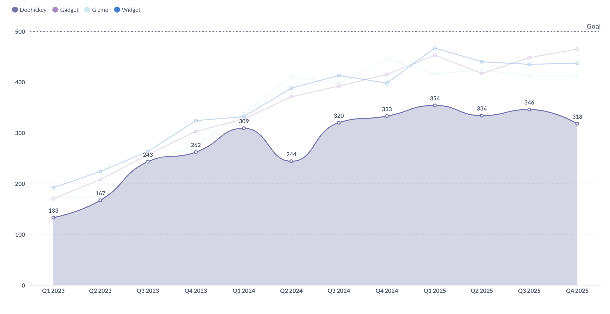
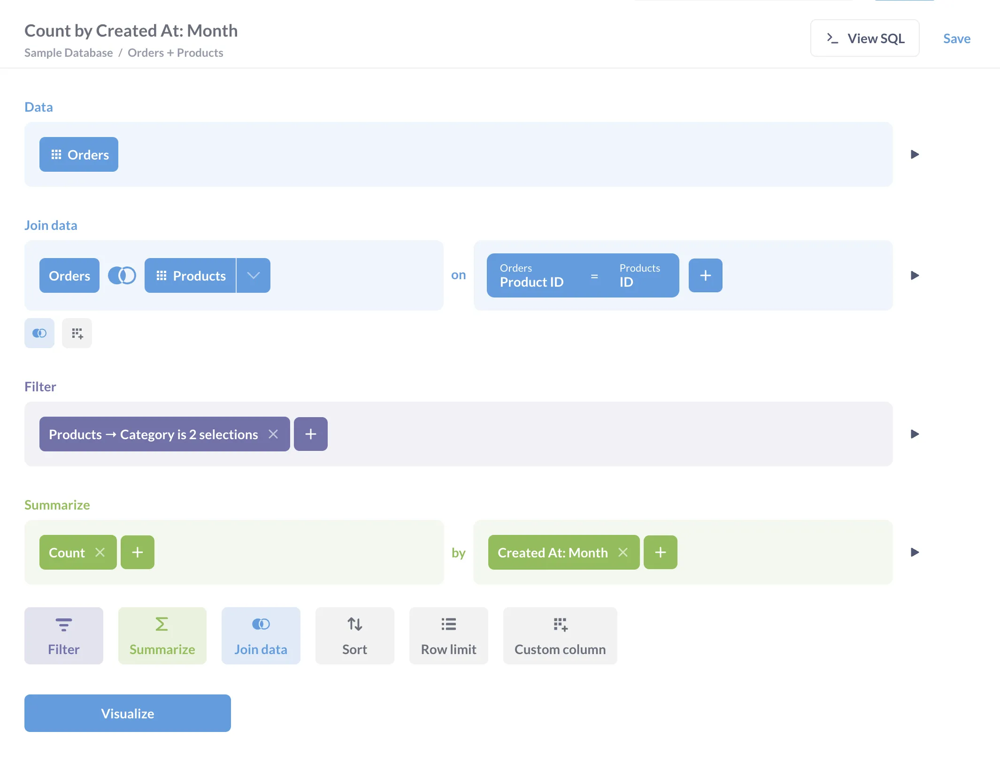
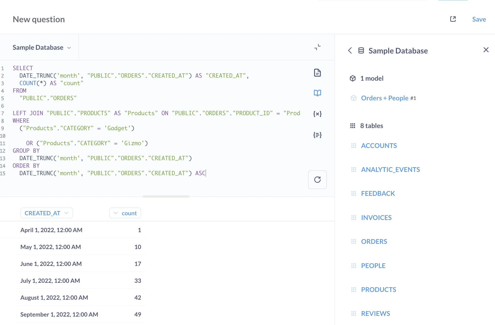
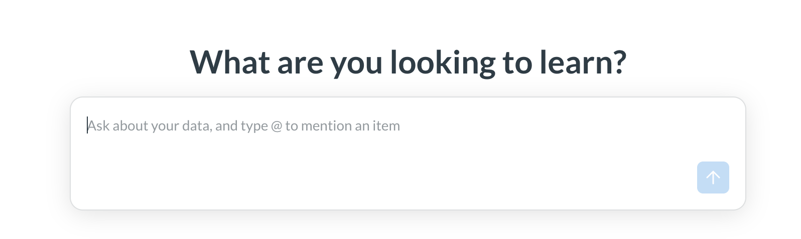
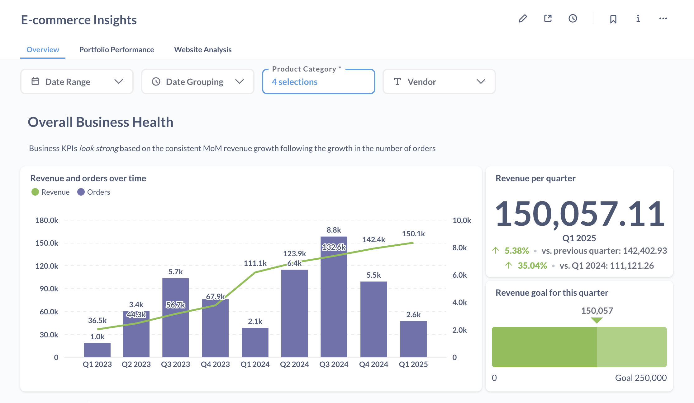
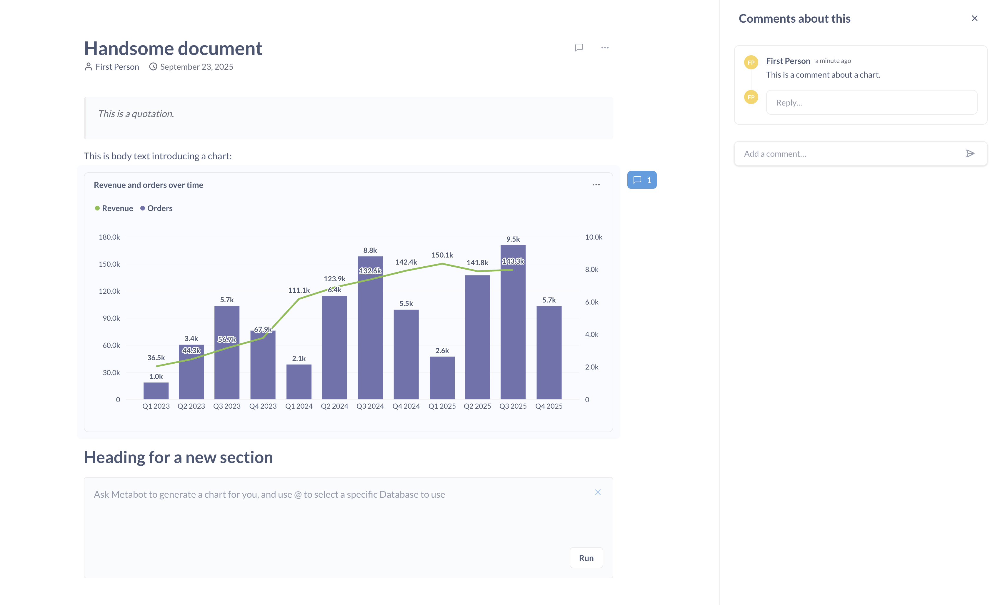
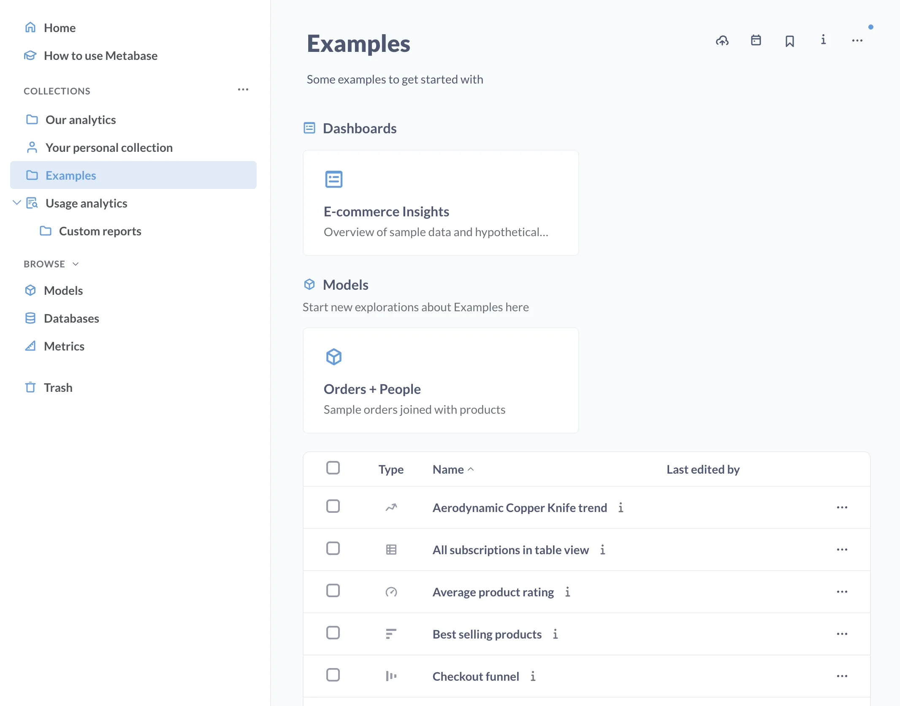
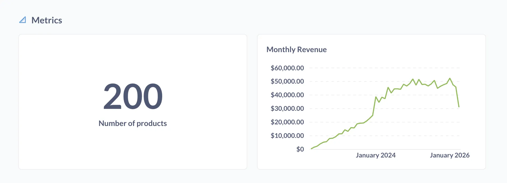
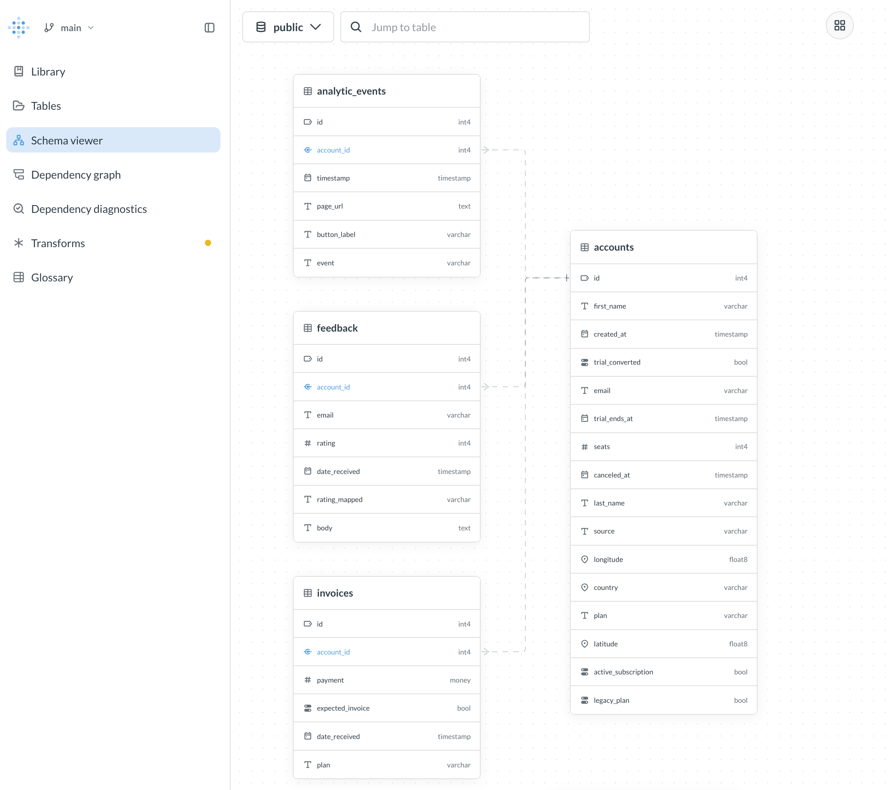

# Metabase concepts

## Overview

Metabase is a business intelligence (BI) platform that connects to [your databases](https://www.metabase.com/data-sources) and gives you a bunch of tools to understand and share your data. Companies typically use Metabase to give their teams an easy way to query data, or to embed Metabase in their application to let customers explore data on their own.

> Coming from another BI tool? Check out our [transition guides](https://www.metabase.com/learn/cheat-sheets/transition-guides).



You can use Metabase to:

- Query your database with a [graphical query builder](#query-builder) or the [native query editor](#native-query-editor).
- Use [AI](#ai-in-metabase) to ask questions in plain language, generate SQL, and more.
- Save results as [Questions](#questions) and organize them into [dashboards](#dashboards) and [collections](#collections).
- Create [transforms](#data-studio) and [Metrics](#metrics) to standardize the datasets and calculations your team relies on.

## Core concepts

Metabase has a lot of tools (more than we can cover here), but here is the basic toolbox:

- [**Questions**](#questions) are saved queries with visualizations that you can add to dashboards or collections.
- [**AI**](#ai-in-metabase) is optional in Metabase, but we have you covered. Ask questions in plain language with Metabot, or connect AI tools via the MCP server or the Metabase CLI.
- [**Dashboards**](#dashboards) group related questions (charts and other cards) that can be filtered and refreshed together.
- [**Documents**](#documents) are like reports. Great for when you want to combine charts and text.
- [**Collections**](#collections) are like folders to organize and manage permissions for your questions, dashboards, and other items.
- [**Metrics**](#metrics) define the official way to calculate important numbers for your team.
- [**Data Studio**](#data-studio) is a workbench for analysts. It's where data teams prep data for everyone else, using transforms to build analytics-ready tables.

## Questions

Questions are saved queries plus their visualization (you can toggle between a table and a chart). If you're coming from [Tableau](https://www.metabase.com/learn/cheat-sheets/transition-guides/tableau-to-metabase), Questions are like worksheets; if [Power BI](https://www.metabase.com/learn/cheat-sheets/transition-guides/powerbi-to-metabase), they're like Reports.

You can also [set up alerts](../questions/alerts.md) to get notified when your data meets certain conditions, and [export results](../questions/exporting-results.md) to CSV, XLSX, or JSON (or PNG for charts).

There are two main ways to create questions: the query builder, and the native code editor. (Or, optionally, just ask [Metabot](#ai-in-metabase).)

### Query builder

The query builder lets you create questions without knowing SQL. It provides a point-and-click interface where you can:

- Select the data you want to analyze.
- [Filter](../questions/query-builder/filters.md) to specific values or conditions.
- [Summarize and group data](../questions/query-builder/summarizing-and-grouping.md), sort, and add custom columns.
- [Join](../questions/query-builder/join.md) data from other tables.
- [Create visualizations](../questions/visualizations/visualizing-results.md) of your results.

Even SQL experts often use the query builder because:

- It's faster. You can drill through charts, group results, and iterate on a question just by clicking around.
- Metabase will pick a chart for you (which you can change and customize manually).
- The charts the query builder produces are interactive: you can [drill through charts](../questions/visualizations/drill-through.md) to explore further (unlike charts built with the native code editor).
- You can hand off the question to people who don't know SQL.
- It's surprisingly powerful: see [Custom expressions](../questions/query-builder/expressions.md).

### Native query editor

If you know SQL (or your database's query language), you can also create questions with the native editor. You can:

- Write complex queries with reusable code saved as [snippets](../questions/native-editor/snippets.md).
- Use [parameters](../questions/native-editor/sql-parameters.md) to make your queries dynamic and reusable.
- Reference [saved questions](../questions/native-editor/referencing-saved-questions-in-queries.md) in your SQL.
- Use database-specific functions.
- Do things that might not be possible in the query builder.

**There is one drawback compared to the query builder**: unlike the questions built with the query builder, people _won't_ be able to [drill through your charts](../questions/visualizations/drill-through.md).

## AI in Metabase

Metabase gives you different ways to use AI to get answers and build stuff (AI is also completely optional).

- [Metabot](../ai/metabot.md) is Metabase's AI assistant. You can ask Metabot questions in plain language ("What was the average order value last month?"), have it [generate and debug SQL](../ai/metabot.md#metabot-in-the-native-editor), and get it to explain charts, in Metabase or in Slack.
- Connect AI tools like Claude Code/Desktop to your Metabase via the [MCP server](../ai/mcp.md).
- Pair an agent with the [Metabase CLI](../installation-and-operation/metabase-cli.md) to create Metabase content via the API. See [Agent-driven development](../ai/agent-driven-development.md).

If you're embedding Metabase, you can also [embed AI chat](../embedding/ai-chat.md) in your own app, so your customers can ask questions about their data.

## Dashboards

Dashboards are a way to group and present related questions.

With dashboards, you can:

- [Arrange multiple questions](../dashboards/introduction.md) in a layout that makes sense.
- [Add filters](../dashboards/filters.md) that affect multiple questions at once.
- [Add text cards](../dashboards/introduction.md#adding-headings-or-descriptions-with-text-cards) to provide context and explanations.
- [Set up automatic refresh intervals](../dashboards/introduction.md#auto-refresh).
- [Make cards interactive](../dashboards/interactive.md).
- [Set up subscriptions](../dashboards/subscriptions.md) to automatically send dashboards via email, Slack, or a webhook.

## Documents

[Documents](../documents/introduction.md) are reports that combine charts with markdown text you can comment on. Documents are handy when you want to tell the story around the numbers, or have an AI write up a written report, complete with charts.

## Collections

Collections work like folders: they're the file system for Metabase. You can use collections to:

- Group related content together: questions, dashboards, documents, and metrics. For example, to group all items for a specific team.
- Mark items as official (pro feature).
- Nest collections within other collections.
- Add [events and timelines](../exploration-and-organization/events-and-timelines.md) to track key dates and milestones.

## Metrics

Instead of everyone calculating important numbers (like revenue, active users, etc.) in their own way, you can standardize these calculations as [metrics](../data-modeling/semantic-layer/metrics.md): a single source of truth you can include in any question or dashboard.

For example, you could create a "Monthly Revenue" metric that sums the totals in your `orders` table (excluding canceled orders) and groups them by month. Anyone can use that metric, so you won't end up with different revenue numbers in different dashboards.

To compare metrics side by side, check out the [Metrics Explorer](../questions/metrics-explorer.md).

## Data Studio

[Data Studio](../data-modeling/data-studio.md) is the workbench where data teams can prep data so that everyone else (including AI agents like Metabot) gets the numbers right.

The main tool here is [transforms](../data-modeling/transforms/transforms-overview.md): these scheduled queries turn raw, normalized data into clean, analytics-ready tables. For example, a "Customer Orders" transform could join your orders, people, and products tables, filter out test orders, and add calculated fields like "Total Lifetime Value".

Data teams also use Data Studio to curate metadata, publish vetted tables and metrics to the [Library](../data-modeling/semantic-layer/library.md), view a [dependency graph](../data-modeling/tools/graph.md) of what a change would affect, and explore how your tables connect to each other with a fancy schema viewer.

You can also version your changes and push them to a git repo with [Remote Sync](../data-modeling/semantic-layer/remote-sync.md).

## One last tip

Press `cmd + k` (Mac) or `ctrl + k` (Windows/Linux) to bring up the command palette. You can use it to:

- Search across all your Metabase content.
- Jump to specific items (questions, dashboards) or pages (like Admin settings).
- Create new questions and dashboards.
- Access recent items.
- Find documentation.

And press `?` to see all of Metabase's keyboard shortcuts.

Bon voyage!
