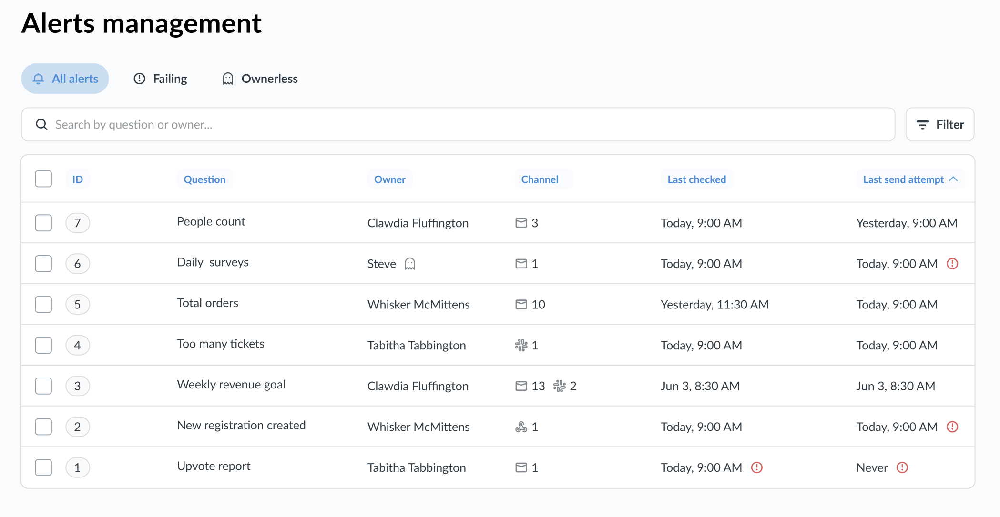
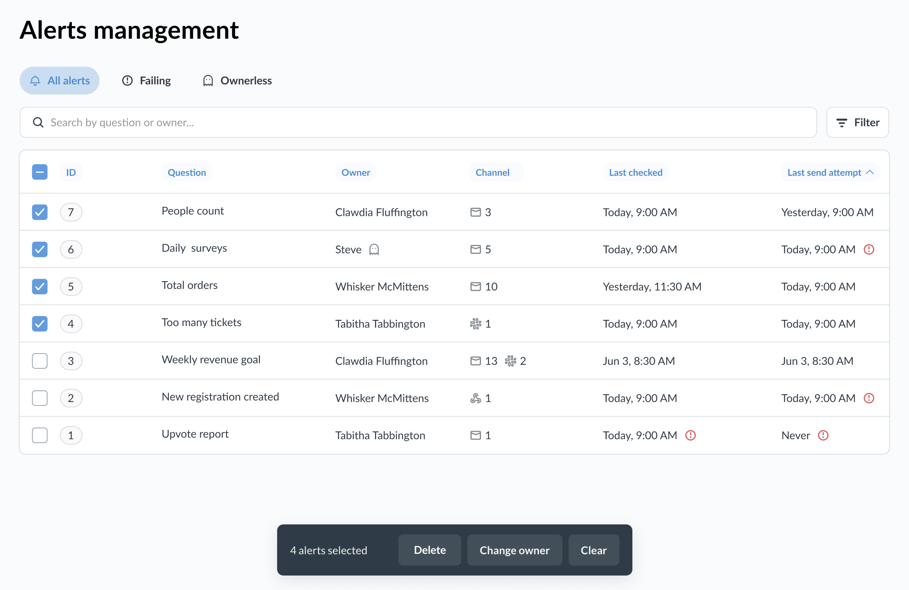

# Alerts management

_Monitor > Alerts management_

Admins can use Alerts management to:

- View and search all [question alerts](../questions/alerts.md) in their Metabase
- Identify failed or orphaned alerts
- Edit alerts, including changing the alert's owner
- Delete alerts in bulk

Alerts management doesn't include [dashboard subscriptions](../dashboards/subscriptions.md).

## See all alerts

_Monitor > Alerts management_

To see all alerts active in your Metabase instance, go to **Monitor > Alerts management**.

You can:

- Filter alerts by channel ([email](../configuring-metabase/email.md), [Slack](../configuring-metabase/slack.md), or [webhook](../configuring-metabase/webhooks.md)) or recipient.

- See alerts that **failed** the last time they were ran.

  Failed alerts view include both alerts that were attempted but failed (for example, because of a query error) and alerts that were abandoned and never attempted (for example, because the instance was restarting at the moment when the alert was scheduled).

  To see the entire history of alert runs (not just the last attempt), go to [Monitor > Background tasks](./background-tasks.md) instead.

- See **ownerless** alerts - alerts whose owner has been deactivated

  This is helpful when you want to [mass-delete](#delete-alerts) alerts that are no longer relevant, or [change the owner](#change-alert-owners) to an active user.

- See individual alert's properties and history.

- [Delete alerts in bulk](#delete-alerts).

- [Change alert owners in bulk](#change-alert-owners).

If you want to get some analytics about your alerts (rather than manage them) - for example, you want to see how many alerts have failed per week, or which questions have the most number of alerts - use [Usage Analytics](../usage-and-performance-tools/usage-analytics.md) instead.

To find a specific alert, search by question or owner. Click **Filter** to filter alerts by channel, last send attempt status, owner status, or email recipient.

## Alert details

For each alert, Metabase shows the:

- **ID**: The alert's unique identifier.
- **Question**: The question that triggers the alert.
- **Owner**: The person who created the alert.
- **Channel**: Where the alert sends notifications (email, Slack, or webhook).
- **Last checked**: The timestamp for when Metabase last ran the alert's question.
- **Last send attempt**: The timestamp for when Metabase last tried to send the alert. Alerts that have never met their condition show **Never**.

If a check or send attempt failed, Metabase displays an error icon next to the timestamp.

To view more information about an alert, click on the alert's row to open the sidebar, which displays:

- Error messages for failing alerts.
- Link to the question that triggers the alert.
- **Check history**: The status of the alert's recent checks.
- **Send history**: The status of the alert's recent send attempts.

Use the up and down arrows at the top of the sidebar to move between alerts in the list.

To edit the alert, click the **pencil** icon at the top of the sidebar.

## Change alert owners

The owner of an alert has the power to edit or delete the alert. Usually, the person who created the alert is also the alert's owner.

Admins can change owners of alerts. This is useful, for example, if the original alert owner left the company, and you need to give some else the power to manage the alert.

To change the owner for one or more alerts:

1. Go to **Monitor > Alerts management**.
2. Select the alerts whose owners you'd like to change.
3. Click **Change owner** at the bottom of the screen.
4. Assign a new owner.

## Delete alerts

You can delete multiple alerts at once.

1. Go to **Monitor > Alerts management**.
2. Select the alerts you'd like to delete.
3. Click **Delete** at the bottom of the screen.

## Further reading

- [Usage analytics](../usage-and-performance-tools/usage-analytics.md)
- [Dashboard subscriptions](../dashboards/subscriptions.md)
- [Setting up email](../configuring-metabase/email.md)
- [Setting up Slack](../configuring-metabase/slack.md)
- [Setting up webhooks](../configuring-metabase/webhooks.md)
