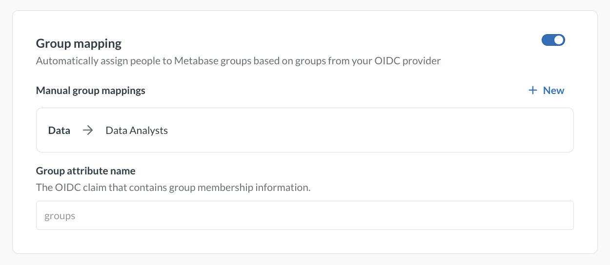

# OIDC-based authentication



By integrating your OpenID Connect (OIDC) provider with Metabase, you can:

- [Provision a Metabase account](#user-provisioning) when someone logs in via your identity provider (IdP).
- Let people access Metabase without re-authenticating.
- Automatically pass user attributes (name, email) from your IdP to Metabase.
- [Map IdP groups to Metabase groups](#group-mapping) so that people are automatically assigned when they log in.

## Self-hosted Metabases must set an encryption key

> Metabase Cloud encrypts credentials by default, so this section only applies to self-hosted Metabases.

[`MB_ENCRYPTION_SECRET_KEY`](../configuring-metabase/environment-variables.md#mb_encryption_secret_key) must be set before enabling OIDC. Metabase uses this key to encrypt the OIDC state cookie. Without it, Metabase will return a 500 error when a person tries to log in via OIDC.

Set this key in your environment before starting Metabase:

```
MB_ENCRYPTION_SECRET_KEY=your-secret-key-at-least-16-characters
```

Once you set an encryption key, don't remove it. Metabase encrypts values in the database with this key and will refuse to start without it.

For more, see [Encrypting your database connection](../databases/encrypting-details-at-rest.md).

## Set up OIDC in Metabase

_Admin > Settings > Authentication > OIDC_

You can also configure OIDC with [environment variables](#environment-variables).

Fill out **Server settings**, then click **Save and enable**. Until you save, the **Group mapping** section stays locked. You can edit **User provisioning** and **Attributes** before you save.

Every field except **Scopes** is required.

| Field             | Description                                                                                                                                                                                                                                                                                                                                                                                                                                                     |
| ----------------- | --------------------------------------------------------------------------------------------------------------------------------------------------------------------------------------------------------------------------------------------------------------------------------------------------------------------------------------------------------------------------------------------------------------------------------------------------------------- |
| **Key**           | A unique identifier for this provider. Lowercase letters, numbers, and hyphens only. Can't be changed after creation. Use a name that describes the provider (e.g., `keycloak`), not the application. Metabase constructs the redirect URI as `{site-url}/auth/sso/{key}/callback`. Configure this exact URI in your IdP, so choose the key _before_ configuring your IdP for Metabase. The full redirect URI is shown in the admin UI after you enter the key. |
| **Login prompt**  | The button label on Metabase's sign-in screen. You can put something like "Sign in with Keycloak", or "Ye who wish to enter Metabase".                                                                                                                                                                                                                                                                                                                          |
| **Issuer URI**    | Your IdP's issuer URI. Metabase fetches the discovery document from `{issuer-uri}/.well-known/openid-configuration`. This request is made from Metabase's server, not from the browser. In containerized deployments (like Docker), the URI must be reachable from Metabase's container, not just from your browser.                                                                                                                                            |
| **Client ID**     | The Client ID assigned for Metabase in your OIDC provider.                                                                                                                                                                                                                                                                                                                                                                                                      |
| **Client secret** | The client secret from your OIDC provider. When editing an existing configuration, leave this blank to keep the current value.                                                                                                                                                                                                                                                                                                                                  |
| **Scopes**        | The OIDC scopes to request. Enter them as a comma-separated string, for example `openid, email, profile`. Defaults to `openid, email, profile`. Most providers don't require changes here. If you're setting this with the `MB_OIDC_PROVIDERS` environment variable, use an array, for example `["openid", "email", "profile"]`.                                                                                                                                |

### Attributes

Metabase maps OIDC claims to account fields. The defaults work for most providers:

| Metabase field | Default claim |
| -------------- | ------------- |
| First name     | `given_name`  |
| Last name      | `family_name` |

If your IdP uses different claim names, update these fields to match. A blank claim name counts as unset, so Metabase falls back to the default.

Metabase always takes the email address from the standard `email` claim. You can't map email to a different claim, and Metabase ignores an `email` entry in `attribute-map` rather than reporting an error.

## Group mapping

You can configure Metabase to automatically sync group memberships from your IdP, so that people are added to (or removed from) Metabase groups based on their IdP groups.

OIDC doesn't define a standard groups claim. You'll need to configure your IdP to include a groups claim in the ID token. Some IdPs (like Azure AD/Entra ID) require a specific `groups` scope or API permission to include group claims — check your provider's docs. Keycloak includes groups via a client scope mapper without needing an extra scope. For a Keycloak example, see [Sync groups from Keycloak to Metabase](./oidc-keycloak.md#sync-groups-from-keycloak-to-metabase).

### Configure group mapping in Metabase

> If your provider is configured via the `MB_OIDC_PROVIDERS` environment variable, group mapping settings are read-only in the admin UI. Manage group mappings in the environment variable instead. See [Environment variables](#environment-variables).

1. Go to **Admin** > **Settings** > **Authentication** > **OIDC** and select your provider.
2. In the **Group mapping** section, turn on the toggle.
3. Next to **Manual group mappings**, click **New**.
4. Enter the group name exactly as your IdP sends it (case-sensitive).
5. Select the Metabase groups to map the group name to.
6. Click **Add mapping**.
7. Repeat steps 3 to 6 for each group you want to map.
8. In **Group attribute name**, enter the OIDC claim that contains group membership information. Defaults to `groups`. This must match the claim name in the ID token exactly.
9. Click **Save and enable**.

Metabase saves each mapping as soon as you add, edit, or remove the mapping. To edit a mapping, hover over the mapping and click the pencil icon.



### How group mapping works

- Metabase updates group memberships on each login based on the groups claim in the ID token.
- If a person's groups claim no longer includes a mapped group, Metabase removes them from the corresponding Metabase group.
- Only mapped groups are affected. Memberships in unmapped Metabase groups (including Administrators) aren't changed.
- If the groups claim is missing from the token entirely, Metabase leaves existing group memberships unchanged.

### Remove a group mapping

To remove a mapping, hover over the mapping and click the trash icon. Metabase asks what should happen to the Metabase group:

- **Nothing, just remove the mapping**
- **Also remove all members from this group**. Members keep their Metabase accounts.
- **Also delete the group**

Then click **Remove mapping**. Removing members or deleting a group takes effect immediately and can't be undone.

If the mapping points to a built-in group such as Administrators, Metabase doesn't offer these options. It removes the mapping without changing the group or its members.

**Also delete the group** isn't available when another mapping uses the same Metabase group.

## Check connection

After entering your OIDC provider settings in **Admin** > **Settings** > **Authentication** > **OIDC**, click **Check connection** to verify that Metabase can reach your provider. The check verifies two things: 1) that Metabase can fetch the discovery document from your Issuer URI, and 2) that the client credentials are valid.

If the check reports "OIDC discovery succeeded, but credentials could not be verified", this could mean you need to configure the client to support the grant type Metabase uses for testing. In a Keycloak client, for example, you should turn on **Service accounts roles** and **Client authentication**.

## User provisioning

By default, Metabase creates accounts for people who authenticate successfully via OIDC but don't yet have a Metabase account. Metabase uses the email claim to identify and create accounts, so the `email` scope must be included in what your IdP returns.

You can turn auto-provisioning off under **Admin** > **Settings** > **Authentication** > **OIDC** > **User provisioning**. The switch saves on its own, so you don't need to click **Save and enable** after you change it. If you've set up [User provisioning with SCIM](./user-provisioning.md), turn off automatic account creation to avoid conflicts.

### How auto-provisioning works

If auto-provisioning is on, when someone logs in via OIDC, Metabase will look up the account by email (case-insensitive). If an account with that email already exists, Metabase links the OIDC identity to that existing account (and [disables their password login](./managing.md#signing-in-via-sso-disables-your-password-login)). On each OIDC login, Metabase updates the account's name from the IdP's claims. Otherwise, Metabase will automatically create a new account.

If auto-provisioning is off, and no matching account exists, the person gets an error, and can't log in.

## Environment variables

You can also configure OIDC via environment variables instead of the admin UI. Settings configured via environment variables are read-only in the admin UI.

- [`MB_OIDC_ALLOWED_NETWORKS`](../configuring-metabase/environment-variables.md#mb_oidc_allowed_networks): controls which networks OIDC requests are allowed to reach. Possible values: `allow-all` (default, no restrictions), `allow-private` (allows external and private networks, but blocks localhost and loopback), or `external-only` (blocks requests to private networks).
- [`MB_OIDC_USER_PROVISIONING_ENABLED`](../configuring-metabase/environment-variables.md#mb_oidc_user_provisioning_enabled): toggle auto-provisioning (`true` by default).
- [`MB_OIDC_PROVIDERS`](../configuring-metabase/environment-variables.md#mb_oidc_providers): JSON string containing the full provider configuration. The value is an array of provider objects. Here's an example:

  ```json
  [
    {
      "key": "keycloak",
      "login-prompt": "Sign in with Keycloak",
      "issuer-uri": "http://keycloak:8080/realms/metabase",
      "client-id": "metabase-client",
      "client-secret": "metabase-client-secret",
      "scopes": ["openid", "email", "profile"],
      "enabled": true,
      "attribute-map": {
        "first_name": "given_name",
        "last_name": "family_name"
      },
      "group-sync": {
        "enabled": true,
        "group-attribute": "groups",
        "group-mappings": {
          "engineering": [5, 6],
          "data-team": [3]
        }
      }
    }
  ]
  ```

  | Field                          | Required | Default                          |
  | ------------------------------ | -------- | -------------------------------- |
  | **key**                        | Yes      |                                  |
  | **login-prompt**               | Yes      |                                  |
  | **issuer-uri**                 | Yes      |                                  |
  | **client-id**                  | Yes      |                                  |
  | **client-secret**              | Yes      |                                  |
  | **enabled**                    | No       | `true`                           |
  | **scopes**                     | No       | `["openid", "email", "profile"]` |
  | **attribute-map**              | No       | See attribute map above          |
  | **group-sync.enabled**         | No       | `false`                          |
  | **group-sync.group-attribute** | No       | `"groups"`                       |
  | **group-sync.group-mappings**  | No       | `{}`                             |

  The `group-sync` fields are nested inside each provider object. In `group-mappings`, keys are IdP group names and values are arrays of Metabase group IDs. You can find group IDs under **Admin** > **People** > **Groups**, or via the `GET /api/permissions/group` API endpoint.

See [Environment variables](../configuring-metabase/environment-variables.md).

## Disable password logins

> **Avoid locking yourself out.** Disabling password logins applies to all accounts, including your Metabase admin account. Before doing this, verify that you can log in with SSO.

To require SSO for all logins, go to **Admin** > **Settings** > **Authentication** > **Overview** and turn off **Enable password authentication**.

## OIDC example provider guide

For a step-by-step walkthrough, see [Keycloak](./oidc-keycloak.md).
