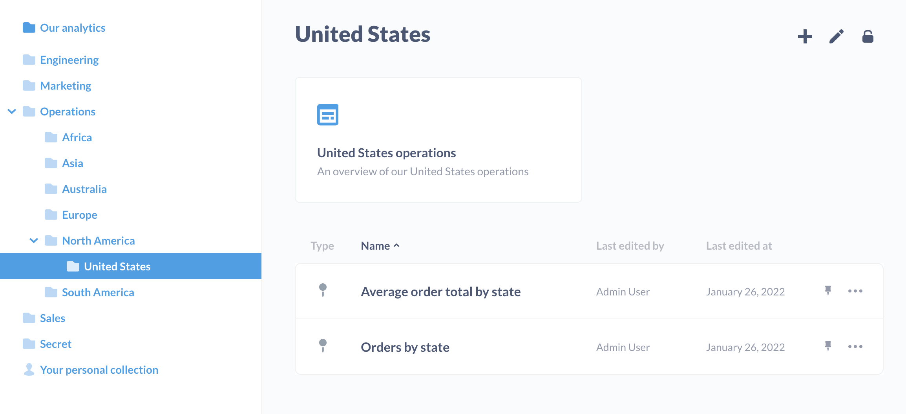
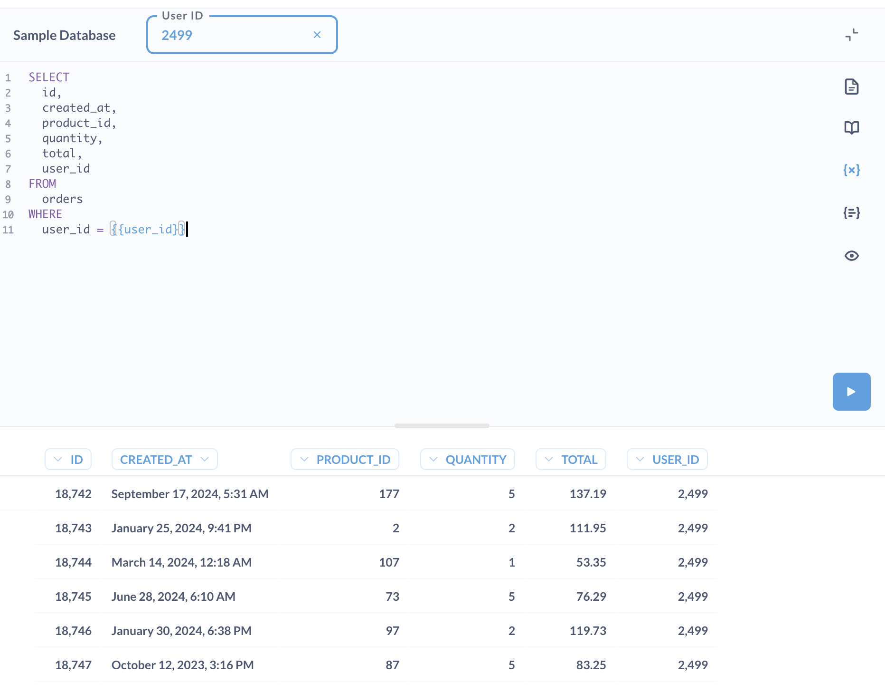
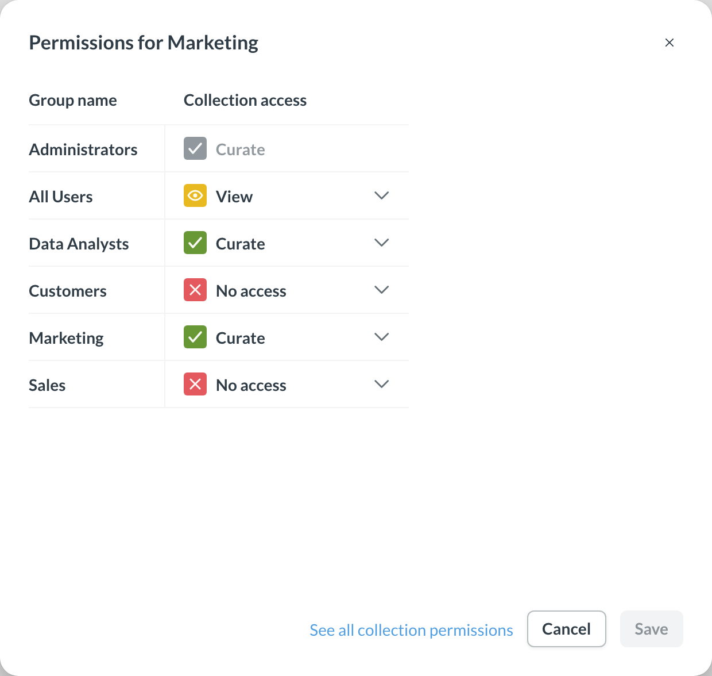
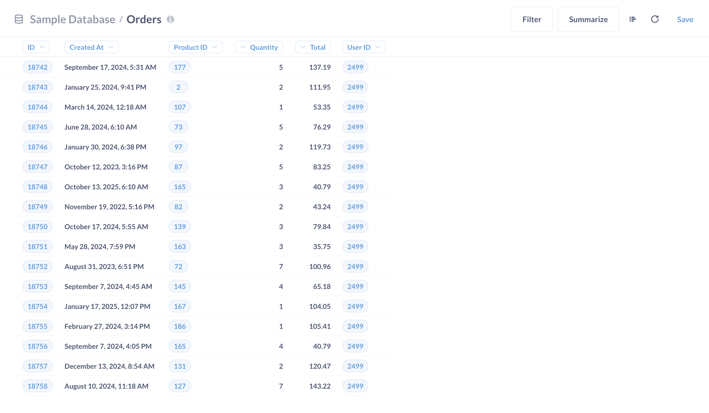
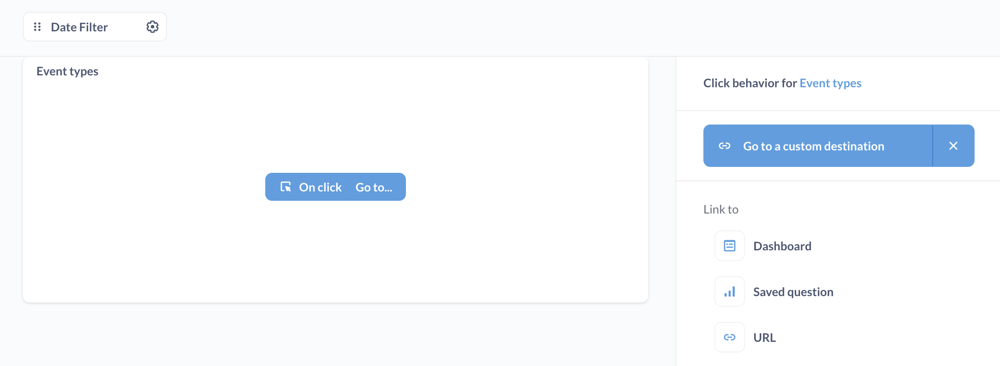

# Collection permissions

You can use [collections](../exploration-and-organization/collections.md) to organize questions, dashboards, models, timelines, and other collections. You can set permissions on those collections to determine which groups of people can view and curate collections' items.

Metabase starts out with a default top-level collection which is called **Our analytics**, which every other collection is saved inside of.

## Collection permission levels

There are three permission levels for collections:

- [Curate access](#curate-access)
- [View access](#view-access)
- [No access](#no-access)

| Action                             | Curate Access | View Access | No Access |
| ---------------------------------- | ------------- | ----------- | --------- |
| View items                         | ✅            | ✅          | ❌        |
| Edit items' title and descriptions | ✅            | ❌          | ❌        |
| Move items                         | ✅            | ❌          | ❌        |
| Delete items                       | ✅            | ❌          | ❌        |
| Pin items                          | ✅            | ❌          | ❌        |
| View events and timelines          | ✅            | ✅          | ❌        |
| Edit events and timelines          | ✅            | ❌          | ❌        |

### Curate access

The group can view, edit, move, delete, and pin items saved in this collection, and can save or move new items into it. The group can also create new sub-collections within this collection. The group can also create and edit [events and timelines](../exploration-and-organization/events-and-timelines.md).

Curate access doesn't let people create or edit a model's actions. Only admins can do that. See [Who can use model actions](../data-modeling/models/actions/introduction.md#who-can-use-model-actions).

### View access

The group can see all the questions, dashboards, and models in the collection, as well as [events and timelines](../exploration-and-organization/events-and-timelines.md). Note: Curate access includes View access.

### No access

The group won't see this collection listed, and they'll lack access to any of the items saved within it.

## Collection vs data permissions

Collection permissions only apply to viewing and curating existing questions, models, and dashboards. Changing the query on an existing question, or creating a new question, requires that the group have [data permissions](./data.md) for the underlying data.

View access to a collection includes access to the query definition of each item saved in it, including the SQL of native questions. If a group can view a question, they can see how that question was built, including through the [Metabase API](../api.html). This is true even if they lack [Create queries](./data.md#create-queries-permissions) permissions for the underlying data, and even if they can't run the query themselves. If you don't want a group to see a query, don't give them access to the collection where that query is saved.

When a group has their data permission set to [Blocked](./data.md#blocked-view-data-permission) for a database or table, the group won't be able to view questions based on that data, even if they have curate access to the collection where those questions are saved.

## Dashboards with questions from multiple collections

If a dashboard includes questions saved to other collections, the group will need view or curate access to all of those collections to view those questions. If not, Metabase will apologize and tell you that you lack permissions to see the cards saved to the other collections.

In general, it's easier to manage permissions when keeping all of a dashboard's questions in the same collection.

## Setting permissions for collections

You can set permissions on a collection by clicking on the three-dot menu (**...**) in the top-right of the screen while viewing the collection, and selecting **Edit permissions**. Only Administrators can edit collection permissions. Each [user group](./introduction.md) can have either View, Curate, or No access to a collection:

If you want to see the bigger picture of what permissions your user groups have for all your collections, just click the link that says **See all collection permissions**, which takes you to the Admin Panel. You'll see a list of your collections down along the left, and clicking on any of those will bring up a list of each group's permission settings for that collection.

Just like with data access permissions, collection permissions are _additive_, meaning that if a user belongs to more than one group, if one of their groups has a more restrictive setting for a collection than another one of their groups, they'll be given the _more permissive_ setting. This is especially important to remember when dealing with the All Users group: since all users are members of this group, if you give the All Users group Curate access to a collection, then _all_ users will be given Curate access for that collection, even if they also belong to a group with _less_ access than that.

## Permissions and sub-collections

- Changing access to a collection doesn't automatically change access to _existing_ subcollections, but all _new_ subcollections will inherit the access level.

  For example, let's say you have a `Campaigns` collection with a `2025 reports` subcollection, and you change the "Data team" group's access to `Campaigns` from "View" to "Curate". Then by default, Data team will get Curate access to `Campaigns` but will retain only "View" access to `2025 reports`. However, if after these permissions are configured, someone adds a new subcollection `2026 reports`, then Data team will get Curate access to "2026 reports" because new subcollections inherit permissions from the parent collection.

- To change access for existing subcollections as well, toggle **Also change sub-collections** when changing collection access.

- A group can be given access to a collection located somewhere within one or more sub-collections _without_ having to have access to every collection "above" it.

  For example, if a group had access to the "Super Secret Collection" that's saved several layers deep within a "Marketing" collection that the group lacks access to, the "Super Secret Collection" would show up at the top-most level that the group _does_ have access to.

## Deleting collections

To move a collection to the Trash, people need Curate access to the collection _and_ to every sub-collection inside it, since trashing a collection also trashes everything in it. Moving a collection works the same way, plus people need Curate access to the new parent collection. See [Delete and Restore](../exploration-and-organization/delete-and-restore.md).

## Pinning items in collections

People in groups with Curate access to a collection can pin items in the collection. Pinning an item in a collection turns the item into a handsome card at the top of the collection.

To pin an item, click the item's three-dot menu (**...**) and select **Pin this**.

Note that collections themselves can't be pinned. If you're running on a [Pro or Enterprise plan](https://www.metabase.com/pricing), admins can designate [Official Collections][official-collections].

## Special collections

### Our analytics

The "Our analytics" collection and individual personal collections are invincible; they cannot be archived, injured, or slain. They are eternal.

### Usage analytics

The Usage analytics collection only has two access levels: View and No access. Even admins can't curate it. See [Usage analytics](../usage-and-performance-tools/usage-analytics.md#access-to-usage-analytics).

### Personal collections

Each person has a personal collection where they're always allowed to save things, even if they don't have Curate permissions for any other collections.

Administrators can see and edit the contents of every user's personal collection (even those belonging to other Administrators) by clicking on the **Other users' personal collections** link at the bottom of the **Collections** section in the left sidebar.

A personal collection works just like any other collection except that its permissions are fixed and cannot be changed. If a sub-collection within a personal collection is moved to a different collection, the sub-collection will inherit the permissions of its new parent collection.

### Library collection

See [Permissions for the Library and its subcollections](../data-modeling/semantic-layer/library.md#library-permissions).

Do not use collection permissions for **Library > Data** to control access to data in published tables. Use [Data permissions](data.md) instead.

The Data Analysts group always has Curate access to Library collections, and you can't change that.

### Data app collections

Each [data app](../data-apps/start.md) has its own collection. You don't set permissions on a data app's collection directly. Groups get View access to it when you [add them to the app](../data-apps/manage.md#choose-who-can-open-an-app), and no group can get Curate access to it.

When [remote sync](../data-modeling/semantic-layer/remote-sync.md#remote-sync-has-two-modes-for-different-roles) is in Read-only mode, no one, not even an admin, can edit a data app's collection or its items in Metabase. Changes come from the app's Git repository.

### Data actions folders

Data actions folders can only be set to View or No access, not Curate, because only admins can create and edit [data actions](../data-modeling/data-actions.md). Groups with View access can run the actions in the folder. See [Data action permissions](../data-modeling/data-actions.md#data-action-permissions).

### External collections

See [Tenants > External collections](../embedding/tenants.md#collection-types)

## Further reading

- [Working with collection permissions][collection-permissions].

[collections]: ../exploration-and-organization/collections.md
[collection-permissions]: https://www.metabase.com/learn/metabase-basics/administration/permissions/collection-permissions
[dashboard-subscriptions]: ../dashboards/subscriptions.md
[official-collections]: ../exploration-and-organization/collections.md#official-collections
[permissions]: https://www.metabase.com/learn/metabase-basics/administration/permissions
[slack-integration]: ../configuring-metabase/slack.md
[sql-snippet-folders]: ../questions/native-editor/snippets.md
