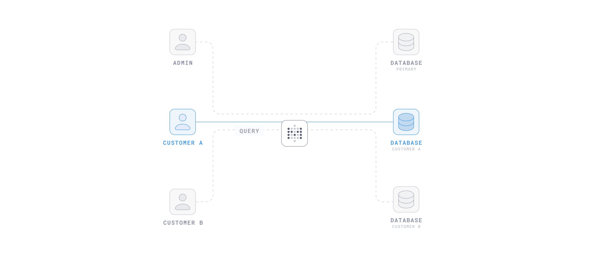
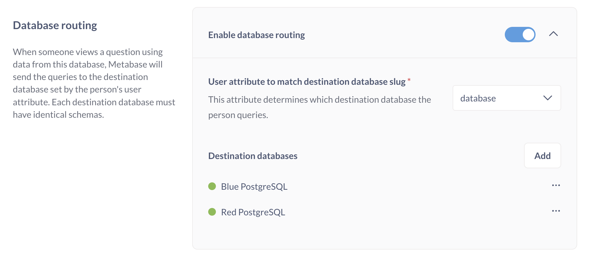

# Database routing



With database routing, an admin can build a question once using one database, and the question will run its query against a different database with the same schema depending on who is viewing the question.



Database routing is useful for:

- Managing modular and full app embedding setups where each customer has their own database with identical schemas.

  With guest embedding, database queries will always be routed to the router database. This is because guest embed users don't have Metabase accounts, so there are no user attributes available to determine which destination database to route to.

- Switching between dev and prod data warehouses.
- Changing the target data warehouse for certain teams.
- Managing separate connections to the same data warehouse, with each connection having separate privileges. This connection management is akin to [connection impersonation](./impersonation.md) for databases that prevent the same connection from changing roles.

## Database routing limitations

### Driver limitations

Database routing is **not supported** on:

- ClickHouse
- Spark SQL
- Vertica.

Different databases have different setups, so _what_ you can route between (database, schema, data catalog, etc.) will differ slightly depending on which data warehouse you're using.

- Athena: Only routing between different connections is supported (e.g., different buckets, roles, or catalogs).
- BigQuery: Only routing between databases in different projects is supported.
- Databricks: When multi-catalog is not enabled, you can route between catalogs on the same host. If multi-catalog is enabled, then you can only route between databases on separate hosts.

### Functionality limitations

Database routing **can't be used** on databases with:

- [Writable connections](../databases/writable-connection.md)
- [Editable tables](../data-modeling/editable-tables.md)
- [Actions](../data-modeling/data-actions.md#databases-that-support-data-actions)
- [CSV uploads](../databases/uploads.md)
- [Model persistence](../data-modeling/models/model-persistence.md)
- [Transforms](../data-modeling/transforms/transforms-overview.md). You can't turn on routing for a database that has transforms, and you can't create transforms on a router database.

Some other features don't work with routed data:

- [Automatic cache refresh](../configuring-metabase/caching.md#some-permissions-setups-are-incompatible-with-automatic-cache-refreshing) isn't available. Caching still works for the queries people run.
- [Research](../ai/research.md) can't use metrics from a router database.
- People whose queries are routed to a destination database won't see [individual records from models](../data-modeling/models/models.md#surface-individual-records-in-search-by-matching-against-this-column) in search results. Metabase indexes those values without routing, so it hides them to keep each person's data separate.

With **guest embedding**, database queries will always be routed to the router database. This is because guest embed users don't have Metabase accounts, so there are no user attributes available to determine which destination database to route to.

**Public links** will not work with database routing.

## How database routing works

You connect Metabase to a database as normal. When you turn on database routing for that database, it becomes a **router database** - the main database that will handle routing queries to **destination databases**. You'll add these destination databases to this router database, with each destination database associated with a value for the user attribute you assign to the router database. You don't need to have your customer databases as separate connections.

With the router database set up with its destination databases, an admin can then create questions that query the router database. When other people log in and view these questions, Metabase will route the queries to the destination database specified by the person's user attribute.

## Setting up database routing



1. [Connect to a database](../databases/connecting.md) that has _the same schema as all of your customer's databases_. This database should be a mock/dev database, ideally with some fake data. The name used for this router database will be the name all users will see, regardless of which destination database they're routed to, so make sure the name makes sense for everyone. (You can change the display name at any time).
2. Once connected to this initial database (the "Router database"), go to its Database routing section and toggle on **Enable database routing**.
3. In the **User attribute to match destination database slug** dropdown, choose the user attribute you want to use to determine which database a user should be routed to. The dropdown lists the attributes your people already have, so you'll need to [add the attribute](#user-attributes-and-database-routing) to at least one person first.
4. In the **Destination databases** section, click **Add**, then fill out the connection details. For each destination database, you'll need to specify a **slug** - this slug is the value that Metabase will use to match against the user attribute you assigned to the router database. At run time, when a user views a question built on the router database, Metabase will check the person's user attribute. If the value matches this slug, the question will query this destination database instead.

## User attributes and database routing

For database routing to work, your users must have a user attribute that Metabase can use to route them to the right destination database.

You can add user attributes manually, or via Single Sign-On (SSO) via [JWT](../people-and-groups/authenticating-with-jwt.md) or [SAML](../people-and-groups/authenticating-with-saml.md).

If an admin user lacks a value for the user attribute, they'll see the router database. You can also explicitly set the value for admins (or any user) to `__METABASE_ROUTER__`.

If a non-admin user account lacks a valid value for the user attribute, they won't be able to view the question at all.

If anyone's attribute value doesn't match the slug of a destination database, Metabase returns an error instead of falling back to the router database. That goes for admins, too.

## Permissions come from the router database

You set [data permissions](./data.md) and [connection impersonation](./impersonation.md) on the router database only. Destination databases don't have permissions of their own: Metabase applies the router database's permissions to every query it routes.

People can't query a destination database directly. Metabase only connects to a destination database by routing a query through its router database, so the user attribute check always applies.

See our docs on [user attributes](../people-and-groups/managing.md#adding-a-user-attribute).

## Testing database routing

To see if database routing is working:

1. Log in as an admin.
2. Create a question that queries the router database.
3. Create a user account and add the user attribute you associated with your router database. Set the value as the slug of one of your destination databases.
4. In a private/incognito tab, log in as the user and view the question you created. You should see data from the destination database associated with the person's user attribute, not the data in the router database.

## Adding destination databases with the API

To add destination databases programmatically, you'll need an [API key](../people-and-groups/api-keys.md) that belongs to the Admins group, because only admins can manage database routing.

Because each database engine has its own connection settings, we recommend that you use the Network tab in your browser's developer tools while you manually add a destination database in the UI. This way you can see the `details` object Metabase generates for your database.

When you click **Add**, you'll see a `POST` request to `/api/ee/database-routing/destination-database?check_connection_details=true`. Click on that request to get the request's headers and JSON payload.

### Adding a new destination database: example with PostgreSQL via `curl`

Here's a `curl` command to add a PostgreSQL database as a destination database. Here the database's `slug` is defined by `name` (in this case, `Green PostgreSQL`).

```sh
curl 'http://localhost:3000/api/ee/database-routing/destination-database?check_connection_details=true' \
  --request POST \
  --header 'Content-Type: application/json' \
  --header 'X-API-Key: mb_CpkoZHvSB5R+P+WsuXWRbdT3WbVphFv/rgMX9UGux/4=' \
  --data '{
  "router_database_id": 2,
  "destinations": [
    {
      "name": "Green PostgreSQL",
      "details": {
        "host": "green-postgres",
        "port": 5432,
        "dbname": "sample",
        "user": "metabase",
        "use-auth-provider": false,
        "password": "metasample123",
        "schema-filters-type": "all",
        "ssl": false,
        "tunnel-enabled": false,
        "destination-database": true
      }
    }
  ]
}'
```

Each item in `destinations` takes only a `name` and a `details` object. The `details` object will have a different set of keys depending on the database. You can add several destination databases in one request by adding more items to `destinations`.

Metabase copies the engine and other database settings, like whether queries run automatically, from the router database. If you send other keys (like `engine` or sync schedules), Metabase ignores them.

With `check_connection_details=true`, Metabase tests each connection before it adds the destination databases. If a connection fails, Metabase adds none of them, and returns the errors for each failed destination by name. Leave the parameter off if you want to add a destination database that isn't reachable yet.
