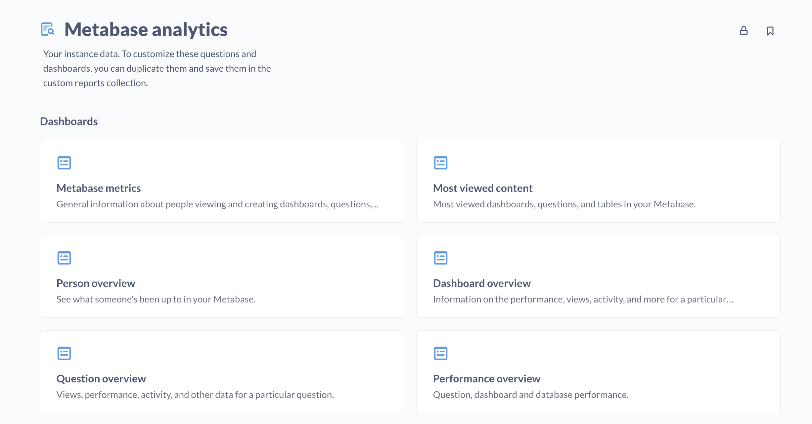

# Usage analytics



The **Usage analytics** collection is a special collection that contains view-only questions, dashboards, and models that help you understand how people are using your Metabase.

You can find the **Usage analytics** collection under **collections** in the left navigation sidebar. You can also create custom reports.

These resources are useful for:

- **Understanding Usage**: Understand how people use your Metabase (e.g., new questions, most active people and groups, and so on).
- **Auditing activity**: Know who viewed or did what and when, including tracking dashboard and question views, queries, downloads, and other activity like changing settings or inviting people to your Metabase.
- **Improving operations**: Know the slowest dashboards and questions, how your databases are performing, who's consuming the most resources, and so on.

> Metabase creates some default user accounts that you might see in your usage analytics, like `internal@metabase.com`. See [Default accounts](../people-and-groups/managing.md#default-user-accounts).

## Common questions and how to answer them

Some of these questions are answered by tools in [Monitor](../monitor/start.md), Trash, or an item's history rather than by usage analytics. Each recipe says which to use.

**Auditing activity**

- [See what someone did in your Metabase](./audit-activity.md#see-what-someone-did-in-your-metabase)
- [See who created, changed, or deleted a question or dashboard](./audit-activity.md#see-who-created-changed-or-deleted-a-question-or-dashboard)
- [See who changed a setting](./audit-activity.md#see-who-changed-a-setting)
- [See who joined, left, or changed groups](./audit-activity.md#see-who-joined-left-or-changed-groups)
- [See which API keys are in use and what they call](./audit-activity.md#see-which-api-keys-are-in-use-and-what-they-call)
- [See who queried a database or table](./audit-activity.md#see-who-queried-a-database-or-table)
- [See who downloaded data](./audit-activity.md#see-who-downloaded-data)
- [See what's public and who's viewing it](./audit-activity.md#see-whats-public-and-whos-viewing-it)
- [Investigate a suspected security incident](./audit-activity.md#investigate-a-suspected-security-incident)
- [Get notified when something happens](./audit-activity.md#get-notified-when-something-happens)

**Understanding usage**

- [Find the most viewed dashboards and questions](./understand-usage.md#find-the-most-viewed-dashboards-and-questions)
- [Count and find content](./understand-usage.md#count-and-find-content)
- [Find content nobody uses](./understand-usage.md#find-content-nobody-uses)
- [Find duplicate and disorganized content](./understand-usage.md#find-duplicate-and-disorganized-content)
- [Check what uses a table or model before you change it](./understand-usage.md#check-what-uses-a-table-or-model-before-you-change-it)
- [Find people who haven't logged in recently](./understand-usage.md#find-people-who-havent-logged-in-recently)
- [See how embedded analytics are used](./understand-usage.md#see-how-embedded-analytics-are-used)
- [See how people use Metabot, MCP, the CLI, and data apps](./understand-usage.md#see-how-people-use-metabot-mcp-the-cli-and-data-apps)

**Improving operations**

- [Find slow dashboards and questions](./troubleshoot-performance-and-notifications.md#find-slow-dashboards-and-questions)
- [Find what's putting the most load on your databases](./troubleshoot-performance-and-notifications.md#find-whats-putting-the-most-load-on-your-databases)
- [Check whether caching is working](./troubleshoot-performance-and-notifications.md#check-whether-caching-is-working)
- [List all subscriptions and alerts](./troubleshoot-performance-and-notifications.md#list-all-subscriptions-and-alerts)
- [Check whether a subscription or alert was sent](./troubleshoot-performance-and-notifications.md#check-whether-a-subscription-or-alert-was-sent)
- [Find questions that fail](./troubleshoot-performance-and-notifications.md#find-questions-that-fail)
- [Find content that broke after a database change](./troubleshoot-performance-and-notifications.md#find-content-that-broke-after-a-database-change)
- [Check whether a sync ran](./troubleshoot-performance-and-notifications.md#check-whether-a-sync-ran)
- [Check Metabase's logs for errors](./troubleshoot-performance-and-notifications.md#check-metabases-logs-for-errors)

## Access to Usage analytics

You can find the **Usage analytics** collection under **collections** in the navigation sidebar. By default, only admins can see the Usage analytics collection, but admins can grant other groups view access to it. You can manage permissions for the collection in **Admin** > **Permissions** > **Collections**.

There are only two access types for the Usage analytics collection: **View** and **No access**. Even admins can't curate Usage analytics.

Additionally, this Usage analytics collection has a default sub-collection called "Custom reports" which you can use to save duplicated/modified questions, dashboards, and models. This sub-collection inherits the same permissions, but it's not view-only; admins have curate access by default, and can grant other groups view access.

> If you're upgrading from a version older than 48, people in groups with monitoring access will also get access to the Usage analytics collection. But after that initial grandfathering in, the monitoring access privilege is unrelated to the Usage analytics collection; you'll need to specifically grant groups access to the Usage analytics collection.

## Viewing usage insights for a question, dashboard, or model

> Only people in groups with view access to the Usage analytics collection will see this Usage insights option.

To view usage analytics for a question, dashboard, or model:

- Visit the item.
- Click on the info button in the upper right.
- Click **Insights**.

Metabase will take you to the relevant usage dashboard and plug in the item's ID.

## Turn on user data collection to see IP addresses and user agents

To see IP addresses, user agents, embed paths, query parameters, the values people submit when they run an action, and Metabot conversation metadata in usage analytics, an admin needs to go to **Admin** > **Settings** > **General** and turn on [**Collect user data to display in usage analytics**](../configuring-metabase/settings.md#collect-user-data-to-display-in-usage-analytics). The setting is off by default. Metabase only logs this data while the setting is on, so activity from before you turn it on won't include this data.

## How long Metabase keeps usage data

By default, Metabase will keep the data about [activity](./usage-analytics-reference.md#activity-log), [views](./usage-analytics-reference.md#view-log), and [query execution](./usage-analytics-reference.md#query-log) for **720 days**. Twice a day, Metabase will delete rows older than this threshold. You can change this limit by adjusting the environment variable [`MB_AUDIT_MAX_RETENTION_DAYS`](../configuring-metabase/environment-variables.md#mb_audit_max_retention_days).

If you're on the Metabase Open Source Edition, or on the [Metabase Cloud Starter plan](https://www.metabase.com/pricing), Metabase doesn't collect [Activity](./usage-analytics-reference.md#activity-log) and [View](./usage-analytics-reference.md#view-log) data. If you upgrade to a Pro or Enterprise plan, either self-hosted or Cloud, you'll only see View and Activity data in Usage Analytics _starting from the time when you upgraded_.

## What usage analytics doesn't track

Usage analytics records what people do inside Metabase. It doesn't record:

- **Changes to permissions.** Usage analytics doesn't record who changed data or collection permissions, or when. It does record changes to group membership. See [Audit activity](./audit-activity.md#see-who-joined-left-or-changed-groups).
- **Changes to collections.** Usage analytics doesn't record who created, moved, or deleted a collection.
- **Moving items to the trash.** To see who moved a question or dashboard to the trash, check [Trash](../exploration-and-organization/delete-and-restore.md) or the item's [history](../exploration-and-organization/history.md).
- **A full login history.** Usage analytics only keeps each person's most recent login. [Session management](../monitor/session-management.md) keeps ended sessions for 30 days.
- **IP addresses and user agents, unless you turn them on.** Metabase only records them while you [collect user data](#turn-on-user-data-collection-to-see-ip-addresses-and-user-agents), and never retroactively.
- **Who viewed a public link or a guest embed.** Metabase records these views, but without a Metabase account, so you can't tell which person viewed them.
- **Server, network, and data warehouse logs.** For errors and warnings from Metabase itself, see [Application logs](../monitor/application-logs.md). For what ran in your data warehouse, check the warehouse's own query history.

## Creating custom reports

You can duplicate any of the questions, dashboards and models in the Usage analytics collection and tweak them to your liking, but you'll need to save them to a different collection.

### Custom reports collection

While you _can_ save custom questions, models, and dashboards wherever you like (except for the Usage analytics collection), we recommend that you save your custom Usage analytics reports in the conveniently named "Custom reports" sub-collection. That way these items inherit the same permissions as the parent Usage analytics collection.

There is one thing to know about the Custom reports collection: its metadata resets whenever Metabase restarts. While you are able to temporarily rename the Custom reports collection, or give it a description or an Official badge, Metabase will drop this collection's metadata when it restarts. But rest assured that Metabase will preserve any questions, models, events, or dashboards that you add to the Custom reports collection.

## Dashboards and models

The Usage analytics collection ships a set of read-only dashboards and models that you can browse from the **collections** sidebar.

For dashboards and models specifically about Metabot and LLM usage, see [AI usage auditing](../ai/usage-auditing.md).

See also the [Usage analytics reference](./usage-analytics-reference.md).

### Performance overview on MySQL or MariaDB

If you're using MySQL or MariaDB as your application database, the Performance overview dashboard won't display results for the cards showing 50th and 90th percentile query running times, because MySQL and MariaDB don't support the [Percentile aggregation](../questions/query-builder/expressions-list.md#percentile). We recommend using PostgreSQL as your application database.
