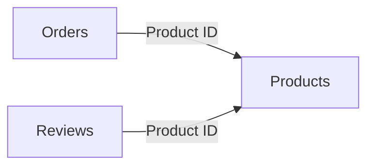
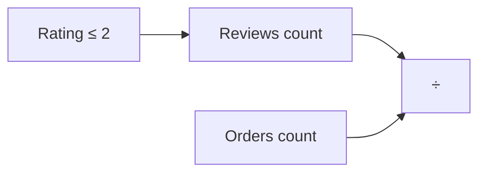
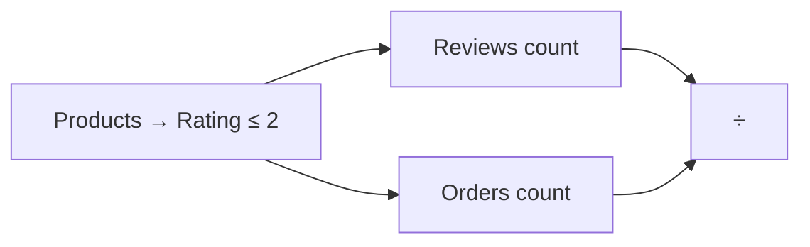

## Contents

1. [Filtering a pill vs filtering the whole metric](#filtering-a-pill-vs-filtering-the-whole-metric)
2. [Dimension descriptions today](#dimension-descriptions-today)

## Filtering a pill vs filtering the whole metric

Metric: **Reviews count ÷ Orders count**, reviews per order. Both tables link to
Products, so anything on Products is shared:

### Filter on a pill: review Rating ≤ 2

`Rating` here is one review's stars. Only Reviews has it, so it goes on the
Reviews pill and filters only the numerator.

### Filter on the whole metric: product Rating ≤ 2

`Products → Rating` is the product's average rating. Both pills reach it, so it
filters both sides.

Live counts from the Sample Database:

<strong>Same name, different question.</strong>
The pill row is bad reviews per order. The metric row is the review rate of
badly rated products. Both columns are called Rating, so name matching must
not pair them.

### What we decided

- A **pill filter** applies to that pill only.
- A **metric filter** is offered only on dimensions every pill has.

## Dimension descriptions today

The Dimensions tab of a metric in Data Studio
(`/data-studio/library/metrics/:id/dimensions`) lets you give each dimension a
display name and a description. Each dimension has one read-only source
column, such as `Orders.ID`.

### Where it is written

- `DimensionSettingsPanel` saves it through the update-dimension endpoint
  (`src/metabase/metrics/core.clj`).
- It is stored in the metric's dimensions JSON and returned by the metric API.

### Where it is read

Nowhere else. No other UI shows it, and nothing sends it on:

- The metrics viewer, explorations and dimension pickers don't show it.
- Metabot's `get_research_candidates` sends dimension ids, group names, types
  and interestingness, but no dimension description
  (`src/metabase/explorations/impl.clj`).

<strong>Write-only today.</strong>
The obvious places to use it: a tooltip in the viewer's dimension picker, and
the dimension groups Metabot gets.

### What the prototype adds

The app's mapping is one dimension to one column on the metric's table. The
"Dimension mapping" prototype lets measures come from different tables, so
each dimension picks one column per measure. The name and description then
describe the shared dimension rather than a single column.
