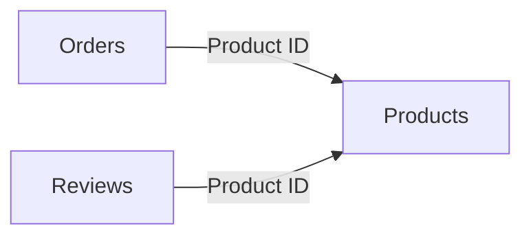
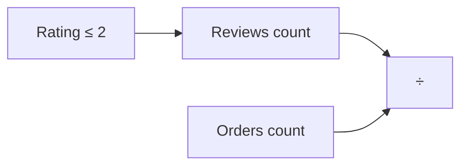
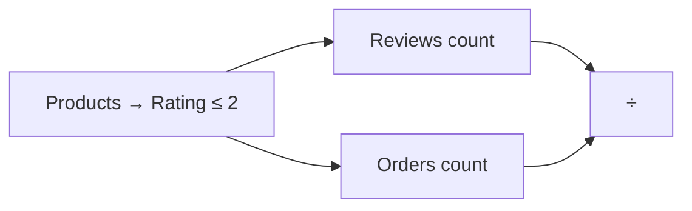

## Filtering a pill vs filtering the whole metric

Metric: **Reviews count ÷ Orders count**, reviews per order. Both tables link to
Products, so anything on Products is shared:

### Filter on a pill: review Rating ≤ 2

`Rating` here is one review's stars. Only Reviews has it, so it goes on the
Reviews pill and filters only the numerator.

### Filter on the whole metric: product Rating ≤ 2

`Products → Rating` is the product's average rating. Both pills reach it, so it
filters both sides.

Made-up numbers:

|                            | Reviews | Orders | Per 100 orders |
| -------------------------- | ------: | -----: | -------------: |
| No filter                  |      80 |  1,000 |        **8.0** |
| Pill: review Rating ≤ 2    |      20 |  1,000 |        **2.0** |
| Metric: product Rating ≤ 2 |      30 |    150 |       **20.0** |

<strong>Same name, different question.</strong>
2.0 is bad reviews per order. 20.0 is the review rate of badly rated products.
Both columns are called Rating, so name matching must not pair them.

### What we decided

- A **pill filter** applies to that pill only.
- A **metric filter** is offered only on dimensions every pill has.
